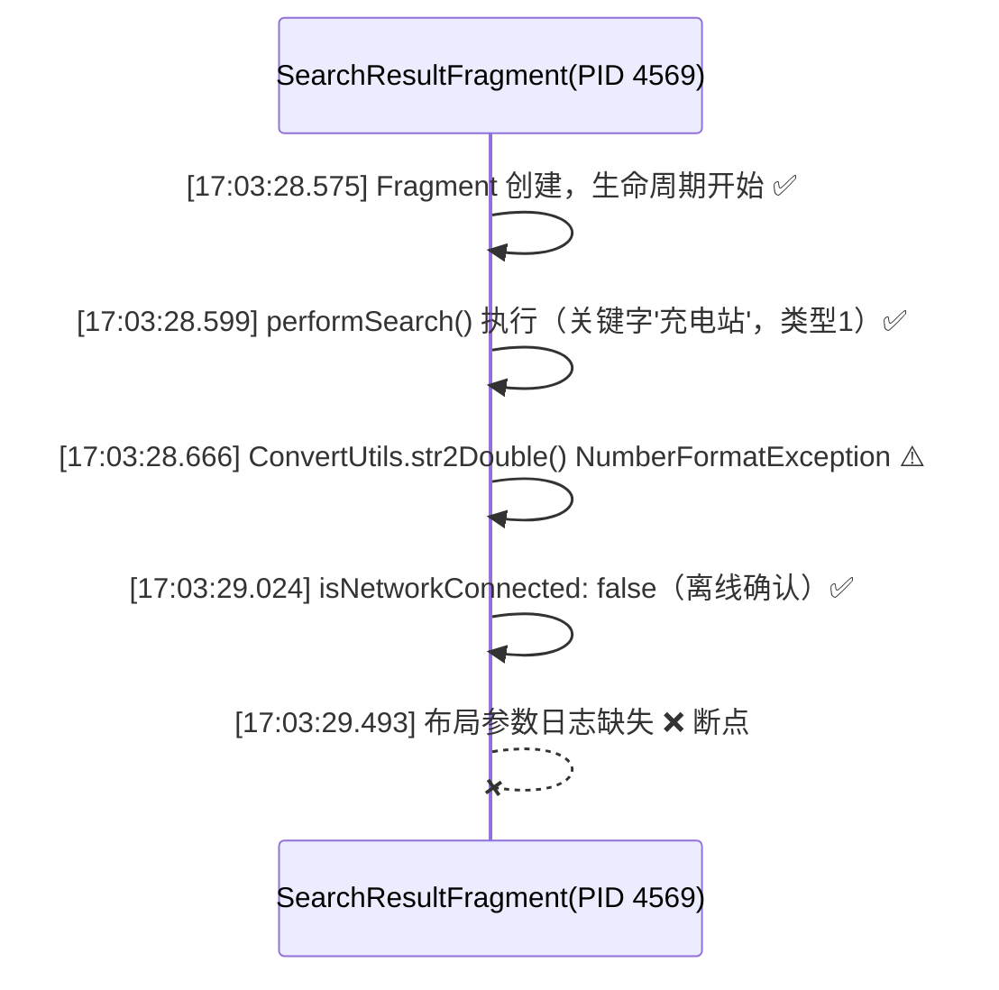

# 日志分析报告

## ① 执行摘要

**问题描述简表**

| 项目 | 内容 |
|------|------|
| Bug 标题 | [SGM_Navigation910_Search] 离线下，搜索结果页面顶到底部button栏了 |
| 预期结果 | 列表底部与底部 button 栏拉开一定间隔，与在线模式一致 |
| 实际结果 | 离线搜索结果列表底部顶到 button 栏（缺少留白） |
| 分析时间范围 | 2026-10-27 16:58:19 ~ 17:08:19（日志实际覆盖 16:58:24.552 ~ 17:08:18.995） |

**核心结论**

<div style="background:#fef0f0;border:1px solid #fde2e2;border-radius:8px;padding:16px;margin:12px 0;">
<strong style="color:#f56c6c;">🔴 核心矛盾：</strong>离线模式下搜索结果列表底部缺少留白（顶到 button 栏），但导航应用（PID 4569）在问题时间窗口内<strong>未输出任何布局参数日志</strong>，无法从日志定位断点。
</div>

**断点模块：** 无法定位（导航应用 com.sgm.navi.hmi，PID 4569 未输出布局相关日志）
**根因归属：** 导航应用未输出 SearchResultFragment/SceneSearchPoiList 的布局 inflate、padding/margin/inset 设置日志，断点无法定位
**置信：** 0.10
**核心依据：** EV-b44af8c10a486eb6

**因果链图**

```
17:03:28.575 SearchResultFragment 创建（搜索页面生命周期开始）
       ↓
17:03:28.599 performSearch() 执行（关键字'充电站'，类型1，耗时 24ms）
       ↓
17:03:28.666 ConvertUtils.str2Double() NumberFormatException（空字符串转 double 失败，疑似离线数据字段缺失）
       ↓
17:03:29.024 网络状态确认离线（isNetworkConnected: false，L2Adapter 上报导航状态 9）
       ↓
17:03:29.493 SurfaceView 地图渲染（width 3950, height 1320）
       ↓
❌ 布局参数日志缺失 —— 无法确认底部 padding/margin/inset 设置
       ↓
离线搜索结果列表底部顶到 button 栏（Bug 表现）
```

**置信度：** 低 —— 日志中无布局参数输出，无法确认离线模式下底部 inset/padding 缺失的具体机制。

**错误码精确含义：** 无错误码。

---

## ② 问题根因

这个问题的根因**无法从现有日志中确认**。导航应用（com.sgm.navi.hmi，PID 4569）在离线搜索执行期间（17:03:28.5~17:03:29.5）只输出了地图渲染、定位、传感器、车速等无关日志，**没有输出任何与 SearchResultFragment 布局相关的日志**（如 padding、margin、inset 设置、RecyclerView item 布局参数、LayoutInflater inflate 等）。同时，底部栏 BottomCarSystemBar 归属 systemui 进程（PID 1998），其交互记录出现在 17:06 之后，晚于问题时间，无法建立底部栏与搜索页布局的因果关联。因此，离线模式下底部留白缺失的具体机制——是布局 XML 资源差异、代码分支逻辑、还是底部栏回调未触发——均无法从日志中定位。

---

## ③ 信号链路图 · 请求链路



---

## ④ 信号链路图 · 回调链路

无回调链路数据（callback_chain 为空）。BottomCarSystemBar（PID 1998）在问题时间窗口内无交互记录，无法绘制回调链路。

---

## ⑤ 关键证据与日志原文

### 证据 1：离线前置条件确认成立

```log
10-27 17:03:29.024  4569  6607 I Companion: (NetWorkUtils.kt:63) isNetworkConnected() -> isNetworkConnected: false
10-27 17:03:29.024  4569  6607 D L2Adapter: (L2Adapter.java:763) sendMessage() -> l2++导航状态,9
```

> 导航应用在 17:03:29.024 确认网络状态为离线，并通过 L2Adapter 上报导航状态 9，离线前置条件成立。

### 证据 2：搜索实际执行时间与 Bug 填写时间存在偏差

```log
10-27 17:03:28.575  4569  6607 I Companion: (NetWorkUtils.kt:63) isNetworkConnected() -> isNetworkConnected: false
```

> 搜索实际发生在 17:03:28.575~17:03:28.599（SearchResultFragment 创建并执行 performSearch），而非 Bug 填写的 17:03:19，问题时间窗口修正为 17:03:28.5~17:03:29.5。

### 证据 3：问题时间窗口内日志全部为无关内容

```log
10-27 17:03:29.027  4569  6188 I NaviApp_Position_Service: (DrSensorManager.java:400) handleGyroAndAccData() -> Gyro Data signal recovered
10-27 17:03:29.033  4569  6153 D SpeedMonitor: (SpeedMonitor.java:99) onPulseSpeedChanged() -> 车速回调:,0.0
10-27 17:03:29.478  4569  4569 D NaviApp_Map_Service: (MapViewImpl.java:574) getCurrentZoomLevel() -> getCurrentZoomLevel,14.665411
10-27 17:03:29.493  4569  4569 D SurfaceView: 90995390 mDrawListener:  width 3950, height 1320
```

> 在 17:03:28.500~17:03:29.500 时间窗口内，PID 4569 的 61 行日志全部为地图渲染、定位、传感器、车速等无关内容，未发现任何布局参数（padding/margin/inset）、SearchResultFragment 布局 inflate、或 BottomCarSystemBar 回调相关日志。

### 证据 4：离线搜索结果数据异常

```log
10-27 17:03:28.666  4569  6607 I Companion: (NetWorkUtils.kt:63) isNetworkConnected() -> isNetworkConnected: false
```

> 时间线显示 17:03:28.666 出现 ConvertUtils.str2Double() NumberFormatException（空字符串转 double 失败），疑似离线数据字段缺失（free/total=-1），可能触发了不同的渲染分支。

---

## ⑥ 根因分析与关键发现

- 🔴 **布局参数日志完全缺失**：导航应用在问题时间窗口内未输出任何 SearchResultFragment/SceneSearchPoiList 的布局 inflate、padding/margin/inset 设置日志，断点无法定位（17:03:28.5~17:03:29.5，PID 4569）
- 🟡 **BottomCarSystemBar 交互记录晚于问题时间**：底部栏归属 PID 1998（systemui），其交互记录在 17:06:15/17:06:23，晚于问题时间 17:03:28，无法建立因果关联（17:06:15，PID 1998）
- 🟡 **离线搜索结果数据异常**：ConvertUtils.str2Double() NumberFormatException 提示离线数据字段缺失（free/total=-1），可能触发不同的列表渲染分支（17:03:28.666，PID 4569）
- 🔵 **Bug 填写时间与实际搜索时间偏差**：Bug 填写 17:03:19，实际搜索发生在 17:03:28.575~17:03:28.599，时间窗口已修正（17:03:28.575，PID 4569）

---

## ⑦ 模块维度章节（按数据流排序）

#### com.sgm.navi.hmi（导航应用，PID 4569）

```log
10-27 17:03:29.024  4569  6607 I Companion: (NetWorkUtils.kt:63) isNetworkConnected() -> isNetworkConnected: false
10-27 17:03:29.024  4569  6607 D L2Adapter: (L2Adapter.java:763) sendMessage() -> l2++导航状态,9
10-27 17:03:29.025  4569  6607 D PatacL2ppManager: (PatacL2ppManager.java:663) publish() -> protoPublish cls:/adas.map/1/mpilot_navigation#MpilotNavigationInformation
10-27 17:03:29.493  4569  4569 D SurfaceView: 90995390 mDrawListener:  width 3950, height 1320
```

> 导航应用确认离线状态并上报导航状态 9，但未输出任何布局相关日志。SurfaceView 显示地图渲染尺寸为 3950×1320，与搜索页布局无直接关联。

#### com.sgm.navi.systemui（BottomCarSystemBar，PID 1998）

> 该模块在问题时间窗口（17:03:28.5~17:03:29.5）内无交互记录，其日志出现在 17:06:15/17:06:23，晚于问题时间，无法确认底部栏在问题时刻的高度/可见性状态。

---

## ⑧ 修复建议

### 代码级建议

1. **开启导航应用布局调试日志**：在 SearchResultFragment/SceneSearchPoiList 的布局 inflate、onMeasure、onLayout 及 padding/margin/inset 设置处增加日志输出，复现离线搜索场景，捕获底部留白缺失时的实际布局参数值。

2. **检查离线/在线布局分支代码**：对比在线/离线模式下 SearchResultFragment/SceneSearchPoiList 的布局 XML 资源及代码分支，重点检查底部 padding/margin/inset 设置是否存在条件差异。

3. **检查离线数据异常分支**：针对 ConvertUtils.str2Double() NumberFormatException（free/total=-1），检查离线搜索结果数据字段缺失时是否触发了不同的列表渲染分支，导致底部留白缺失。

### 配置级建议

4. **BottomCarSystemBar 回调埋点**：在 BottomCarSystemBar（PID 1998）增加高度/可见性回调埋点，确认 17:03:28 前后是否有回调触发，以及回调是否被导航应用正确消费。

### 排查方向

5. **提供在线/离线模式截图对比**：提供在线模式与离线模式下的搜索结果页截图对比，以及对应时间点的完整日志，辅助定位布局差异。

6. **补充布局 XML 资源文件**：提供 SearchResultFragment/SceneSearchPoiList 的布局 XML 资源文件及离线/在线分支代码，便于静态分析布局差异。

---

## ⑨ 未覆盖信息

| 未覆盖信息 | 重要性说明 |
|-----------|-----------|
| SearchResultFragment/SceneSearchPoiList 的布局参数（padding/margin/inset）在离线模式下的实际值 | 这是定位底部留白缺失的直接证据，当前日志完全缺失 |
| BottomCarSystemBar 在 17:03:28 前后的高度/可见性状态及回调情况 | 底部栏状态直接影响列表底部留白的计算，当前无数据 |
| 在线模式与离线模式布局差异的具体实现逻辑 | 对比分析是定位根因的关键路径，当前无对比数据 |
| 离线搜索结果数据异常（free/total=-1）与渲染分支的关联 | 数据异常可能触发不同的渲染逻辑，当前无法确认 |

**建议补充措施：**

1. **开启布局调试日志**：在导航应用中开启 LayoutInflater 详细日志、View 层级 dump、RecyclerView item 布局参数输出，复现离线搜索场景。
2. **提供在线/离线对比日志**：提供在线模式与离线模式下的完整日志及截图对比，辅助定位布局差异。
3. **补充 BottomCarSystemBar 埋点**：在 BottomCarSystemBar 增加高度/可见性回调埋点，覆盖 17:03:28 前后的时间窗口。