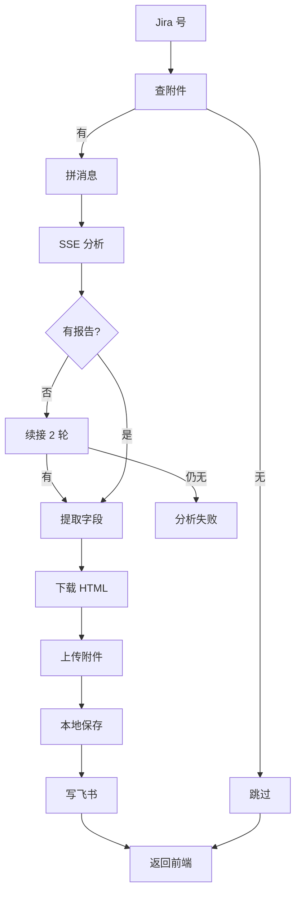
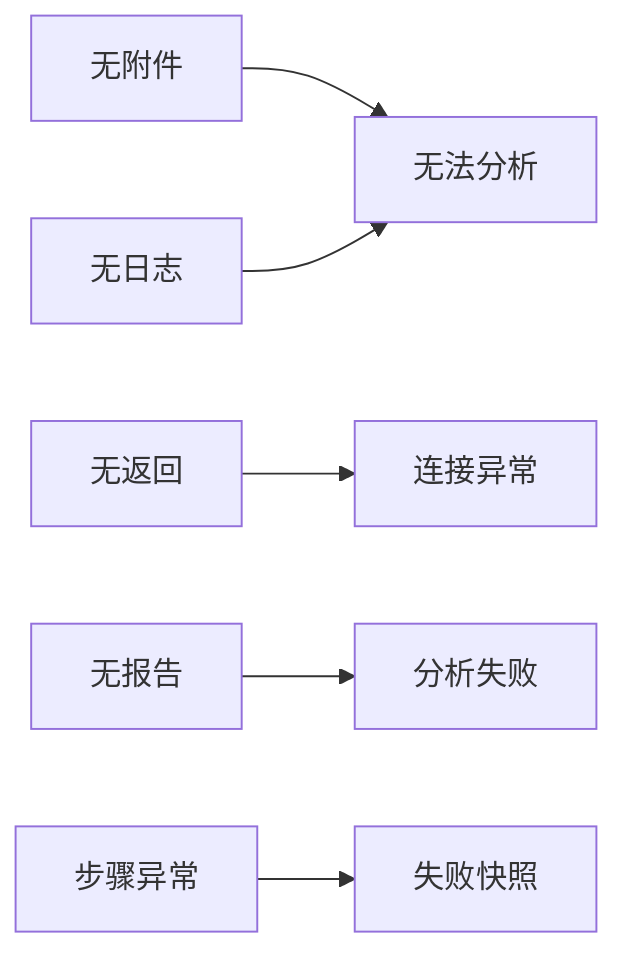

# ADP 调用逻辑

## 主流程



## 失败分支



| 分支 | fail_type |
|---|---|
| 无附件 / 无日志 | 输入质量问题 |
| 无返回 | ADP连接超时或网络异常 |
| 无报告 | 分析完成但未产出HTML报告 |
| 步骤异常 | `处理异常: xxx` |
| 写表失败 | 飞书写入失败 |

## 接口总览（本项目封装的 HTTP 接口）

| 端点 | 用途 |
|---|---|
| `POST /api/test/adp_single` | 单条 |
| `POST /api/test/adp_batch` | 批量 |
| `POST /api/test/adp_lookup` | 查表（接 `/api/jobs`） |
| `POST /api/test/adp_enrich` | 补全描述/时间 |
| `POST /api/test/adp_lookup/stop` | 停止 |
| `GET /api/test/adp_report` | 看完整报告 |

## ADP 平台原生接口（v2）

调用的是腾讯混元大模型知识引擎（LKE）的 ADP 平台接口，**不是本项目封装的接口**。

### 协议与端点

| 项 | 值 |
|---|---|
| 协议 | **HTTPS**（HTTP/1.1 长连接，承载 SSE 流） |
| 方法 | **POST** |
| 端点 | `https://wss.lke.cloud.tencent.com/adp/v2/chat` |
| 链接类型 | **长链接**（SSE 流式响应，单次分析 5~45 分钟不等） |
| Content-Type | `application/json` |
| 认证方式 | **Body 内携带 `AppKey`**（不是 Header Bearer Token） |
| 总超时 | 3600s（`adp.timeout` 配置） |
| 连接超时 | 30s |
| 单段读超时 | 60s（任意相邻两个 SSE 事件之间不得超过 60s，否则 `httpx.ReadTimeout`） |

> 注意：域名是 `wss.lke.cloud.tencent.com`，但协议是 **HTTPS**，不是 WebSocket（命名带 `wss` 只是历史原因）。

### 入参（Request Body，JSON）

| 字段 | 类型 | 必填 | 值 / 说明 |
|---|---|---|---|
| `RequestId` | string | ✅ | 32 位小写 hex（`uuid4().hex[:32]`），本次请求唯一 ID |
| `ConversationId` | string | ✅ | 32 位小写 hex（`uuid4().hex[:32]`），会话 ID（Agent 沙箱绑定） |
| **`AppKey`** | string | ✅ | **从 `config.yaml` 的 `adp.app_key` 读取**（平台分发的密钥） |
| `VisitorId` | string | ❌ | 用户标识，默认 `jira_analysis_user` |
| `Contents` | array | ✅ | 消息列表，固定传 1 条：`[{"Type": "text", "Text": "<拼好的 prompt>"}]` |
| `Incremental` | bool | ❌ | 固定 `true`（增量推送文本片段） |
| `Stream` | string | ❌ | 固定 `"enable"`（开启 SSE 流） |
| `StreamingThrottle` | int | ❌ | 固定 `5`（节流系数） |

### 请求示例

```json
POST https://wss.lke.cloud.tencent.com/adp/v2/chat
Content-Type: application/json

{
  "RequestId": "9f3e2a1b7c4d8e6f9a0b1c2d3e4f5a6b",
  "ConversationId": "1a2b3c4d5e6f7a8b9c0d1e2f3a4b5c6d",
  "AppKey": "skOjTaUWsqWhWYamAtTTaQpRXiqgGirNGEoJmwRlEptJQTDduXplKpFHcTwapQYOVxhbXKmTxuzKjtWuYSJCyPYLptOCLkGuvhQBwkXYXOHjvZtPPLiTdPuffyzorKKQ",
  "VisitorId": "jira_analysis_user",
  "Contents": [
    {"Type": "text", "Text": "JIRA号 VCU-554052，描述: 音效模式 STR 后未能记忆..."}
  ],
  "Incremental": true,
  "Stream": "enable",
  "StreamingThrottle": 5
}
```

### 响应（SSE 流）

- 格式：标准 SSE，每行 `data: {json}\n\n`
- 终止符：`data: [DONE]\n\n`（收到后正常关闭连接）
- 每个事件 JSON 通用字段：

| 字段 | 类型 | 说明 |
|---|---|---|
| `Type` | string | 事件类型（见下表） |
| `Timestamp` | int | 毫秒时间戳（用于计算 `start_ts` / `end_ts`） |

#### 已知事件类型

| Type | 关键字段 | 用途 |
|---|---|---|
| `response.created` | `TraceId` / `trace_id` / `ConversationId` | 响应开始，提取 `trace_id` + `start_ts` |
| `text.delta` | `Text` | 增量文本片段（latin-1 → UTF-8 修复后拼接） |
| `text.replace` | `Text` | 替换整段（一般是最终的 closeout JSON） |
| `content.added` | `Content.Type=file` + `Content.File.{FileName,FileUrl}` | 文件产物（HTML 报告、附件） |
| `heartbeat` | - | 保活心跳（平台侧发出） |
| `message.processing` / `message.done` / `message.added` | `Message` | Agent 工具调用过程（仅记录，不解析） |

### 报告链接的两种域名

| 域名 | 格式 | 认证 | 备注 |
|---|---|---|---|
| `agent.adp-cos.com/.../<file>?q-signature=...` | COS CDN 直签 URL | **无需**（签名在 query 里） | 100% 可直接 GET |
| `lke.cloud.tencent.com/s/<short_id>` | LKE 分享短链 | **无需**（302 → COS 签名 URL） | 有 TTL，分析完 30 分钟内仍可访问 |
| `sandbox.adp.cloud.tencent.com/files?path=...` | 沙箱内文件 | **需要 directory token**（app_key 不行） | 本代码不用 |

### 关联的辅助端点

| 端点 | 协议 | 用途 | 认证 |
|---|---|---|---|
| `https://dpportal.apps.saic-gm.com/api/logAnalysis/attachments` | HTTPS GET | 查 Jira 附件列表 | Header `Authorization: Bearer {attach_api_key}` |
| `https://sandbox.adp.cloud.tencent.com/files?path=...` | HTTPS GET | 沙箱内文件访问 | 需 directory token（本项目不用） |

## 接口入参说明（本项目封装的 HTTP 接口）

### 1. `POST /api/test/adp_single` —— 单条分析（SSE）

**Body（JSON）：**

| 字段 | 类型 | 必填 | 说明 |
|---|---|---|---|
| `bugid` | string | ✅ | Jira 号，如 `VCU-554052` |

**示例：**
```json
{ "bugid": "VCU-554052" }
```

**行为：**
- 自动查 Jira 补全 `description` + `trigger_time`（`description` 为空时用 `summary` 兜底）
- 调用 ADP v2 SSE 分析 → 提取字段 → 下载 HTML → 上传飞书附件 → 写回多维表格
- **响应类型：`text/event-stream`**，事件格式 `{type, step, status, ...}`
- 事件类型：`step`（实时步骤：`jira_info`/`attachments`/`adp_analysis`/`extract`/`download_report`/`write_feishu`）、`keepalive`（30s 心跳）、`done`（最终结果）

### 2. `POST /api/test/adp_batch` —— 批量分析（SSE）

**Body（JSON）：**

| 字段 | 类型 | 必填 | 默认 | 说明 |
|---|---|---|---|---|
| `items` | array | ✅ | - | 待执行项列表 `[{bugid, description?, trigger_time?}]` |
| `batch_size` | int | ❌ | 2 | 每批并发数 |
| `continuous` | bool | ❌ | false | `true`=连续执行所有批；`false`=只跑第一批 |

**示例：**
```json
{
  "items": [
    {"bugid": "VCU-554052", "description": "OTA升级失败", "trigger_time": "2026-06-04 03:00:00"},
    {"bugid": "VCU-495999"}
  ],
  "batch_size": 2,
  "continuous": true
}
```

**行为：**
- 自动去重（排除同来源已执行的 Jira）
- `description`/`trigger_time` 为空时回查 Jira 补全
- 按 `batch_size` 切批并发执行
- **响应类型：`text/event-stream`**，事件：`start`/`dedup`/`batch_start`/`batch_done`/`keepalive`/`done`

### 3. `POST /api/test/adp_lookup` —— 查表执行（SSE）

**Body（JSON）：**

| 字段 | 类型 | 必填 | 默认 | 说明 |
|---|---|---|---|---|
| `mode` | string | ❌ | `manual` | `manual`=手动传 bugids；`auto`=从多维表格自动捞未执行的 |
| `bugids` | array | mode=manual 时必填 | - | Jira 号列表 |
| `limit` | int | ❌ | 10 | auto 模式下每次最多取几条 |
| `batch_size` | int | ❌ | 2 | 并发数 |

**示例：**
```json
{ "mode": "auto", "limit": 10, "batch_size": 2 }
```
```json
{ "mode": "manual", "bugids": ["VCU-554052", "VCU-495999"] }
```

**行为：**
- 从 ADP 多维表格读取记录，补全描述/时间
- 2 并发执行，失败自动重试 1 次
- 写回多维表格
- **响应类型：`text/event-stream`**

### 4. `POST /api/test/adp_enrich` —— 批量补全字段（JSON）

**Body（JSON）：**

| 字段 | 类型 | 必填 | 说明 |
|---|---|---|---|
| `bugids` | array | ✅ | Jira 号列表 |

**示例：**
```json
{ "bugids": ["VCU-554052", "VCU-495999"] }
```

**行为：**
- 5 并发回查 Jira，补全 `description` + `trigger_time`
- **响应类型：普通 JSON**：`{ok, data: [{bugid, description, trigger_time, error?}], message}`
- 用于 Excel 导入后批量补全缺失字段

### 5. `POST /api/test/adp_lookup/stop` —— 停止批量任务（JSON）

**Body：** 无（空 body）

**行为：**
- 设置全局 `stop_event`，正在运行的 `adp_batch` / `adp_lookup` 会在下一次循环前终止
- **响应类型：普通 JSON**

### 6. `GET /api/test/adp_report` —— 查看完整报告（文件流）

**Query：**

| 参数 | 类型 | 必填 | 说明 |
|---|---|---|---|
| `jira_key` | string | ✅ | Jira 号 |

**示例：**
```
GET /api/test/adp_report?jira_key=VCU-554052
```

**行为：**
- 读取 `docs/adp_results/{KEY}/{KEY}_full_analysis.md` 并返回
- **响应类型：`text/markdown`**（`FileResponse`）
- 前端点「查看完整报告」时按需拉取，避免把全文塞进 SSE

## 通用约定

- **SSE 事件格式**：每行 `data: {json}\n\n`，JSON 中至少含 `type` 字段
- **JSON 响应格式**：统一 `{ok: bool, data: any, message?: string}`，走 `_ok()` / `_fail()`
- **Jira 号规范**：所有 `bugid` 均经 `.strip()` 处理，大小写敏感
- **描述字段截断**：`description` 最多取 500 字符（避免 ADP 上下文超限）
- **触发时间**：由 `jira_client.extract_trigger_time_from_issue` 三级优先级提取（优先级见 timestudy 文档）

## 文件落点

```
docs/adp_results/{KEY}/
  ├─ {KEY}_full_analysis.md   成功：完整报告
  ├─ {KEY}_raw_data.json      原始数据
  └─ {KEY}_fail_{时间}.md     失败：快照
reports/adp/{KEY}/*.html      HTML 原件
飞书多维表格                  6 字段 + 报告附件
```

## 关键点

- 预览只回 2000 字，全文靠 `report_path` / `adp_report` 打开；
- 报告链接是附件字段，必须 `file_token`；
- SSE 超时 3600s、心跳 30s、无报告且流超 5 分钟续接 2 轮（各 5 分钟）。
