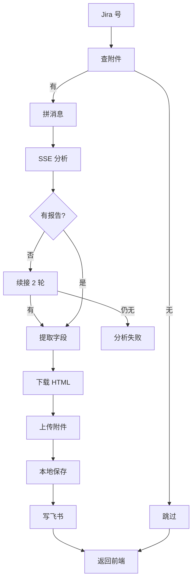
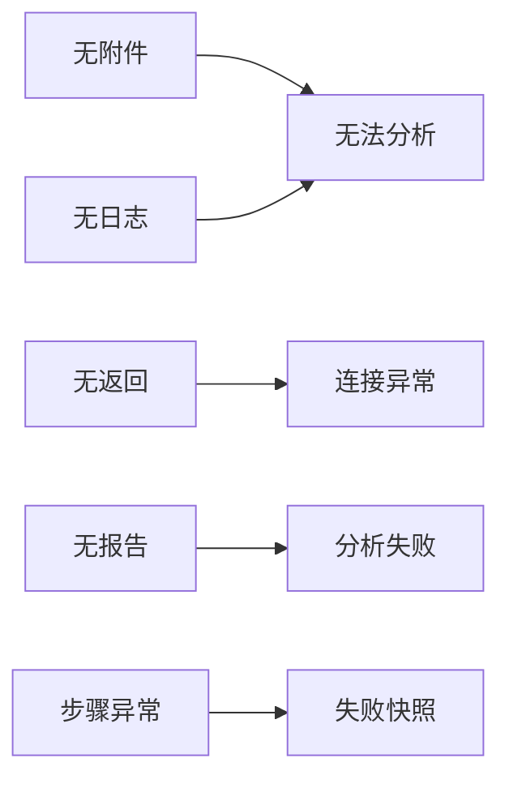

# ADP 调用逻辑

## 主流程



## 失败分支



| 分支 | fail_type |
|---|---|
| 无附件 / 无日志 | 输入质量问题 |
| 无返回 | ADP连接超时或网络异常 |
| 无报告 | 分析完成但未产出HTML报告 |
| 步骤异常 | `处理异常: xxx` |
| 写表失败 | 飞书写入失败 |

## 接口

| 端点 | 用途 |
|---|---|
| `POST /api/test/adp_single` | 单条 |
| `POST /api/test/adp_batch` | 批量 |
| `POST /api/test/adp_lookup` | 查表（接 `/api/jobs`） |
| `POST /api/test/adp_enrich` | 补全描述/时间 |
| `POST /api/test/adp_lookup/stop` | 停止 |
| `GET /api/test/adp_report` | 看完整报告 |

## 文件落点

```
docs/adp_results/{KEY}/
  ├─ {KEY}_full_analysis.md   成功：完整报告
  ├─ {KEY}_raw_data.json      原始数据
  └─ {KEY}_fail_{时间}.md     失败：快照
reports/adp/{KEY}/*.html      HTML 原件
飞书多维表格                  6 字段 + 报告附件
```

## 关键点

- 预览只回 2000 字，全文靠 `report_path` / `adp_report` 打开；
- 报告链接是附件字段，必须 `file_token`；
- SSE 超时 3600s、心跳 30s、无报告且流超 5 分钟续接 2 轮（各 5 分钟）。
