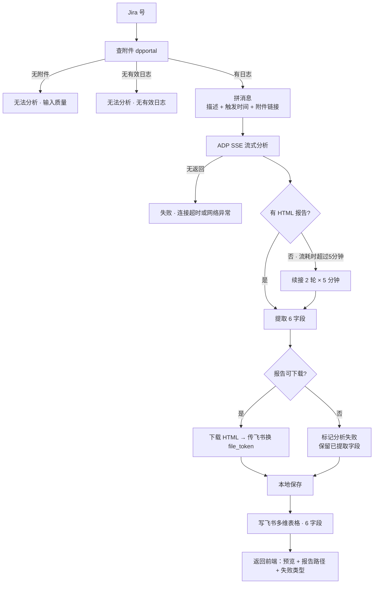
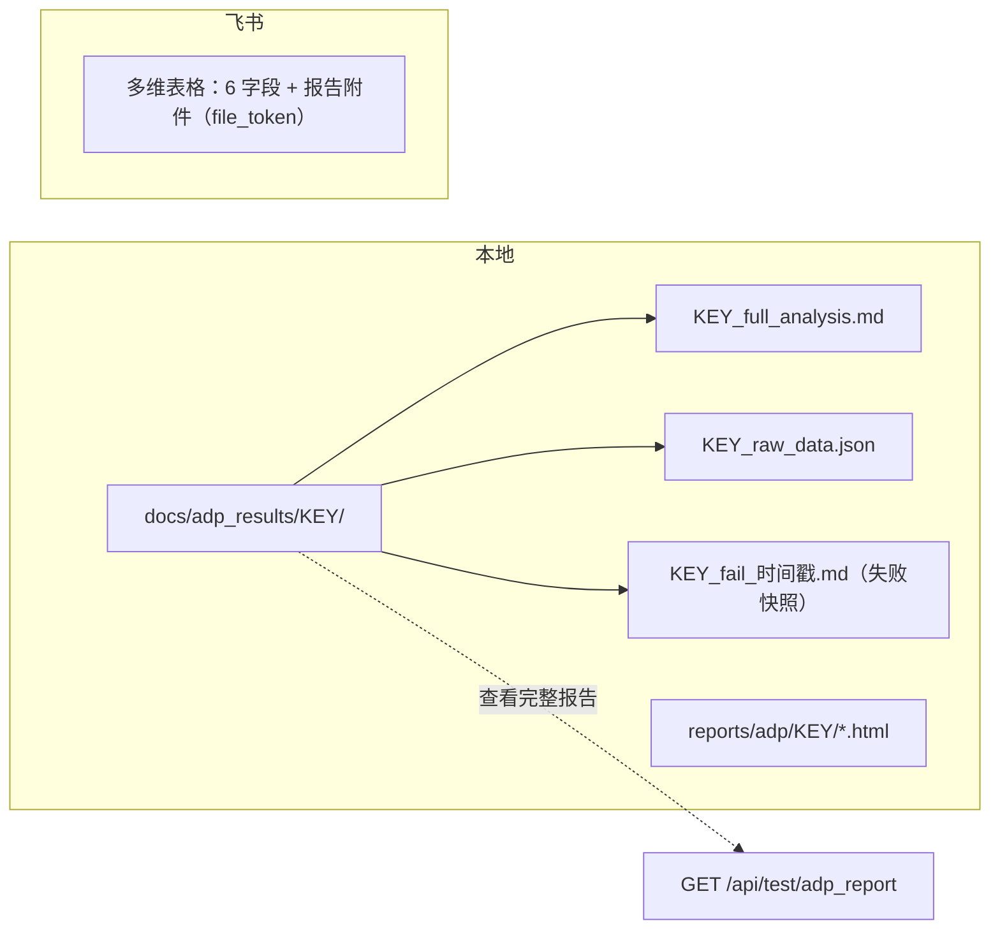
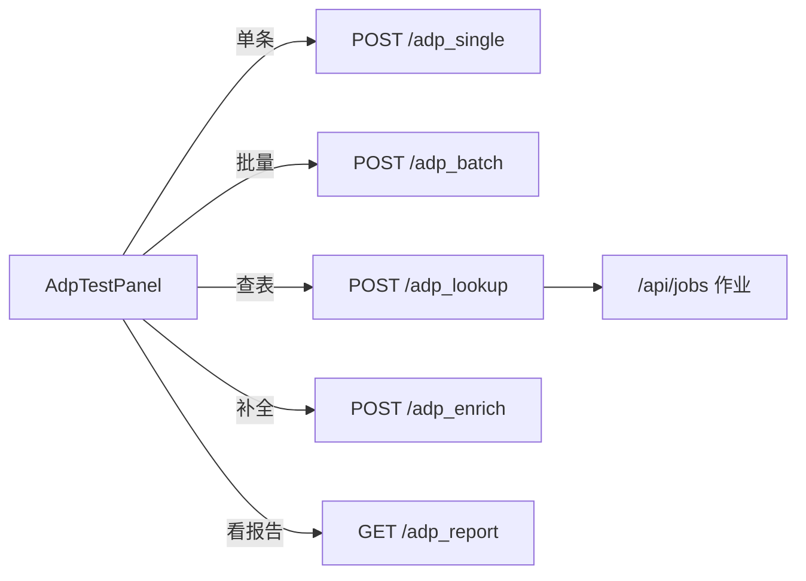

# ADP 调用逻辑

> 实现：`src/services/adp_ops.py` ｜ 端点：`src/api/routes/testing.py`

## 主流程

## 数据落在哪

## 接口

## 失败类型

- 输入质量：无附件 / 无有效日志 / 链接为空 / 描述不清
- ADP 连接超时或网络异常
- 下载链接失效
- 分析过程未完成
- 分析完成但未产出 HTML 报告
- `处理异常: xxx` / 飞书写入失败 / ADP 分析超时

## 参数与坑

| 项 | 值 |
|---|---|
| 并发 / SSE 超时 | 2 / 3600s（connect 30s、read 60s） |
| 重试 / 心跳 | 3 次（10/20/30s） / 30s |
| 续接 / 下载 / 预览 | 300s×2 轮 / 120s / 2000 字 |

1. 报告链接是**附件字段**：必须 `[{"file_token": token}]`，写 URL 会 `AttachFieldConvFail`。
2. **全文只落盘**，前端只拿预览。
3. 失败也留 `_fail_*.md`，失败时同样能「查看完整报告」。
