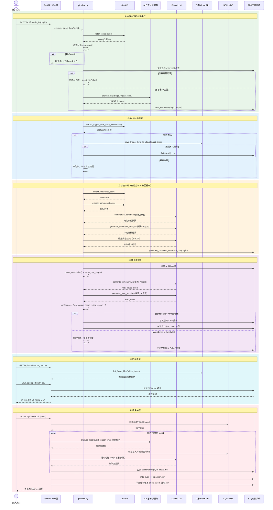
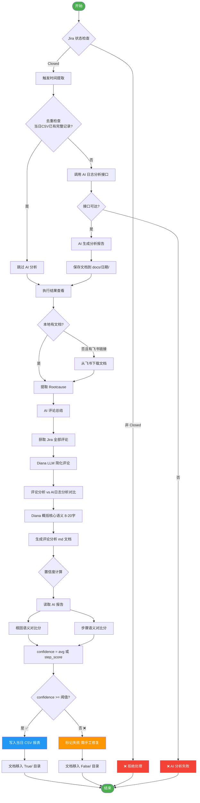
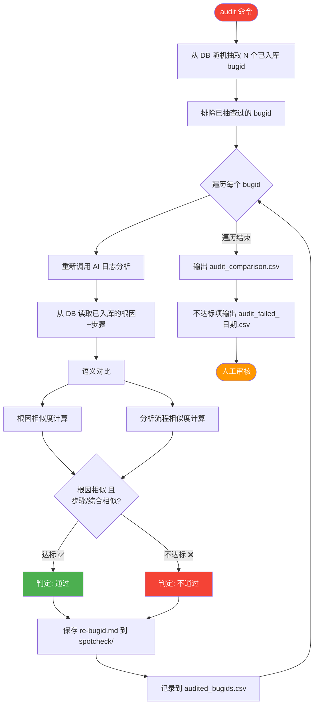
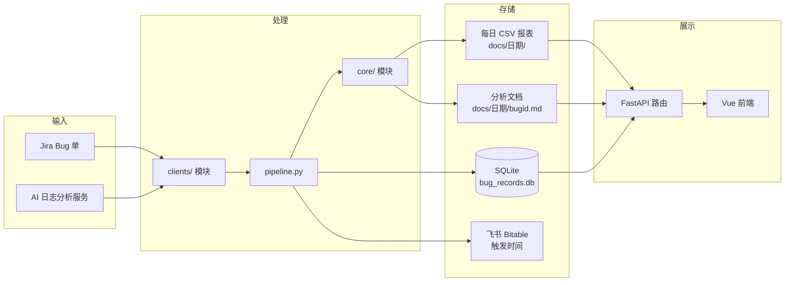

# Bug 分析全流程图

## 一、总体流程概览

---

## 二、全流程时序图

---

## 三、单 Bug 执行流程详细图（execute_single_flow）

---

## 四、质量抽查流程详细图

---

## 五、模块职责对照表

| 阶段 | 核心模块 | API 路由 | 外部依赖 |
|------|---------|---------|---------|
| ① AI日志分析去重 | `pipeline.execute_single_flow` | `POST /api/flow/single` | Jira API, AI日志分析服务 |
| ② 触发时间提取 | `jira_client.extract_trigger_time_from_issue` + `trigger_ops` | `POST /api/flow/extract_time`, `POST /api/trigger_time/batch_read` | Jira API, 飞书 Bitable |
| ③ 排查诊断 | `pipeline._fill_comment_summary` + `comment_filter` | 内嵌在 flow/single 中 | Diana LLM, Jira API |
| ④ 置信度写入 | `pipeline._fill_confidence` + `semantic` | 内嵌在 flow/single 中 | Diana LLM (TF-IDF 语义) |
| ⑤ 数据看板 | `data.py` + `report.py` 路由 | `GET /api/data/*`, `GET /api/report/*` | 飞书云盘, 本地 CSV |
| ⑥ 质量抽查 | `audit.sample_and_audit` | `POST /api/flow/audit` | AI日志分析服务, Diana LLM, SQLite |

---

## 六、关键数据流向

