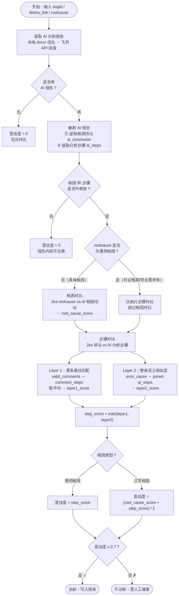
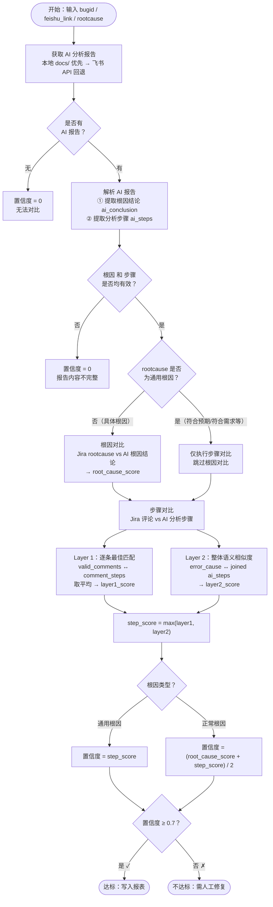
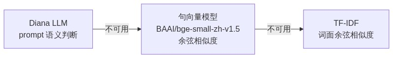
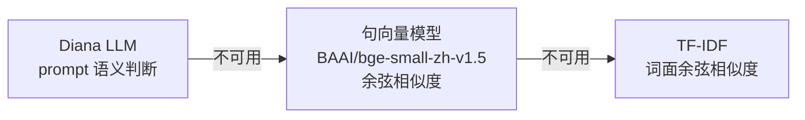
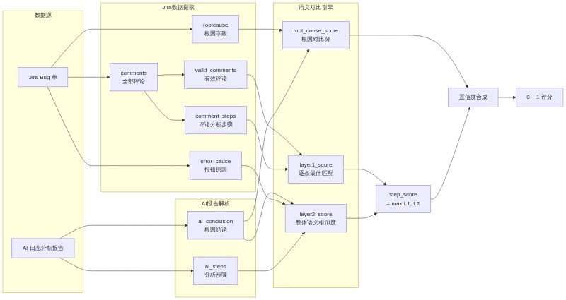
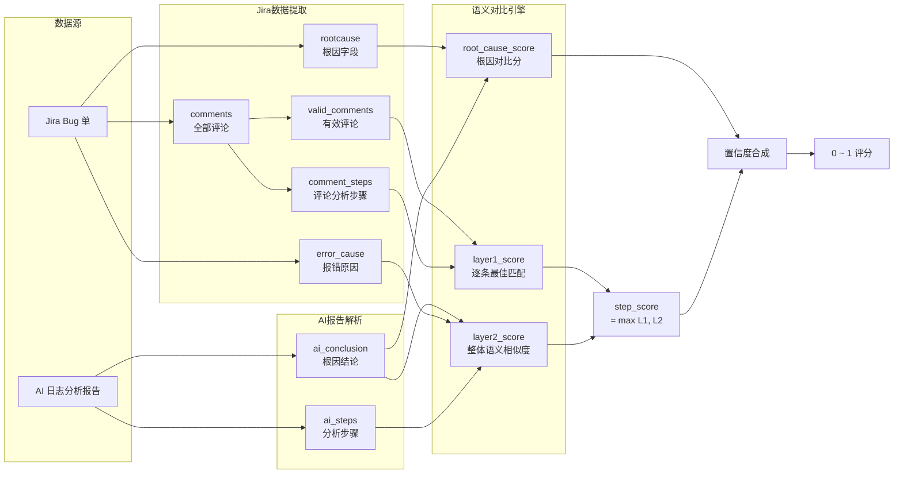

# 置信度计算逻辑

## 概述

置信度（Confidence）用于衡量 **AI 日志分析报告** 与 **Jira Bug 单实际数据** 之间的一致性程度。  
通过对「根因」和「分析步骤」两个维度的语义对比，产出 0~1 的综合评分，达标（≥ 0.7）方可写入正式报表，不达标则需人工复核修复。

---

## 流程图



<!-- Mermaid 源码（编辑时改这里，然后用 mermaid.ink 重新生成 PNG）：

-->

---

## 核心模块说明

### 1. AI 报告获取

| 优先级 | 来源 | 说明 |
|--------|------|------|
| 1 | 本地 `docs/{日期}/{bugid}.md` | 已下载或已生成的本地文档 |
| 2 | 飞书 Open API | 通过飞书链接提取 doc_id，调用 `fetch_docx_as_markdown` |
| 3 | 无报告 | 置信度直接返回 **0** |

### 2. AI 报告解析

从报告文本中提取两个关键内容：

- **根因结论**（`parse_conclusion`）：匹配 `## 根因结论` / `### ④ 根因分析` 等标题段落
- **分析步骤**（`parse_doc_steps`）：优先提取 `**证据 N：xxx**` 格式的证据段落，无证据时回退提取 `1. xxx` 格式的序号步骤

> 两者均无法提取时，置信度 = 0

### 3. 根因类型判定

判断 Jira rootcause 是否为**通用根因**（无实质根因信息的表述）：

```
通用根因关键词：符合需求、符合预期、需求符合、预期行为、设计如此、非问题、登陆后无法复现、test error
```

判定规则：去除括号内容后，基础文本 ≤ 10 字且包含上述关键词 → 通用根因

### 4. 根因对比（正常根因专属）

```
root_cause_score = semantic_similarity(Jira rootcause, AI 根因结论)
```

通用根因跳过此步骤（root_cause_score 不参与最终计算）。

### 5. 步骤对比（双层取最大值）

| 层级 | 对比方式 | 计算公式 |
|------|---------|---------|
| **Layer 1** | 逐条最佳匹配 | Jira 有效评论 ↔ AI 评论提取步骤，每条取最大相似度后求平均 → `layer1_score` |
| **Layer 2** | 整体语义相似度 | Jira error_cause ↔ AI 分析步骤拼接文本 → `layer2_score` |

```
step_score = max(layer1_score, layer2_score)
```

### 6. 置信度合成公式

| 根因类型 | 公式 | 说明 |
|---------|------|------|
| **正常根因** | `confidence = (root_cause_score + step_score) / 2` | 根因与步骤各占 50% 权重 |
| **通用根因** | `confidence = step_score` | 无实质根因可对比，仅依赖步骤一致性 |

---

## 语义相似度计算（三级回退）



<!-- Mermaid 源码（编辑时改这里，然后用 mermaid.ink 重新生成 PNG）：

-->

| 优先级 | 方法 | 特点 |
|--------|------|------|
| 1 | **Diana LLM** | 通过 prompt 让大模型判断根因是否相同，精细但慢 |
| 2 | **句向量模型** | BAAI/bge-small-zh-v1.5 编码后余弦相似度，适合批量 |
| 3 | **TF-IDF 兜底** | jieba 分词 + TF-IDF 向量化余弦，LLM 和模型均不可用时回退 |

---

## 阈值判定与后续处理

```
阈值（threshold）= 0.7（可在 config.yaml 中配置）
```

| 结果 | 条件 | 处理 |
|------|------|------|
| **达标** ✓ | confidence ≥ 0.7 | 评论文档移入 `{日期}/True/`，写入正式报表 |
| **不达标** ✗ | confidence < 0.7 | 评论文档移入 `{日期}/False/`，标记为需人工修复 |
| **备用判定** | confidence 不达标时 | 额外计算 AI 日志分析结论 vs AI 评论排查结论的语义相似度（`extra_similarity`），供人工参考 |

---

## 数据流总览



<!-- Mermaid 源码（编辑时改这里，然后用 mermaid.ink 重新生成 PNG）：

-->

---

## 关键代码位置

| 模块 | 文件 | 核心函数 |
|------|------|---------|
| 置信度计算主逻辑 | `src/pipeline.py` | `_fill_confidence()` |
| 通用根因判定 | `src/pipeline.py` | `_is_generic_rootcause()` |
| AI 报告解析 | `src/core/doc_generator.py` | `parse_conclusion()` / `parse_doc_steps()` |
| 语义相似度 | `src/core/semantic.py` | `semantic_similarity()` / `semantic_best_matches()` |
| TF-IDF 兜底 | `src/core/similarity.py` | `cosine_of_texts()` / `compare_root_cause()` |
| Diana LLM 对比 | `src/clients/diana_client.py` | `llm_similarity()` |
| 阈值配置 | `config/config.yaml` | `similarity.threshold: 0.7` |
