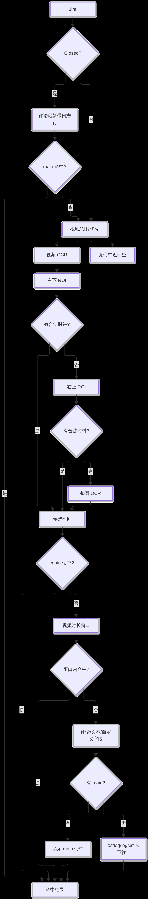
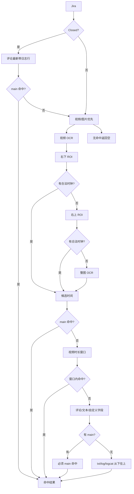

# 触发时间提取优化日志

本文档只记录**通用时间提取逻辑**：来源优先级（Closed / 非 Closed）、评论区最新带日志行评论、文本/描述/自定义字段、视频 OCR 与 ROI、压缩包及多卷联合解压、main 命中校验、txt/log/logcat 参考匹配、时间格式兼容、视频时长窗口、时间来源标签、提取失败原因。
前端页面、看板、批量执行队列、ADP、人工审核、云端写回等非时间提取内容不写入本文档。

## 当前时间提取逻辑

### 当前完整逻辑图

**总原则：除 Closed 人工评论直接采用外，所有候选都必须命中参考，未命中不返回；秒不参与匹配。**

### 批量提取顺序

- **Closed**：评论区最新带日志行评论 → 直接采用；无评论再走视频/文本/图片。
- **非 Closed**：视频/图片 → 评论 → 文本/自定义字段 → 图片。
- 单个 Jira 命中即停止；多个 Jira 并行提取。
- 无视频、无图片、无日志包：`无有效附件`。
- 有附件但所有来源未命中：`未提取到时间`。

### 评论区

- 只取“最新一条带日志行”的人工评论，按评论添加时间 `created` 排序。
- 日志标题行 `----- pid ... at ...` 不作为评论时间。
- `BOSCH_SYNC_TOOL`、`BUILD_TIMESTAMP=` 等构建信息评论是脏数据，跳过。
- 完整日期候选：日期 + 时分命中，秒忽略。
- 只有时分候选：只比时分，日期和秒忽略。
- 评论候选未命中 main，不返回，继续后续来源。
- **Closed**：评论时间优先，直接采用最新带日志行评论。
- **非 Closed**：视频/图片优先，视频/图片没有结果后才看评论。
- 评论时间是 `2026/10/28 16.29` 这类点分格式时同样兼容。

### 时间范围

- 自定义字段出现 `13:26--13:28`、`13:26~13:28` 这类范围时，展开为范围内所有整分：
  `13:26、13:27、13:28`。
- 每个整分都作为候选逐个去 main 命中，命中哪个就用哪个。
- 全部不命中才结束。

### 压缩包与分卷

- 支持 `.zip`、`.zip.001`、`.partN.rar`、`.z01 + .zip`、`.7z.001`。
- 多卷必须按卷号顺序全部拼接后解压，不能只解单卷。
- main 探查 3+1 层：先探三层，没有 main 再探第四层；仍没有则看其他附件。
- main 文件名时间优先；有 main 时候选必须命中 main。
- 没有 main 时，才用 txt/log/logcat 内容命中。
- 压缩包内只有一个文件且是文本（txt/log/logcat）时，按文本内容命中，不要求 main。
- `.z01 + .zip` 等分卷即使解压报错，只要还能列出包内 `main.log`，就继续用 main 文件名验证，不能直接判失败。
- `.part1.rar` 是分卷标志：必须找同基础名的全部 `partN.rar` 一起合并解压，不能只解 part1。
- 分卷缺失或不连续时判为不完整。

### 文本类文件

- `txt` / `logcat` / `.log` 从下往上逐行匹配。
- 带年份的行跳过，继续往上找。
- 只取无年份命中，补当前年。
- 英文日期命中判定该附件不可用，停止该附件。
- 文本内容只做参考，不能直接作为最终结果。

### 时间字符兼容

- 完整时间、无年份短时间、点分时间 `2026/10/28 16.29`。
- 全角冒号、点号、逗号、中文日期、英文月份等兼容规则见后续模块。
- 支持字段里的 `Time 2026/10/28 9:50:00`、`Time：2026/10/28 16.29`。
- 描述里“崩溃”行带时间时优先提取；该时间仍需参与 main/文本命中。
- 视频时长窗口按分钟向上取整：2 分 17 秒按 3 分钟计算，窗口内命中 main 时取 main 时间。

## 时间字符兼容规则

视频帧 OCR / 图片 OCR / 评论文本中常见非标准时间格式，以下为当前已兼容的全部字符转换规则。
处理入口：`_preprocess_ocr_datetime()` → `_fix_ocr_char_confusion()` → `_normalize_ocr_time()`。

### 1. 全角 / 分隔符归一化

| 原始字符 | 转换结果 | 示例 |
|----------|----------|------|
| `：`（全角冒号） | `:` | `11：30` → `11:30` |
| `；`（中文分号） | `:` | `8；44` → `8:44` |
| `;`（半角分号） | `:` | `8;44` → `8:44` |
| `,`（逗号） | `:` | `10,12` → `10:12` |
| `.`（点号） | `:` | `10.26.39` → `10:26:39` |
| `——` / `–` / `—` | 空格 | `2026-01-09——14:02` → `2026-01-09 14:02` |
| `\|` / `｜` | 空格 | `2026-10-26\|19:39:17` → `2026-10-26 19:39:17` |

### 2. OCR 字符混淆修正

仅对匹配时间模式的片段替换，避免误改其他文本。数字密度 <40% 时视为乱码，不替换。

| 混淆字符 | 修正为 | 场景 |
|----------|--------|------|
| `O` / `o` | `0` | `OI:3O` → `01:30` |
| `I` / `l` / `L` | `1` | `I4:3I` → `14:31` |
| `Z` / `z` | `2` | `ZO:LI` → `20:11` |
| `S` / `s` | `5` | `I5:3S` → `15:35` |
| `B` | `8` | `B:3O` → `8:30` |

### 3. 英文月份缩写（含 OCR 误读变体）

车载 HMI / 手机状态栏常在时间上方显示英文月份，如 `Oct 9` `Nov 2026`。  
转换后变为标准数字日期（`Oct 9` → `2026-10-9`），可被 `_OCR_TIME_FULL_RE` 匹配。

| 月份 | 标准缩写 | 常见 OCR 误读 |
|------|----------|---------------|
| 1月 | jan, january | qan, jar, jari |
| 2月 | feb, february | teb |
| 3月 | mar, march | — |
| 4月 | apr, april | — |
| 5月 | may | mau |
| 6月 | jun, june | jur |
| 7月 | jul, july | — |
| 8月 | aug, august | auq |
| 9月 | sep, september | seq |
| 10月 | oct, october | qct, 0ct, 0et |
| 11月 | nov, november | nou, riov |
| 12月 | dec, december | deo |

年份补充规则：有显式年份时直接使用；无年份时从文本上下文搜索 4 位年份，找不到则用当前年份。

### 4. 中文日期关键字

车载 HMI 屏幕常显示 `2026年11月9日 16:44`，OCR 可能识别出空格。

| 原始格式 | 转换结果 | 示例 |
|----------|----------|------|
| `YYYY年MM月DD日` | `YYYY-M-D` | `2026年11月9日` → `2026-11-9` |
| `YYYY 年 MM 月 DD 日` | `YYYY-M-D` | `2026 年 11 月 9 日` → `2026-11-9` |
| `MM月DD日 HH:MM` | `当年-MM-DD HH:MM` | `11月9日 16:44` → `2026-11-09 16:44` |

### 5. 缺失分隔符修复

| 场景 | 示例 | 转换 |
|------|------|------|
| 孤立 4 位数字（非年份） | `1433` | `14:33` |
| 孤立 6 位数字 | `172440` | `17:24:40` |
| 日期时间粘连 | `2026-01-0914:02` | `2026-01-09 14:02` |
| 日期与无分隔符时间 | `2026-01-22172440` | `2026-01-22 17:24:40` |

### 6. 年份修正

| 场景 | 示例 | 转换 |
|------|------|------|
| 3 位年份 | `026-10-27` | `2026-10-27` |
| 首位误识别 | `6024-01-22` | `2024-01-22`（3000~9999 → 2000+后三位） |
| 2 位年份 | `26-10-20` | `2026-10-20` |

---
