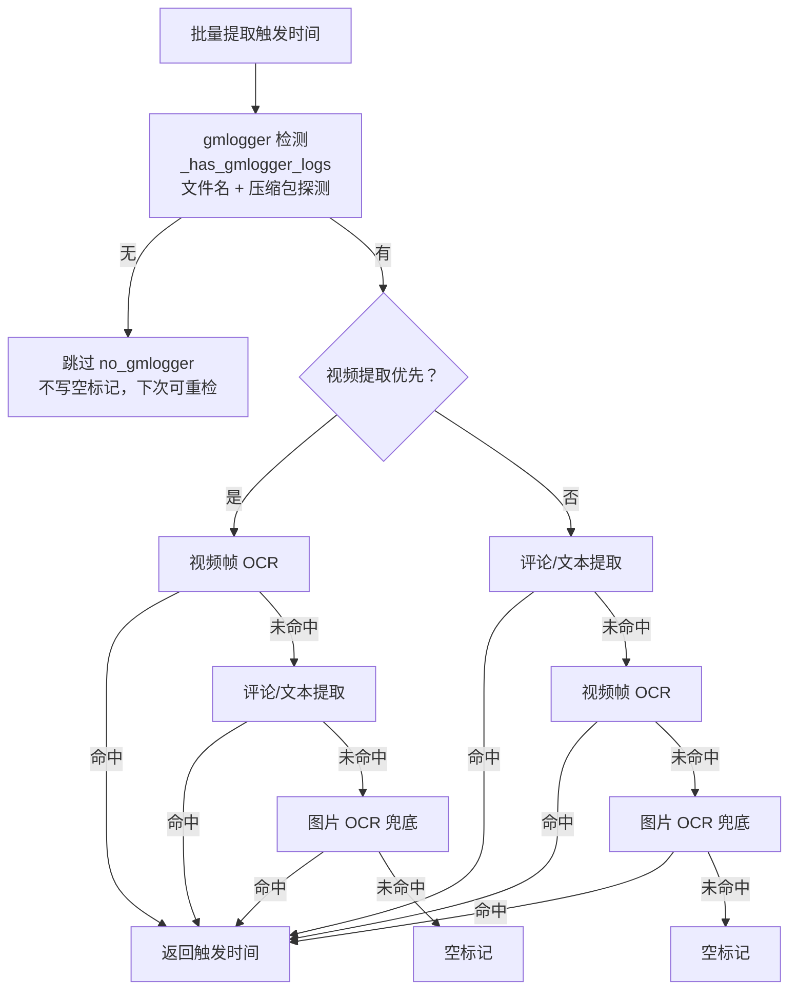
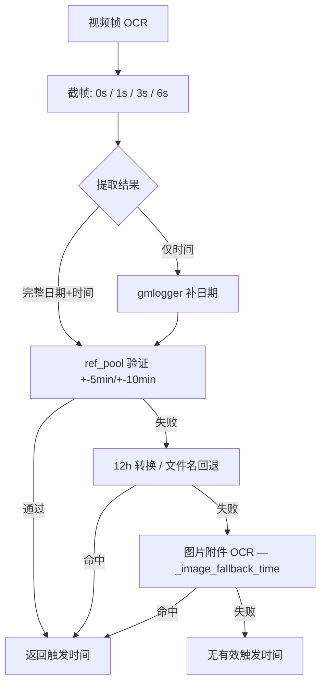

# 触发时间提取优化日志

本文档为触发时间提取的学习总结：仅记录**通用时间提取逻辑**的变更总结（逻辑变更时自动追加到历史变更记录）；
偶发失败、或无需修改提取逻辑的失败不入库。
失败原始记录（含顺便排查的根因）见 `timestudy/records/records_YYYY-MM-DD.csv`；分析快照见 `timestudy/error_patterns*.json`。

## 当前时间提取逻辑

### 批量提取流程（`_process_one` in `testing.py`）

### 视频帧 OCR 内部逻辑（`_diag_extract_time_from_video_simple`）

> **ref_pool 验证池**：包内 main.log 时间（权威，容差 5min）> 外层 gmlogger 文件名时间（补充，容差 10min）

## 历史变更记录

<b>1. 封面帧小字时钟 OCR 识别修复（2026-10-09）</b>

- **问题描述**：封面帧有清晰时钟但 OCR 读成乱码，时间提取失败
- **相关Bug号**：VCU-553755
- **根因**：EasyOCR 默认画布 1280 导致大图下采样，小字号/低对比度时钟识别能力不足
- **解决方案**：新增 _ocr_readtext 使用 canvas_size=2560、mag_ratio=1.5、降低阈值，统一应用到三处 OCR 调用点

<b>2. gmlogger 包内 main 文件日期遗漏修复（2026-10-10）</b>

- **问题描述**：视频封面读出 6:17，但未能匹配到包内 58-main.log_2026_10_10_6_18_4.gz 的正确日期
- **相关Bug号**：VCU-553973
- **根因**：① main_names[:5] 只取前 5 个 main 文件，30+ 文件时遗漏目标日期；② 外层 gmlogger 文件名有旧日期时不触发包内回退
- **解决方案**：遍历所有 main 文件解析时间（头读限 10 个）；始终下载包内取权威日期，包内优先、外层仅补充

<b>3. 标题仅时间时用创建日期补全导致日期错误（2026-10-10）</b>

- **问题描述**：标题含 10:31，评论区有完整 2026-10-6 10:31:00，但系统用 Jira 创建日期 2026-10-09 补全成 2026-10-09 10:31:00
- **相关Bug号**：VCU-553601
- **根因**：标题仅含时间无日期时，_extract_times_from_text 用 created_date 补全，但创建日期可能比实际事件日期晚几天；评论区有正确日期但未被检查
- **解决方案**：标题仅时间时，先从评论区查找同一时间的完整日期（时间差≤1秒），命中则用评论日期；未命中再回退 gmlogger 补充

<b>4. 视频 OCR 低置信度误识别过滤（2026-10-10）</b>

- **问题描述**：视频帧中手机屏幕显示 10:08，因清晰度低被 OCR 误读为 16:50，导致提取错误时间
- **相关Bug号**：VCU-553491
- **根因**：OCR 结果的置信度完全被忽略，低置信度的误识别文本直接参与时间提取，模糊帧的数字容易被错读
- **解决方案**：在 _ocr_readtext 中过滤置信度<0.3 的时间类文本（仅含数字/冒号/斜杠），三处 OCR 调用点统一生效

<b>5. 排查诊断未解压时视频OCR无条件覆盖文本提取结果（2026-10-10）</b>

- **问题描述**：文本路径已正确提取到 13:44:00（Initial Setting），但排查诊断仍返回视频 OCR 的 16:50:53
- **相关Bug号**：VCU-553491
- **根因**：gmlogger 未解压时 ref_pool 为空，视频 OCR 结果不经任何验证直接返回 success，覆盖了正确的文本提取时间
- **解决方案**：调整 _diag_verify_suggestion 中无包内时间戳分支的优先级：文本路径已提取有效时间时优先与 gmlogger 文件名时间印证，仅在文本无结果时才回退视频 OCR

<b>6. 水印相机时间过滤——优先使用设备屏幕时间（2026-10-10）</b>

- **问题描述**：视频帧同时存在水印相机时间(16:13)和设备屏幕时间(17:37)，OCR 误用水印时间
- **相关Bug号**：VCU-553532
- **根因**：水印相机叠加的时间往往不准确，但 OCR 不区分来源，水印时间可能被优先匹配
- **解决方案**：在 _ocr_readtext 中检测水印关键词(“水印”/“相机真实可靠”)，计算水印区域 bbox，过滤该区域内的时间类文本

<b>7. 视频未命中gmlogger时新增非视频图片OCR时钟兜底（2026-10-11）</b>

- **问题描述**：视频提取时间(17:27)与gmlogger包内/文件名时间(20:05)不命中，直接走兜底或返回空；附件中车机时钟截图(20:01)未被利用，导致提取失败
- **相关Bug号**：VCU-550243
- **根因**：图片OCR兜底 _diag_extract_time_from_images 仅在诊断流程且gmlogger组数>10时调用，主提取链路 _diag_extract_time_from_video_simple 在视频未命中gmlogger时从不参考非视频图片
- **解决方案**：新增 _image_fallback_time：视频未命中gmlogger后调用图片OCR，图片时钟(20:01)与参考时间(20:05)按时分接近(容差10分钟)则用参考日期+图片时间拼接返回；差距过大弃用回退原逻辑

<b>8. gmlogger 前置检查移至所有时间提取之前（2026-10-12）</b>

- **问题描述**：gmlogger 检查在评论/字段提取之后，导致无 gmlogger 的 Jira 仍执行了不必要的评论提取
- **根因**：_extract_one 中 gmlogger 前置检查位置不对，应在 fetch_issue 之后、所有时间提取之前
- **解决方案**：将 _has_gmlogger_logs 检查移到 fetch_issue 之后、评论/字段提取之前，无 gmlogger 直接返回 None（不写空标签，不属于通用报错，下次重新检查）

<b>9. gmlogger 下载增加双重超时保护（2026-10-12）</b>

- **问题描述**：156MB 的 gmlogger 压缩包下载卡住，阻塞整个提取流程
- **相关Bug号**：批量执行中偶发
- **根因**：httpx.stream() 的 read=300（5分钟等待响应头/数据块），服务器不响应时整个线程挂起
- **解决方案**：read 超时从 300s 降至 60s；增加 5 分钟 wall-clock deadline（time.monotonic），每下载 1MB 检查一次；体积阈值从 500MB 降至 200MB

<b>10. 移除视频兜底链路的外层文件名日期回退（2026-10-12）</b>

- **问题描述**：gmlogger 包内 main.log 日期获取失败时，仍用外层文件名的日期凑合，可能匹配到错误日期
- **根因**：_diag_extract_time_from_video_simple 中包内日期失败后回退到外层 gmlogger 文件名日期，外层文件名日期可能不准
- **解决方案**：包内日期为权威来源，获取失败时直接跳过视频兜底，不再用外层文件名日期凑合

<b>11. RapidOCR 检测阈值修复（2026-10-12）</b>

- **问题描述**：低质量视频帧 RapidOCR 检测不到文本，频繁回退 EasyOCR
- **根因**：RapidOCR 默认 box_thresh=0.5 太高（EasyOCR 用 text_threshold=0.25），阈值差一倍导致低质量帧检测失败
- **解决方案**：box_thresh 从 0.5 降至 0.3，text_score 设为 0.15（与应用层过滤阈值对齐）

<b>12. RapidOCR 图像放大规则从 EasyOCR 迁移（2026-10-13）</b>

- **问题描述**：EasyOCR 的 mag_ratio=1.5（图像放大1.5倍）未迁移到 RapidOCR，小字号识别能力下降
- **根因**：切换 OCR 引擎时只迁移了检测阈值，未迁移图像预处理参数
- **解决方案**：_rapid_ocr_readtext 对宽度<1280px 的图像自动放大 1.5x（INTER_CUBIC），bbox 坐标还原；已二值化/锐化的 ROI（_already_enhanced=True）跳过放大避免伪影放大

<b>13. gmlogger 内包日期提取优化——仅从 main 文件名提取（2026-10-13）</b>

- **问题描述**：VCU-555094 的 main.log 存在但头部 64KB 无日期匹配，提取时间 0 个，视频兜底被跳过
- **相关Bug号**：VCU-555094
- **根因**：原逻辑先尝试文件名解析，失败后解压读文件头部 64KB 提取日期，但 main.log 头部可能无日期格式
- **解决方案**：简化为仅从 main 文件名提取日期（不解压读内容），带去重；_diag_scan_entry_times 保持仅匹配 main.log 文件名

<b>14. gmlogger包内日期获取失败时回退到外层文件名日期继续视频兜底（2026-10-13）</b>

- **问题描述**：批量执行中多个 VCU（555132/555131/555130/555129/555127）因 gmlogger 压缩包过大(>200MB)被跳过，视频OCR和图片OCR全部未执行
- **相关Bug号**：VCU-555132, VCU-555131, VCU-555130, VCU-555129, VCU-555127
- **根因**：_diag_extract_time_from_video_simple 中包内日期获取失败时直接 return ""，跳过了整个视频兜底和图片兜底链路；但外层 gmlogger 文件名日期已在 gm_times 中解析，可以作为回退参考
- **解决方案**：包内日期失败时回退到外层 gmlogger 文件名日期继续视频/图片 OCR；仅当包内和外层均无日期时才跳过（OCR 无法验证）

