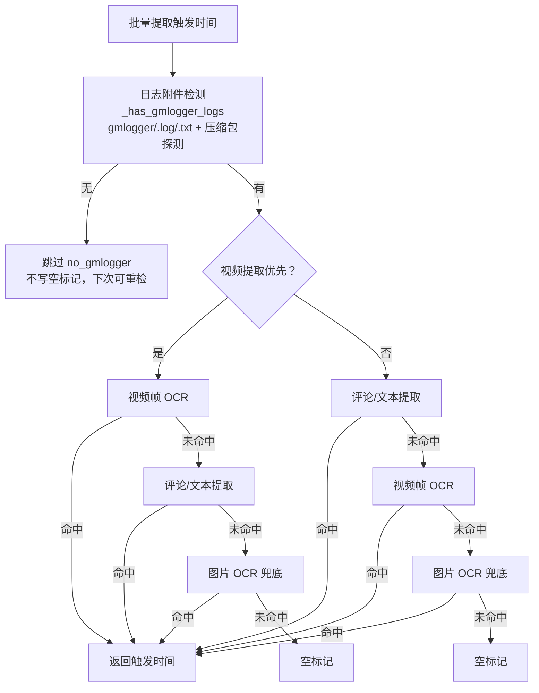
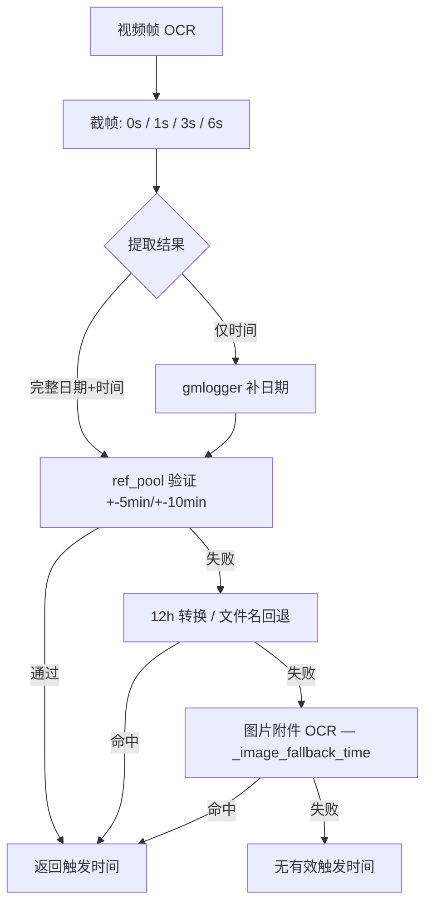

# 触发时间提取优化日志

本文档为触发时间提取的学习总结：仅记录**通用时间提取逻辑**的变更总结（逻辑变更时自动追加到历史变更记录）；
偶发失败、或无需修改提取逻辑的失败不入库。
失败原始记录（含顺便排查的根因）见 `timestudy/records/records_YYYY-MM-DD.csv`；分析快照见 `timestudy/error_patterns*.json`。

## 当前时间提取逻辑

### 批量提取流程（`_process_one` in `testing.py`）

### 视频帧 OCR 内部逻辑（`_diag_extract_time_from_video_simple`）

> **ref_pool 验证池**：包内 main.log 时间（权威，容差 5min）> 外层 gmlogger 文件名时间（补充，容差 10min）> gmlogger 上传时间（兜底，无包内/外层日期时启用）

## 历史变更记录

<b>1. 封面帧小字时钟 OCR 识别修复（2026-10-09）</b>

- **问题描述**：封面帧有清晰时钟但 OCR 读成乱码，时间提取失败
- **相关Bug号**：VCU-553755
- **根因**：EasyOCR 默认画布 1280 导致大图下采样，小字号/低对比度时钟识别能力不足
- **解决方案**：新增 _ocr_readtext 使用 canvas_size=2560、mag_ratio=1.5、降低阈值，统一应用到三处 OCR 调用点

<b>2. gmlogger 包内 main 文件日期遗漏修复（2026-10-10）</b>

- **问题描述**：视频封面读出 6:17，但未能匹配到包内 58-main.log_2026_10_10_6_18_4.gz 的正确日期
- **相关Bug号**：VCU-553973
- **根因**：① main_names[:5] 只取前 5 个 main 文件，30+ 文件时遗漏目标日期；② 外层 gmlogger 文件名有旧日期时不触发包内回退
- **解决方案**：遍历所有 main 文件解析时间（头读限 10 个）；始终下载包内取权威日期，包内优先、外层仅补充

<b>3. 标题仅时间时用创建日期补全导致日期错误（2026-10-10）</b>

- **问题描述**：标题含 10:31，评论区有完整 2026-10-6 10:31:00，但系统用 Jira 创建日期 2026-10-09 补全成 2026-10-09 10:31:00
- **相关Bug号**：VCU-553601
- **根因**：标题仅含时间无日期时，_extract_times_from_text 用 created_date 补全，但创建日期可能比实际事件日期晚几天；评论区有正确日期但未被检查
- **解决方案**：标题仅时间时，先从评论区查找同一时间的完整日期（时间差≤1秒），命中则用评论日期；未命中再回退 gmlogger 补充

<b>4. 视频 OCR 低置信度误识别过滤（2026-10-10）</b>

- **问题描述**：视频帧中手机屏幕显示 10:08，因清晰度低被 OCR 误读为 16:50，导致提取错误时间
- **相关Bug号**：VCU-553491
- **根因**：OCR 结果的置信度完全被忽略，低置信度的误识别文本直接参与时间提取，模糊帧的数字容易被错读
- **解决方案**：在 _ocr_readtext 中过滤置信度<0.3 的时间类文本（仅含数字/冒号/斜杠），三处 OCR 调用点统一生效

<b>5. 排查诊断未解压时视频OCR无条件覆盖文本提取结果（2026-10-10）</b>

- **问题描述**：文本路径已正确提取到 13:44:00（Initial Setting），但排查诊断仍返回视频 OCR 的 16:50:53
- **相关Bug号**：VCU-553491
- **根因**：gmlogger 未解压时 ref_pool 为空，视频 OCR 结果不经任何验证直接返回 success，覆盖了正确的文本提取时间
- **解决方案**：调整 _diag_verify_suggestion 中无包内时间戳分支的优先级：文本路径已提取有效时间时优先与 gmlogger 文件名时间印证，仅在文本无结果时才回退视频 OCR

<b>6. 水印相机时间过滤——优先使用设备屏幕时间（2026-10-10）</b>

- **问题描述**：视频帧同时存在水印相机时间(16:13)和设备屏幕时间(17:37)，OCR 误用水印时间
- **相关Bug号**：VCU-553532
- **根因**：水印相机叠加的时间往往不准确，但 OCR 不区分来源，水印时间可能被优先匹配
- **解决方案**：在 _ocr_readtext 中检测水印关键词(“水印”/“相机真实可靠”)，计算水印区域 bbox，过滤该区域内的时间类文本

<b>7. 视频未命中gmlogger时新增非视频图片OCR时钟兜底（2026-10-11）</b>

- **问题描述**：视频提取时间(17:27)与gmlogger包内/文件名时间(20:05)不命中，直接走兜底或返回空；附件中车机时钟截图(20:01)未被利用，导致提取失败
- **相关Bug号**：VCU-550243
- **根因**：图片OCR兜底 _diag_extract_time_from_images 仅在诊断流程且gmlogger组数>10时调用，主提取链路 _diag_extract_time_from_video_simple 在视频未命中gmlogger时从不参考非视频图片
- **解决方案**：新增 _image_fallback_time：视频未命中gmlogger后调用图片OCR，图片时钟(20:01)与参考时间(20:05)按时分接近(容差10分钟)则用参考日期+图片时间拼接返回；差距过大弃用回退原逻辑

<b>8. gmlogger 前置检查移至所有时间提取之前（2026-10-12）</b>

- **问题描述**：gmlogger 检查在评论/字段提取之后，导致无 gmlogger 的 Jira 仍执行了不必要的评论提取
- **根因**：_extract_one 中 gmlogger 前置检查位置不对，应在 fetch_issue 之后、所有时间提取之前
- **解决方案**：将 _has_gmlogger_logs 检查移到 fetch_issue 之后、评论/字段提取之前，无 gmlogger 直接返回 None（不写空标签，不属于通用报错，下次重新检查）

<b>9. gmlogger 下载增加双重超时保护（2026-10-12）</b>

- **问题描述**：156MB 的 gmlogger 压缩包下载卡住，阻塞整个提取流程
- **相关Bug号**：批量执行中偶发
- **根因**：httpx.stream() 的 read=300（5分钟等待响应头/数据块），服务器不响应时整个线程挂起
- **解决方案**：read 超时从 300s 降至 60s；增加 5 分钟 wall-clock deadline（time.monotonic），每下载 1MB 检查一次；体积阈值从 500MB 降至 200MB

<b>10. 移除视频兜底链路的外层文件名日期回退（2026-10-12）</b>

- **问题描述**：gmlogger 包内 main.log 日期获取失败时，仍用外层文件名的日期凑合，可能匹配到错误日期
- **根因**：_diag_extract_time_from_video_simple 中包内日期失败后回退到外层 gmlogger 文件名日期，外层文件名日期可能不准
- **解决方案**：包内日期为权威来源，获取失败时直接跳过视频兜底，不再用外层文件名日期凑合

<b>11. RapidOCR 检测阈值修复（2026-10-12）</b>

- **问题描述**：低质量视频帧 RapidOCR 检测不到文本，频繁回退 EasyOCR
- **根因**：RapidOCR 默认 box_thresh=0.5 太高（EasyOCR 用 text_threshold=0.25），阈值差一倍导致低质量帧检测失败
- **解决方案**：box_thresh 从 0.5 降至 0.3，text_score 设为 0.15（与应用层过滤阈值对齐）

<b>12. RapidOCR 图像放大规则从 EasyOCR 迁移（2026-10-13）</b>

- **问题描述**：EasyOCR 的 mag_ratio=1.5（图像放大1.5倍）未迁移到 RapidOCR，小字号识别能力下降
- **根因**：切换 OCR 引擎时只迁移了检测阈值，未迁移图像预处理参数
- **解决方案**：_rapid_ocr_readtext 对宽度<1280px 的图像自动放大 1.5x（INTER_CUBIC），bbox 坐标还原；已二值化/锐化的 ROI（_already_enhanced=True）跳过放大避免伪影放大

<b>13. gmlogger 内包日期提取优化——仅从 main 文件名提取（2026-10-13）</b>

- **问题描述**：VCU-555094 的 main.log 存在但头部 64KB 无日期匹配，提取时间 0 个，视频兜底被跳过
- **相关Bug号**：VCU-555094
- **根因**：原逻辑先尝试文件名解析，失败后解压读文件头部 64KB 提取日期，但 main.log 头部可能无日期格式
- **解决方案**：简化为仅从 main 文件名提取日期（不解压读内容），带去重；_diag_scan_entry_times 保持仅匹配 main.log 文件名

<b>14. gmlogger包内日期获取失败时回退到外层文件名日期继续视频兜底（2026-10-13）</b>

- **问题描述**：批量执行中多个 VCU（555132/555131/555130/555129/555127）因 gmlogger 压缩包过大(>200MB)被跳过，视频OCR和图片OCR全部未执行
- **相关Bug号**：VCU-555132, VCU-555131, VCU-555130, VCU-555129, VCU-555127
- **根因**：_diag_extract_time_from_video_simple 中包内日期获取失败时直接 return ""，跳过了整个视频兜底和图片兜底链路；但外层 gmlogger 文件名日期已在 gm_times 中解析，可以作为回退参考
- **解决方案**：包内日期失败时回退到外层 gmlogger 文件名日期继续视频/图片 OCR；仅当包内和外层均无日期时才跳过（OCR 无法验证）

<b>15. EasyOCR 延迟初始化——避免不必要的模型下载（2026-10-17）</b>

- **问题描述**：每次诊断都提前初始化 EasyOCR，即使 RapidOCR 已能处理仍触发中文模型下载（"Downloading recognition model"）
- **根因**：server.py 和 server_legacy.py 中 4+3 处 `_get_ocr_reader()` 在函数入口提前调用，EasyOCR 每次初始化都尝试下载缺失的 `zh_sim_g2.pth` 中文模型
- **解决方案**：所有提前初始化改为延迟加载——`_ocr_readtext` 内部仅当 RapidOCR 结果为空或置信度<0.3 时才初始化 EasyOCR；传参从 `reader` 改为 `None`，函数内部按需获取

<b>16. .log/.txt 文件纳入日志附件判断与文件名时间提取（2026-10-17）</b>

- **问题描述**：附件为 `[SFTC-1.21.24]server.log` 等 `.log`/`.txt` 文件时，被误判为"无gmlogger"跳过排查
- **根因**：`_has_gmlogger_logs` 仅检查文件名含 `gmlogger` 或 `main.log`，`.log`/`.txt` 后缀文件不匹配；`gm_atts` 筛选和 `_diag_gmlogger_times` 也仅识别 gmlogger
- **解决方案**：三处统一扩展——① `_has_gmlogger_logs` 附件名 `.endswith(".log")` / `.endswith(".txt")` 直接判定有日志，压缩包内探测同步扩展；② `gm_atts` 筛选加入 `.log`/`.txt`；③ `_diag_gmlogger_times` 和 `_extract_attachment_time` 用 `_COMPACT_RE` 通用正则解析文件名时间，提取不到则继续走视频/图片 OCR 链路，不解压

<b>17. 云端触发时间表再平衡与写入分配优化（2026-10-17）</b>

- **问题描述**：部分触发时间表超过 500 条上限（511/503/503/501），而其他表只有 1 条记录，存储分布不均
- **根因**：旧写入逻辑顺序找第一个有空位的表填满，导致前面的表都堆到 500，后面的表很空；历史数据可能超限但无自动修正机制
- **解决方案**：① 写入策略改为按剩余空间从大到小排序，优先填空位最多的表；② 新增再平衡 API `POST /api/trigger_time/rebalance`，扫描超限表（>500），将多余记录搬到余量最大的未满表；实测将 4 张超限表共 18 条记录搬入仅 1 条记录的表

<b>18. 评论区附件名时间提取与分钟频率中位数选择（2026-10-17）</b>

- **问题描述**：VCU-555714 错误提取了描述中的时间 `2026-10-07 20:50`，而评论区附件名（如 `58-main.log_2026_10_14_7_40_26.gz`）包含正确时间 `2026-10-14 07:40`
- **根因**：`_diag_verify_suggestion` 在 gmlogger 包内无法解析且无压缩包时，直接采纳评论区/描述提取的时间，未考虑附件文件名中的时间戳
- **解决方案**：① 新增 `extract_times_from_comment_attachments` 和 `extract_median_time_from_attachments` 函数，从评论区文本中匹配 `main.log_YYYY_MM_DD_H_M_S` 模式；② 分钟频率统计策略：统计各分钟值出现次数，筛选出现次数 >= max(2, max_count//2) 的分钟值，取中位数（如 38×2、39×4、40×4、41×4 → 候选 [38,39,40,41] → 中位数 40）；③ 在 `_diag_verify_suggestion` 的两个关键回退点插入附件时间校验：gmlogger 未交叉印证时、压缩包无 main.log 时
- **实现文件**：`src/clients/jira_client.py`（新增函数）、`src/web/server.py`（`_diag_verify_suggestion` 增加校验点）

<b>19. RapidOCR 置信度类型安全修复（2026-10-17）</b>

- **问题描述**：VCU-552013 视频 OCR 全部失败，报 `unsupported operand type(s) for +: 'int' and 'str'`
- **根因**：RapidOCR 返回的 `conf` 字段为字符串类型而非 float，`_ocr_readtext` 中 `sum((r[2] for r in results), 0)` 执行 `0 + "0.95"` 时抛出 TypeError
- **解决方案**：在 `_avg_conf` 计算前增加类型安全检查，将非数值类型的 conf 强制转为 float 或归零；同时修复 `server.py` 和 `server_legacy.py`；实测 VCU-552013 修复后视频 OCR 正确提取 `2026-09-24 16:34:00`

<b>20. gmlogger 压缩包内 main.log 日期提取与 ref_pool 空跳过修复（2026-10-19）</b>

- **问题描述**：VCU-557682 视频封面清晰显示 5:38，但视频 OCR 被完全跳过，返回“提取失败”
- **相关Bug号**：VCU-557682
- **根因**：① `_diag_extract_time_from_video_simple` step 3 用 `"gmlogger" in fn_lower` 跳过了 gmlogger 压缩包，导致 `gmlogger(1).7z` 内的 `main.log_2026_10_19_6_56_11.gz` 等带日期文件未被探测，`ref_pool` 为空；② `ref_pool` 为空时函数直接 `return ""` 跳过整个视频 OCR；③ 包内 main 文件名小时为非零填充的 `6`，`_COMPACT_RE` 的 `\d{2}` 无法匹配单数字小时，误把 `6_56` 解析为分钟 65；④ Jira 附件创建时间带时区 (`+08:00`) 与 OCR 解析的 naive datetime 比较时抛 `can't subtract offset-naive and offset-aware datetimes`
- **解决方案**：① 移除 step 3 的 gmlogger 跳过条件，让 gmlogger 压缩包也通过 `_diag_list_archive_entries` 探测内部 main.log 日期；② 为包内 main 文件添加下划线分隔格式的兆底解析（`20\d{2}_\d{1,2}_\d{1,2}_\d{1,2}_\d{1,2}`，支持 1-2 位小时/分钟）；③ `ref_pool` 为空时不再提前返回，继续尝试视频 OCR，并将 gmlogger 上传时间加入 `ref_pool` 作为兆底参考；④ 统一在 `_build_gmlogger_info`、`gm_ref_dt` 赋值、`_find_closest_gmlogger` 的 `video_upload` 处去除时区信息

<b>21. 诊断端点预归类保护与错误信息规则补全（2026-10-20）</b>

- **问题描述**：批量诊断失败记录时，预归类逻辑未生效，所有记录都走了完整 Jira 诊断流程（下载附件、视频 OCR 等），浪费时间和 API 调用
- **相关Bug号**：VCU-557688, VCU-557547（HTTP 504）; VCU-557666, VCU-557757（解压后未找到可识别的日志文件）
- **根因**：① 预归类仅在前端 `batch_pre_classify` 流程中执行，前端处理响应时未正确拆分 skip/need_analysis 记录导致全部进入诊断；② `_diag_pre_classify` 中 504/502 匹配规则仅匹配 "504 Gateway Timeout" 格式，实际错误信息为 "JIRA API 调用失败（HTTP 504）" 格式不匹配
- **解决方案**：① 在 `/api/troubleshoot/diagnose` 端点内增加预归类保护——诊断前检查 err_msg，命中跳过类别时直接返回 `needs_analysis: false` 不查 Jira；② `_diag_pre_classify` 扩展 504/502/503 匹配规则（支持 "HTTP 504"/"HTTP 502"/"HTTP 503" 格式）；③ "解压后未找到可识别的日志文件" 不跳过诊断（可能是压缩格式问题，实际有日志），走深度诊断下载附件确认
- **实现文件**：`src/api/routes/troubleshoot.py`（diagnose 端点预归类保护）、`src/services/troubleshoot_service.py`（`_diag_pre_classify` 规则补全）

<b>22. 批量写入人工审核结果 Pydantic 模型字段不匹配修复（2026-10-20）</b>

- **问题描述**：点击"批量写入人工审核结果"按钮后报"未匹配到任何记录"，但直接调用函数可正常匹配
- **根因**：`ReviewItem` Pydantic 模型只定义了 `bugid: str` 和 `review: str = ""` 两个字段，但前端发送的是 `bugid`、`done_time`、`human_reason` 三个字段。Pydantic 静默丢弃了未定义的 `done_time` 和 `human_reason`，导致 `batch_write_review` 函数收到空 `human_reason` 被 `if not human_reason: continue` 跳过所有记录
- **解决方案**：更新 `ReviewItem` 模型为 `bugid: str, done_time: str = "", human_reason: str = ""`，与前端发送字段完全匹配；同时在 `batch_write_review` 增加 bugid 兆底匹配（done_time 不精确匹配时取该 bugid 最新记录），增强健壮性
- **实现文件**：`src/schemas/troubleshoot.py`（`ReviewItem` 字段修正）、`src/services/troubleshoot_service.py`（兆底匹配）

<b>23. 视频帧提取范围从 [1,3,6] 秒改为前6帧 [0,1,2,3,4,5] 秒（2026-10-20）</b>

- **问题描述**：视频帧提取在封面帧未命中时，仅截取第1/3/6秒进行 OCR，采样点少且间隔大，容易错过清晰时钟帧
- **相关Bug号**：VCU-557464
- **根因**：原 positions=[1, 3, 6] 只有 3 个采样点，间距不均匀（1s→2s→3s），对于时钟位置变化较快的视频容易漏掉关键帧
- **解决方案**：将第二阶段帧提取从 `positions=[1, 3, 6]` 改为 `positions=[1, 2, 3, 4, 5]`，加上封面帧 [0]，总共覆盖前6秒，采样点从 4 个增加到 6 个，间距均匀（每秒1帧）
- **实现文件**：`src/services/server_legacy.py`（`_diag_extract_time_from_video_simple` 和 `_diag_extract_time_from_video` 两处）

<b>24. 视频 OCR 多级验证——视频文件名日期时间与 OCR 时间交叉确认（2026-10-20）</b>

- **问题描述**：VCU-557464 描述含两个时间（11:30 和 2026-10-11 17:08:47），视频帧0 OCR 提取到 11:30，视频文件名含 2026-10-14 11:30，但诊断返回了错误的 2026-10-11 17:08:47
- **相关Bug号**：VCU-557464
- **根因**：视频 OCR 提取到仅时间（11:30）后，只能用 gmlogger 文件名日期补充（2026-10-11），与 gmlogger 时间差距大未通过验证，时间被丢弃；视频自身文件名含完整日期时间（2026-10-14 11:30）与 OCR 时间完全匹配，但未被利用
- **解决方案**：新增 `_parse_video_filename_datetime` 函数从视频文件名提取完整日期时间（支持 YYYYMMDD_HHMMSS / YYYYMMDD_HHMM 等格式）；在两个视频提取函数的 OCR 仅时间处理路径中增加多级验证步骤——OCR 时间与视频文件名时间 HH:MM 完全匹配时，直接采用视频文件名日期时间（无需 gmlogger 验证），实现 OCR+文件名多级确认
- **实现文件**：`src/services/server_legacy.py`（新增 `_parse_video_filename_datetime`、修改 `_diag_extract_time_from_video_simple` 和 `_diag_extract_time_from_video` 的 OCR 仅时间路径）

<b>25. 全角冒号兼容——描述中“测试时间：11：30”提取失败修复（2026-10-20）</b>

- **问题描述**：VCU-557464 描述中有“测试时间：11：30”，使用了中文全角冒号（：），时间提取正则无法匹配
- **相关Bug号**：VCU-557464
- **根因**：`_normalize_datetime_text` 未处理全角冒号（U+FF1A），导致“11：30”不被任何时间正则匹配到
- **解决方案**：在 `_normalize_datetime_text` 中增加两条规则：①非数字后全角冒号+数字替换为“半角冒号+空格”（测试时间：11：30 → 测试时间: 11:30），避免与独立时间正则的 lookbehind 冲突；②数字间全角冒号直接替换为半角冒号（11：30 → 11:30）
- **实现文件**：`src/clients/jira_client.py`（`_normalize_datetime_text` 函数）

<b>26. 多源综合置信度评分——诊断流程从顺序提取+提前返回重构为全量提取+评分选择（2026-10-20）</b>

- **问题描述**：VCU-557464 描述同时含“11:30”和“2026-10-11 17:08:47”，原流程按优先级先取到评论时间 2026-10-11 17:08:47 就直接返回成功，未考虑视频提取的 2026-10-14 11:30:00 才是正确答案
- **相关Bug号**：VCU-557464
- **根因**：`_diag_run_core` 调用 `_diag_verify_suggestion` 采用顺序提取策略，评论匹配就返回 success，视频提取被跳过；即使提取了视频，也只做单源判断，无法对比多候选的置信度
- **解决方案**：重构 `_diag_run_core` 的提取流程为“多源独立提取 + 综合置信度评分”：
  1. 独立提取评论/标题/描述文本时间、视频 OCR 时间、图片 OCR 时间（互不依赖）
  2. 从描述+评论+标题中提取所有时间候选（`_extract_times_from_text`）
  3. 构建候选池并评分：完整日期时间文本=1分，仅时间=0.5分，视频独立=2分，视频+文本HH:MM匹配额外+1.5分，图片类似
  4. 选最高分候选作为建议时间（≥ 2.0分判定 success，否则 manual）
- **验证结果**：VCU-557464 重试后 suggested_time=2026-10-14 11:30:00（视频2.0+描述+视频1.5=3.5分），击败了 2026-10-11 17:08:47（仅描述单源 1.0分）
- **实现文件**：`src/services/server_legacy.py`（`_diag_run_core` 置信度评分逻辑）

<b>27. ISO 8601 解析变量名覆盖参数导致 time-only 误提取修复（2026-10-21）</b>

- **问题描述**：VCU-557464 描述中“11:30”被错误地补全为“2026-10-11 11:30:00”（用了同文本中另一个完整时间的日期）
- **相关Bug号**：VCU-557464
- **根因**：`_extract_times_from_text` 函数的 ISO 8601 解析代码中 `date_str, time_str, ...` 局部变量名与函数参数 `date_str` 冲突，ISO 匹配到“2026-10-11 17:08:47”后将 `date_str` 参数覆盖为“2026-10-11”，导致后续 `if date_str:` 守卫失效，time-only 模式被错误激活
- **解决方案**：将 ISO 8601 代码块的局部变量 `date_str, time_str` 重命名为 `_iso_date, _iso_time`，避免覆盖函数参数
- **实现文件**：`src/clients/jira_client.py`（`_extract_times_from_text` 函数）

<b>28. 多源置信度重构——“日期提供者+仅时间补全”架构（2026-10-21）</b>

- **问题描述**：旧评分架构对每个候选简单赋分，无法正确利用“仅时间”候选（如 OCR“11:30”）与“完整日期时间”源（如视频文件名“2026-10-14 11:30:00”）的交叉确认关系
- **相关Bug号**：VCU-557464
- **根因**：旧逻辑将所有时间统一打分，无法区分“完全一致”和“差距较大”的匹配质量，且不支持 gmlogger 文件名、视频文件名等作为“日期提供者”来补全仅时间候选
- **解决方案**：重构为“日期提供者 + 仅时间补全”架构：
  1. **日期提供者**（有完整日期的来源）：文本完整日期时间、视频文件名日期时间、gmlogger文件名日期时间、视频/图片 OCR（如有完整日期）
  2. **仅时间候选**（需要补全日期）：文本中的 time-only、视频 OCR 仅时间、图片 OCR 仅时间
  3. **补全匹配**：为每个仅时间候选找最佳日期提供者，按匹配质量赋分（完全一致=3分，≤30分钟=1.5分，≤1小时=0.5分）
  4. **兜底机制**：若置信度不足，下载 gmlogger 压缩包提取包内 main 文件名时间作为额外日期提供者
  5. **最终选择**：确认次数优先，其次得分
- **验证结果**：VCU-557464 结果 suggested_time=2026-10-14 11:30:00，确认数=2（视频文件名+视频OCR），得分=5.0（视频文件名1分+视频OCR1分+文本描述补全3分）
- **实现文件**：`src/services/server_legacy.py`（`_diag_run_core` 评分逻辑重构，新增 E 步包内main兆底）

<b>29. OCR 纠正容差优化 + 有 gmlogger 文件名时跳过压缩包探测（2026-10-22）</b>

- **问题描述**：VCU-559847 视频 OCR 读到 "15:27"（实际正确），但 `_correct_ocr_by_reference` 将其"纠正"为 "15:29:00"（参考 gmlogger 文件名时间 15:33，仅 1 位差异），导致最终提取结果 `2026-10-22 15:29:00` 不准确
- **相关Bug号**：VCU-559847
- **根因**：
  1. `_correct_ocr_by_reference` 容差仅 5 分钟，OCR 时间与 gmlogger 时间差 6 分钟时触发了不必要的纠正
  2. 有 gmlogger 文件名时间（三个文件日期一致且可解析）时，仍会下载探测其他非 gmlogger 压缩包，浪费资源
- **解决方案**：
  1. **容差扩大**：`_correct_ocr_by_reference` 的"无需纠正"阈值从 5 分钟改为 10 分钟，OCR 时间与 gmlogger 参考时间差 ≤10 分钟时直接保留原值
  2. **跳过压缩包探测**：`_diag_extract_time_from_video_simple` 中，如果 gmlogger 文件名已有可解析时间（`gm_times` 非空），跳过整个压缩包下载探测（step 3），只下载视频做 OCR
  3. **清除错误缓存**：删除 `data/video_time_cache.json` 中 `VCU-559847:IMG_1066.MOV` 的错误条目
- **优化效果**：
  - VCU-559847 场景（3个 gmlogger + 1个视频）：只下载视频，OCR "15:27" 不纠正，拼接 gmlogger 日期 → `2026-10-22 15:27:00`（正确）
  - 减少不必要的附件下载（gmlogger 分卷包 + 其他压缩包均不下载）
- **实现文件**：`src/services/server_legacy.py`（`_correct_ocr_by_reference` 容差、`_diag_extract_time_from_video_simple` 跳过逻辑）

<b>30. 触发时间自检与来源/偏差落库——把“提取成功”和“过滤命中”分开度量（2026-10-26）</b>

- **问题描述**：10 月共 3230 条分析记录（去重 2639 个 Jira），成功 2686（83.2%）、失败 544（16.8%）；失败中 **72.4%（394 条）是“时间过滤后日志为空”**。进一步只读核对发现这不是“没有触发时间”，而是**提取出来的时间与日志包对不上**：失败样本里问题时间几乎全部等于视频 OCR 缓存时间，日期差 1~2 天但时钟几乎一致（VCU-560297/VCU-560419/VCU-559995）、年份差 1 年（VCU-557671）、或遇到没有可解析日志包的纯视频单。更关键的是“成功”也不等于“准”：成功样本 40 条与日志包时间比对，**只有 20% 落在 30 秒内、28% 落在 1 分钟内**，其余 1 分钟~数小时。
- **相关Bug号**：VCU-560297、VCU-560419、VCU-559995（时钟对、日期错）、VCU-557671（年份错）、VCU-557593/VCU-558311（早于日志包）；数据侧统计口径见 10 月多维表格导出与 `timestudy/records/records_2026-10-*.csv`
- **根因**：
  1. **容差与窗口错配**：提取侧用 `_match_tolerance = 300/600` 秒（内层 main.log 5 分钟、仅外层文件名 10 分钟）判定“命中”，而 AI 侧日志过滤窗口实测**中位 6 秒、P90 30 秒**（从 10 月报告 `时间范围 [HH:MM:SS ~ HH:MM:SS]` 抓取 51 个窗口），两者相差 50~100 倍
  2. **时间分辨率不匹配**：`data/video_time_cache.json` 中 2901 条视频 OCR 结果里 **83% 秒位为 00（分钟级）**，分钟级时间天然无法命中秒级窗口
  3. **日期补全可选用到错误来源**：视频 OCR 只读到时钟时，日期可能取自 Jira 创建日期/分析日期等不可靠来源，导致“时钟对、日期错”
  4. **问题不可度量**：触发时间表只有 `jira号/触发时间/提取时间` 三列，没有“来源/参考时间/偏差/是否命中窗口”，无法区分“提取错”还是“窗口窄”；且自学习记录只在机器人诊断链路写入，批量分析链路完全没有记录
- **解决方案**：
  1. **触发表新增 5 列**：`时间来源`、`参考时间`、`时间差秒`、`窗口命中`、`时间状态`；`ensure_trigger_time_fields()` 首次写入时幂等补列（`create_bitable_field`），再平衡搬表时一并保留（原来只搬 3 个核心字段会丢列）
  2. **提取阶段登记日志包参考时间**：新增 `remember_ref_time()` / `_lookup_ref()`，`testing.py` 与 `trigger.py` 在拿到附件后用 `_diag_gmlogger_times()` 登记参考时间，写表时自动计算自检列
  3. **自检分级**：新增 `self_check_trigger_time()`——≤30 秒 `正常/窗口命中`、≤300 秒 `待确认/未命中`、>300 秒 `不可用`、无参考 `无参考`
  4. **分析前自检（P0-2）**：`pipeline._time_check_before_analysis()` 在调用 AI 前比对触发时间与日志包时间，>300 秒直接跳过分析并写明原因（`supplement_row` 与 `compare_bug_analysis` 两条链路），30~300 秒照常分析但标注 `时间自检`；阈值可通过 `ai_log_api.time_warn_offset_sec / time_reject_offset_sec` 调整
  5. **自学习记录接上批量链路**：`testing.py` 的 `_process_one` 提取成功后写 `_timestudy_record()`，包含来源、参考时间、匹配差秒、视频数、gmlogger 数，落盘 `data/timestudy/records.csv`
  6. **写入安全兜底**：新增 `_safe_update_records()` / `_safe_create_records()`，扩展列写入失败时自动退回核心字段重试，字段未迁移也不影响触发时间正常写入
- **验证结果**：
  - 10 月成功样本 40 条：与日志包时间差 ≤10 秒 4 条、11~30 秒 4 条、31~60 秒 3 条、1~5 分钟 19 条、5~60 分钟 5 条、>1 小时 2 条、日期错 2 条、无参考 1 条
  - 自检分级/扩展列写入/补列幂等/分析前自检共 6 个新用例全部通过；全量回归 56 passed
  - 服务重启后 141 条路由正常，`/api/trigger_time/batch_read` 返回 200
- **实现文件**：`src/services/trigger_ops.py`（扩展列、自检、参考时间登记、安全写入）、`src/api/routes/testing.py`（参考时间登记 + 自学习记录）、`src/api/routes/trigger.py`（参考时间登记）、`src/pipeline.py`（分析前自检）、`config/config.yaml`（自检阈值）、`tests/test_time_check.py`

