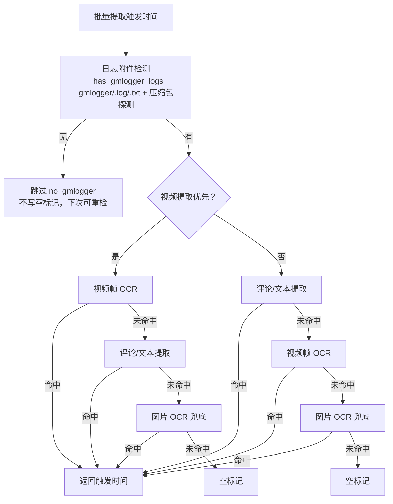
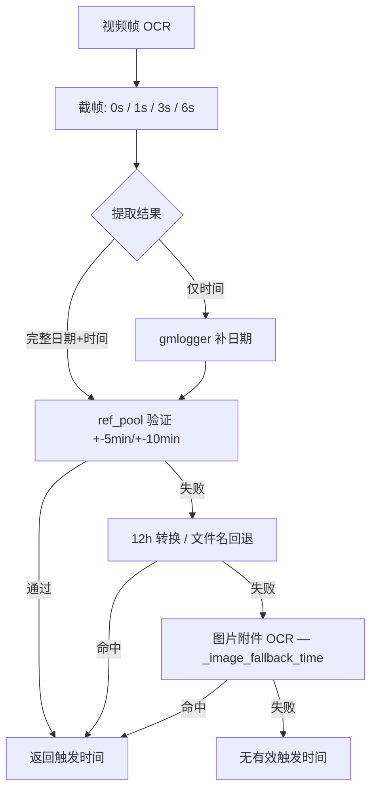

# 触发时间提取优化日志

本文档为触发时间提取的学习总结：仅记录**通用时间提取逻辑**的变更总结（逻辑变更时自动追加到历史变更记录）；
偶发失败、或无需修改提取逻辑的失败不入库。
失败原始记录（含顺便排查的根因）见 `timestudy/records/records_YYYY-MM-DD.csv`；分析快照见 `timestudy/error_patterns*.json`。

## 当前时间提取逻辑

### 批量提取流程（`_process_one` in `testing.py`）

### 视频帧 OCR 内部逻辑（`_diag_extract_time_from_video_simple`）

> **ref_pool 验证池**：包内 main.log 时间（权威，容差 5min）> 外层 gmlogger 文件名时间（补充，容差 10min）> gmlogger 上传时间（兜底，无包内/外层日期时启用）

## 历史变更记录

<b>1. 封面帧小字时钟 OCR 识别修复（2026-10-09）</b>

- **问题描述**：封面帧有清晰时钟但 OCR 读成乱码，时间提取失败
- **相关Bug号**：VCU-553755
- **根因**：EasyOCR 默认画布 1280 导致大图下采样，小字号/低对比度时钟识别能力不足
- **解决方案**：新增 _ocr_readtext 使用 canvas_size=2560、mag_ratio=1.5、降低阈值，统一应用到三处 OCR 调用点

<b>2. gmlogger 包内 main 文件日期遗漏修复（2026-10-10）</b>

- **问题描述**：视频封面读出 6:17，但未能匹配到包内 58-main.log_2026_10_10_6_18_4.gz 的正确日期
- **相关Bug号**：VCU-553973
- **根因**：① main_names[:5] 只取前 5 个 main 文件，30+ 文件时遗漏目标日期；② 外层 gmlogger 文件名有旧日期时不触发包内回退
- **解决方案**：遍历所有 main 文件解析时间（头读限 10 个）；始终下载包内取权威日期，包内优先、外层仅补充

<b>3. 标题仅时间时用创建日期补全导致日期错误（2026-10-10）</b>

- **问题描述**：标题含 10:31，评论区有完整 2026-10-6 10:31:00，但系统用 Jira 创建日期 2026-10-09 补全成 2026-10-09 10:31:00
- **相关Bug号**：VCU-553601
- **根因**：标题仅含时间无日期时，_extract_times_from_text 用 created_date 补全，但创建日期可能比实际事件日期晚几天；评论区有正确日期但未被检查
- **解决方案**：标题仅时间时，先从评论区查找同一时间的完整日期（时间差≤1秒），命中则用评论日期；未命中再回退 gmlogger 补充

<b>4. 视频 OCR 低置信度误识别过滤（2026-10-10）</b>

- **问题描述**：视频帧中手机屏幕显示 10:08，因清晰度低被 OCR 误读为 16:50，导致提取错误时间
- **相关Bug号**：VCU-553491
- **根因**：OCR 结果的置信度完全被忽略，低置信度的误识别文本直接参与时间提取，模糊帧的数字容易被错读
- **解决方案**：在 _ocr_readtext 中过滤置信度<0.3 的时间类文本（仅含数字/冒号/斜杠），三处 OCR 调用点统一生效

<b>5. 排查诊断未解压时视频OCR无条件覆盖文本提取结果（2026-10-10）</b>

- **问题描述**：文本路径已正确提取到 13:44:00（Initial Setting），但排查诊断仍返回视频 OCR 的 16:50:53
- **相关Bug号**：VCU-553491
- **根因**：gmlogger 未解压时 ref_pool 为空，视频 OCR 结果不经任何验证直接返回 success，覆盖了正确的文本提取时间
- **解决方案**：调整 _diag_verify_suggestion 中无包内时间戳分支的优先级：文本路径已提取有效时间时优先与 gmlogger 文件名时间印证，仅在文本无结果时才回退视频 OCR

<b>6. 水印相机时间过滤——优先使用设备屏幕时间（2026-10-10）</b>

- **问题描述**：视频帧同时存在水印相机时间(16:13)和设备屏幕时间(17:37)，OCR 误用水印时间
- **相关Bug号**：VCU-553532
- **根因**：水印相机叠加的时间往往不准确，但 OCR 不区分来源，水印时间可能被优先匹配
- **解决方案**：在 _ocr_readtext 中检测水印关键词(“水印”/“相机真实可靠”)，计算水印区域 bbox，过滤该区域内的时间类文本

<b>7. 视频未命中gmlogger时新增非视频图片OCR时钟兜底（2026-10-11）</b>

- **问题描述**：视频提取时间(17:27)与gmlogger包内/文件名时间(20:05)不命中，直接走兜底或返回空；附件中车机时钟截图(20:01)未被利用，导致提取失败
- **相关Bug号**：VCU-550243
- **根因**：图片OCR兜底 _diag_extract_time_from_images 仅在诊断流程且gmlogger组数>10时调用，主提取链路 _diag_extract_time_from_video_simple 在视频未命中gmlogger时从不参考非视频图片
- **解决方案**：新增 _image_fallback_time：视频未命中gmlogger后调用图片OCR，图片时钟(20:01)与参考时间(20:05)按时分接近(容差10分钟)则用参考日期+图片时间拼接返回；差距过大弃用回退原逻辑

<b>8. gmlogger 前置检查移至所有时间提取之前（2026-10-12）</b>

- **问题描述**：gmlogger 检查在评论/字段提取之后，导致无 gmlogger 的 Jira 仍执行了不必要的评论提取
- **根因**：_extract_one 中 gmlogger 前置检查位置不对，应在 fetch_issue 之后、所有时间提取之前
- **解决方案**：将 _has_gmlogger_logs 检查移到 fetch_issue 之后、评论/字段提取之前，无 gmlogger 直接返回 None（不写空标签，不属于通用报错，下次重新检查）

<b>9. gmlogger 下载增加双重超时保护（2026-10-12）</b>

- **问题描述**：156MB 的 gmlogger 压缩包下载卡住，阻塞整个提取流程
- **相关Bug号**：批量执行中偶发
- **根因**：httpx.stream() 的 read=300（5分钟等待响应头/数据块），服务器不响应时整个线程挂起
- **解决方案**：read 超时从 300s 降至 60s；增加 5 分钟 wall-clock deadline（time.monotonic），每下载 1MB 检查一次；体积阈值从 500MB 降至 200MB

<b>10. 移除视频兜底链路的外层文件名日期回退（2026-10-12）</b>

- **问题描述**：gmlogger 包内 main.log 日期获取失败时，仍用外层文件名的日期凑合，可能匹配到错误日期
- **根因**：_diag_extract_time_from_video_simple 中包内日期失败后回退到外层 gmlogger 文件名日期，外层文件名日期可能不准
- **解决方案**：包内日期为权威来源，获取失败时直接跳过视频兜底，不再用外层文件名日期凑合

<b>11. RapidOCR 检测阈值修复（2026-10-12）</b>

- **问题描述**：低质量视频帧 RapidOCR 检测不到文本，频繁回退 EasyOCR
- **根因**：RapidOCR 默认 box_thresh=0.5 太高（EasyOCR 用 text_threshold=0.25），阈值差一倍导致低质量帧检测失败
- **解决方案**：box_thresh 从 0.5 降至 0.3，text_score 设为 0.15（与应用层过滤阈值对齐）

<b>12. RapidOCR 图像放大规则从 EasyOCR 迁移（2026-10-13）</b>

- **问题描述**：EasyOCR 的 mag_ratio=1.5（图像放大1.5倍）未迁移到 RapidOCR，小字号识别能力下降
- **根因**：切换 OCR 引擎时只迁移了检测阈值，未迁移图像预处理参数
- **解决方案**：_rapid_ocr_readtext 对宽度<1280px 的图像自动放大 1.5x（INTER_CUBIC），bbox 坐标还原；已二值化/锐化的 ROI（_already_enhanced=True）跳过放大避免伪影放大

<b>13. gmlogger 内包日期提取优化——仅从 main 文件名提取（2026-10-13）</b>

- **问题描述**：VCU-555094 的 main.log 存在但头部 64KB 无日期匹配，提取时间 0 个，视频兜底被跳过
- **相关Bug号**：VCU-555094
- **根因**：原逻辑先尝试文件名解析，失败后解压读文件头部 64KB 提取日期，但 main.log 头部可能无日期格式
- **解决方案**：简化为仅从 main 文件名提取日期（不解压读内容），带去重；_diag_scan_entry_times 保持仅匹配 main.log 文件名

<b>14. gmlogger包内日期获取失败时回退到外层文件名日期继续视频兜底（2026-10-13）</b>

- **问题描述**：批量执行中多个 VCU（555132/555131/555130/555129/555127）因 gmlogger 压缩包过大(>200MB)被跳过，视频OCR和图片OCR全部未执行
- **相关Bug号**：VCU-555132, VCU-555131, VCU-555130, VCU-555129, VCU-555127
- **根因**：_diag_extract_time_from_video_simple 中包内日期获取失败时直接 return ""，跳过了整个视频兜底和图片兜底链路；但外层 gmlogger 文件名日期已在 gm_times 中解析，可以作为回退参考
- **解决方案**：包内日期失败时回退到外层 gmlogger 文件名日期继续视频/图片 OCR；仅当包内和外层均无日期时才跳过（OCR 无法验证）

<b>15. EasyOCR 延迟初始化——避免不必要的模型下载（2026-10-17）</b>

- **问题描述**：每次诊断都提前初始化 EasyOCR，即使 RapidOCR 已能处理仍触发中文模型下载（"Downloading recognition model"）
- **根因**：server.py 和 server_legacy.py 中 4+3 处 `_get_ocr_reader()` 在函数入口提前调用，EasyOCR 每次初始化都尝试下载缺失的 `zh_sim_g2.pth` 中文模型
- **解决方案**：所有提前初始化改为延迟加载——`_ocr_readtext` 内部仅当 RapidOCR 结果为空或置信度<0.3 时才初始化 EasyOCR；传参从 `reader` 改为 `None`，函数内部按需获取

<b>16. .log/.txt 文件纳入日志附件判断与文件名时间提取（2026-10-17）</b>

- **问题描述**：附件为 `[SFTC-1.21.24]server.log` 等 `.log`/`.txt` 文件时，被误判为"无gmlogger"跳过排查
- **根因**：`_has_gmlogger_logs` 仅检查文件名含 `gmlogger` 或 `main.log`，`.log`/`.txt` 后缀文件不匹配；`gm_atts` 筛选和 `_diag_gmlogger_times` 也仅识别 gmlogger
- **解决方案**：三处统一扩展——① `_has_gmlogger_logs` 附件名 `.endswith(".log")` / `.endswith(".txt")` 直接判定有日志，压缩包内探测同步扩展；② `gm_atts` 筛选加入 `.log`/`.txt`；③ `_diag_gmlogger_times` 和 `_extract_attachment_time` 用 `_COMPACT_RE` 通用正则解析文件名时间，提取不到则继续走视频/图片 OCR 链路，不解压

<b>17. 云端触发时间表再平衡与写入分配优化（2026-10-17）</b>

- **问题描述**：部分触发时间表超过 500 条上限（511/503/503/501），而其他表只有 1 条记录，存储分布不均
- **根因**：旧写入逻辑顺序找第一个有空位的表填满，导致前面的表都堆到 500，后面的表很空；历史数据可能超限但无自动修正机制
- **解决方案**：① 写入策略改为按剩余空间从大到小排序，优先填空位最多的表；② 新增再平衡 API `POST /api/trigger_time/rebalance`，扫描超限表（>500），将多余记录搬到余量最大的未满表；实测将 4 张超限表共 18 条记录搬入仅 1 条记录的表

<b>18. 评论区附件名时间提取与分钟频率中位数选择（2026-10-17）</b>

- **问题描述**：VCU-555714 错误提取了描述中的时间 `2026-10-07 20:50`，而评论区附件名（如 `58-main.log_2026_10_14_7_40_26.gz`）包含正确时间 `2026-10-14 07:40`
- **根因**：`_diag_verify_suggestion` 在 gmlogger 包内无法解析且无压缩包时，直接采纳评论区/描述提取的时间，未考虑附件文件名中的时间戳
- **解决方案**：① 新增 `extract_times_from_comment_attachments` 和 `extract_median_time_from_attachments` 函数，从评论区文本中匹配 `main.log_YYYY_MM_DD_H_M_S` 模式；② 分钟频率统计策略：统计各分钟值出现次数，筛选出现次数 >= max(2, max_count//2) 的分钟值，取中位数（如 38×2、39×4、40×4、41×4 → 候选 [38,39,40,41] → 中位数 40）；③ 在 `_diag_verify_suggestion` 的两个关键回退点插入附件时间校验：gmlogger 未交叉印证时、压缩包无 main.log 时
- **实现文件**：`src/clients/jira_client.py`（新增函数）、`src/web/server.py`（`_diag_verify_suggestion` 增加校验点）

<b>19. RapidOCR 置信度类型安全修复（2026-10-17）</b>

- **问题描述**：VCU-552013 视频 OCR 全部失败，报 `unsupported operand type(s) for +: 'int' and 'str'`
- **根因**：RapidOCR 返回的 `conf` 字段为字符串类型而非 float，`_ocr_readtext` 中 `sum((r[2] for r in results), 0)` 执行 `0 + "0.95"` 时抛出 TypeError
- **解决方案**：在 `_avg_conf` 计算前增加类型安全检查，将非数值类型的 conf 强制转为 float 或归零；同时修复 `server.py` 和 `server_legacy.py`；实测 VCU-552013 修复后视频 OCR 正确提取 `2026-09-24 16:34:00`

<b>20. gmlogger 压缩包内 main.log 日期提取与 ref_pool 空跳过修复（2026-10-19）</b>

- **问题描述**：VCU-557682 视频封面清晰显示 5:38，但视频 OCR 被完全跳过，返回“提取失败”
- **相关Bug号**：VCU-557682
- **根因**：① `_diag_extract_time_from_video_simple` step 3 用 `"gmlogger" in fn_lower` 跳过了 gmlogger 压缩包，导致 `gmlogger(1).7z` 内的 `main.log_2026_10_19_6_56_11.gz` 等带日期文件未被探测，`ref_pool` 为空；② `ref_pool` 为空时函数直接 `return ""` 跳过整个视频 OCR；③ 包内 main 文件名小时为非零填充的 `6`，`_COMPACT_RE` 的 `\d{2}` 无法匹配单数字小时，误把 `6_56` 解析为分钟 65；④ Jira 附件创建时间带时区 (`+08:00`) 与 OCR 解析的 naive datetime 比较时抛 `can't subtract offset-naive and offset-aware datetimes`
- **解决方案**：① 移除 step 3 的 gmlogger 跳过条件，让 gmlogger 压缩包也通过 `_diag_list_archive_entries` 探测内部 main.log 日期；② 为包内 main 文件添加下划线分隔格式的兆底解析（`20\d{2}_\d{1,2}_\d{1,2}_\d{1,2}_\d{1,2}`，支持 1-2 位小时/分钟）；③ `ref_pool` 为空时不再提前返回，继续尝试视频 OCR，并将 gmlogger 上传时间加入 `ref_pool` 作为兆底参考；④ 统一在 `_build_gmlogger_info`、`gm_ref_dt` 赋值、`_find_closest_gmlogger` 的 `video_upload` 处去除时区信息

<b>21. 诊断端点预归类保护与错误信息规则补全（2026-10-20）</b>

- **问题描述**：批量诊断失败记录时，预归类逻辑未生效，所有记录都走了完整 Jira 诊断流程（下载附件、视频 OCR 等），浪费时间和 API 调用
- **相关Bug号**：VCU-557688, VCU-557547（HTTP 504）; VCU-557666, VCU-557757（解压后未找到可识别的日志文件）
- **根因**：① 预归类仅在前端 `batch_pre_classify` 流程中执行，前端处理响应时未正确拆分 skip/need_analysis 记录导致全部进入诊断；② `_diag_pre_classify` 中 504/502 匹配规则仅匹配 "504 Gateway Timeout" 格式，实际错误信息为 "JIRA API 调用失败（HTTP 504）" 格式不匹配
- **解决方案**：① 在 `/api/troubleshoot/diagnose` 端点内增加预归类保护——诊断前检查 err_msg，命中跳过类别时直接返回 `needs_analysis: false` 不查 Jira；② `_diag_pre_classify` 扩展 504/502/503 匹配规则（支持 "HTTP 504"/"HTTP 502"/"HTTP 503" 格式）；③ "解压后未找到可识别的日志文件" 不跳过诊断（可能是压缩格式问题，实际有日志），走深度诊断下载附件确认
- **实现文件**：`src/api/routes/troubleshoot.py`（diagnose 端点预归类保护）、`src/services/troubleshoot_service.py`（`_diag_pre_classify` 规则补全）

<b>22. 批量写入人工审核结果 Pydantic 模型字段不匹配修复（2026-10-20）</b>

- **问题描述**：点击"批量写入人工审核结果"按钮后报"未匹配到任何记录"，但直接调用函数可正常匹配
- **根因**：`ReviewItem` Pydantic 模型只定义了 `bugid: str` 和 `review: str = ""` 两个字段，但前端发送的是 `bugid`、`done_time`、`human_reason` 三个字段。Pydantic 静默丢弃了未定义的 `done_time` 和 `human_reason`，导致 `batch_write_review` 函数收到空 `human_reason` 被 `if not human_reason: continue` 跳过所有记录
- **解决方案**：更新 `ReviewItem` 模型为 `bugid: str, done_time: str = "", human_reason: str = ""`，与前端发送字段完全匹配；同时在 `batch_write_review` 增加 bugid 兆底匹配（done_time 不精确匹配时取该 bugid 最新记录），增强健壮性
- **实现文件**：`src/schemas/troubleshoot.py`（`ReviewItem` 字段修正）、`src/services/troubleshoot_service.py`（兆底匹配）

<b>23. 视频帧提取范围从 [1,3,6] 秒改为前6帧 [0,1,2,3,4,5] 秒（2026-10-20）</b>

- **问题描述**：视频帧提取在封面帧未命中时，仅截取第1/3/6秒进行 OCR，采样点少且间隔大，容易错过清晰时钟帧
- **相关Bug号**：VCU-557464
- **根因**：原 positions=[1, 3, 6] 只有 3 个采样点，间距不均匀（1s→2s→3s），对于时钟位置变化较快的视频容易漏掉关键帧
- **解决方案**：将第二阶段帧提取从 `positions=[1, 3, 6]` 改为 `positions=[1, 2, 3, 4, 5]`，加上封面帧 [0]，总共覆盖前6秒，采样点从 4 个增加到 6 个，间距均匀（每秒1帧）
- **实现文件**：`src/services/server_legacy.py`（`_diag_extract_time_from_video_simple` 和 `_diag_extract_time_from_video` 两处）

<b>24. 视频 OCR 多级验证——视频文件名日期时间与 OCR 时间交叉确认（2026-10-20）</b>

- **问题描述**：VCU-557464 描述含两个时间（11:30 和 2026-10-11 17:08:47），视频帧0 OCR 提取到 11:30，视频文件名含 2026-10-14 11:30，但诊断返回了错误的 2026-10-11 17:08:47
- **相关Bug号**：VCU-557464
- **根因**：视频 OCR 提取到仅时间（11:30）后，只能用 gmlogger 文件名日期补充（2026-10-11），与 gmlogger 时间差距大未通过验证，时间被丢弃；视频自身文件名含完整日期时间（2026-10-14 11:30）与 OCR 时间完全匹配，但未被利用
- **解决方案**：新增 `_parse_video_filename_datetime` 函数从视频文件名提取完整日期时间（支持 YYYYMMDD_HHMMSS / YYYYMMDD_HHMM 等格式）；在两个视频提取函数的 OCR 仅时间处理路径中增加多级验证步骤——OCR 时间与视频文件名时间 HH:MM 完全匹配时，直接采用视频文件名日期时间（无需 gmlogger 验证），实现 OCR+文件名多级确认
- **实现文件**：`src/services/server_legacy.py`（新增 `_parse_video_filename_datetime`、修改 `_diag_extract_time_from_video_simple` 和 `_diag_extract_time_from_video` 的 OCR 仅时间路径）

<b>25. 全角冒号兼容——描述中“测试时间：11：30”提取失败修复（2026-10-20）</b>

- **问题描述**：VCU-557464 描述中有“测试时间：11：30”，使用了中文全角冒号（：），时间提取正则无法匹配
- **相关Bug号**：VCU-557464
- **根因**：`_normalize_datetime_text` 未处理全角冒号（U+FF1A），导致“11：30”不被任何时间正则匹配到
- **解决方案**：在 `_normalize_datetime_text` 中增加两条规则：①非数字后全角冒号+数字替换为“半角冒号+空格”（测试时间：11：30 → 测试时间: 11:30），避免与独立时间正则的 lookbehind 冲突；②数字间全角冒号直接替换为半角冒号（11：30 → 11:30）
- **实现文件**：`src/clients/jira_client.py`（`_normalize_datetime_text` 函数）

<b>26. 多源综合置信度评分——诊断流程从顺序提取+提前返回重构为全量提取+评分选择（2026-10-20）</b>

- **问题描述**：VCU-557464 描述同时含“11:30”和“2026-10-11 17:08:47”，原流程按优先级先取到评论时间 2026-10-11 17:08:47 就直接返回成功，未考虑视频提取的 2026-10-14 11:30:00 才是正确答案
- **相关Bug号**：VCU-557464
- **根因**：`_diag_run_core` 调用 `_diag_verify_suggestion` 采用顺序提取策略，评论匹配就返回 success，视频提取被跳过；即使提取了视频，也只做单源判断，无法对比多候选的置信度
- **解决方案**：重构 `_diag_run_core` 的提取流程为“多源独立提取 + 综合置信度评分”：
  1. 独立提取评论/标题/描述文本时间、视频 OCR 时间、图片 OCR 时间（互不依赖）
  2. 从描述+评论+标题中提取所有时间候选（`_extract_times_from_text`）
  3. 构建候选池并评分：完整日期时间文本=1分，仅时间=0.5分，视频独立=2分，视频+文本HH:MM匹配额外+1.5分，图片类似
  4. 选最高分候选作为建议时间（≥ 2.0分判定 success，否则 manual）
- **验证结果**：VCU-557464 重试后 suggested_time=2026-10-14 11:30:00（视频2.0+描述+视频1.5=3.5分），击败了 2026-10-11 17:08:47（仅描述单源 1.0分）
- **实现文件**：`src/services/server_legacy.py`（`_diag_run_core` 置信度评分逻辑）

<b>27. ISO 8601 解析变量名覆盖参数导致 time-only 误提取修复（2026-10-21）</b>

- **问题描述**：VCU-557464 描述中“11:30”被错误地补全为“2026-10-11 11:30:00”（用了同文本中另一个完整时间的日期）
- **相关Bug号**：VCU-557464
- **根因**：`_extract_times_from_text` 函数的 ISO 8601 解析代码中 `date_str, time_str, ...` 局部变量名与函数参数 `date_str` 冲突，ISO 匹配到“2026-10-11 17:08:47”后将 `date_str` 参数覆盖为“2026-10-11”，导致后续 `if date_str:` 守卫失效，time-only 模式被错误激活
- **解决方案**：将 ISO 8601 代码块的局部变量 `date_str, time_str` 重命名为 `_iso_date, _iso_time`，避免覆盖函数参数
- **实现文件**：`src/clients/jira_client.py`（`_extract_times_from_text` 函数）

<b>28. 多源置信度重构——“日期提供者+仅时间补全”架构（2026-10-21）</b>

- **问题描述**：旧评分架构对每个候选简单赋分，无法正确利用“仅时间”候选（如 OCR“11:30”）与“完整日期时间”源（如视频文件名“2026-10-14 11:30:00”）的交叉确认关系
- **相关Bug号**：VCU-557464
- **根因**：旧逻辑将所有时间统一打分，无法区分“完全一致”和“差距较大”的匹配质量，且不支持 gmlogger 文件名、视频文件名等作为“日期提供者”来补全仅时间候选
- **解决方案**：重构为“日期提供者 + 仅时间补全”架构：
  1. **日期提供者**（有完整日期的来源）：文本完整日期时间、视频文件名日期时间、gmlogger文件名日期时间、视频/图片 OCR（如有完整日期）
  2. **仅时间候选**（需要补全日期）：文本中的 time-only、视频 OCR 仅时间、图片 OCR 仅时间
  3. **补全匹配**：为每个仅时间候选找最佳日期提供者，按匹配质量赋分（完全一致=3分，≤30分钟=1.5分，≤1小时=0.5分）
  4. **兜底机制**：若置信度不足，下载 gmlogger 压缩包提取包内 main 文件名时间作为额外日期提供者
  5. **最终选择**：确认次数优先，其次得分
- **验证结果**：VCU-557464 结果 suggested_time=2026-10-14 11:30:00，确认数=2（视频文件名+视频OCR），得分=5.0（视频文件名1分+视频OCR1分+文本描述补全3分）
- **实现文件**：`src/services/server_legacy.py`（`_diag_run_core` 评分逻辑重构，新增 E 步包内main兆底）

<b>29. OCR 纠正容差优化 + 有 gmlogger 文件名时跳过压缩包探测（2026-10-22）</b>

- **问题描述**：VCU-559847 视频 OCR 读到 "15:27"（实际正确），但 `_correct_ocr_by_reference` 将其"纠正"为 "15:29:00"（参考 gmlogger 文件名时间 15:33，仅 1 位差异），导致最终提取结果 `2026-10-22 15:29:00` 不准确
- **相关Bug号**：VCU-559847
- **根因**：
  1. `_correct_ocr_by_reference` 容差仅 5 分钟，OCR 时间与 gmlogger 时间差 6 分钟时触发了不必要的纠正
  2. 有 gmlogger 文件名时间（三个文件日期一致且可解析）时，仍会下载探测其他非 gmlogger 压缩包，浪费资源
- **解决方案**：
  1. **容差扩大**：`_correct_ocr_by_reference` 的"无需纠正"阈值从 5 分钟改为 10 分钟，OCR 时间与 gmlogger 参考时间差 ≤10 分钟时直接保留原值
  2. **跳过压缩包探测**：`_diag_extract_time_from_video_simple` 中，如果 gmlogger 文件名已有可解析时间（`gm_times` 非空），跳过整个压缩包下载探测（step 3），只下载视频做 OCR
  3. **清除错误缓存**：删除 `data/video_time_cache.json` 中 `VCU-559847:IMG_1066.MOV` 的错误条目
- **优化效果**：
  - VCU-559847 场景（3个 gmlogger + 1个视频）：只下载视频，OCR "15:27" 不纠正，拼接 gmlogger 日期 → `2026-10-22 15:27:00`（正确）
  - 减少不必要的附件下载（gmlogger 分卷包 + 其他压缩包均不下载）
- **实现文件**：`src/services/server_legacy.py`（`_correct_ocr_by_reference` 容差、`_diag_extract_time_from_video_simple` 跳过逻辑）

<b>30. 触发时间自检与来源/偏差落库——把“提取成功”和“过滤命中”分开度量（2026-10-26）</b>

- **问题描述**：10 月共 3230 条分析记录（去重 2639 个 Jira），成功 2686（83.2%）、失败 544（16.8%）；失败中 **72.4%（394 条）是“时间过滤后日志为空”**。进一步只读核对发现这不是“没有触发时间”，而是**提取出来的时间与日志包对不上**：失败样本里问题时间几乎全部等于视频 OCR 缓存时间，日期差 1~2 天但时钟几乎一致（VCU-560297/VCU-560419/VCU-559995）、年份差 1 年（VCU-557671）、或遇到没有可解析日志包的纯视频单。更关键的是“成功”也不等于“准”：成功样本 40 条与日志包时间比对，**只有 20% 落在 30 秒内、28% 落在 1 分钟内**，其余 1 分钟~数小时。
- **相关Bug号**：VCU-560297、VCU-560419、VCU-559995（时钟对、日期错）、VCU-557671（年份错）、VCU-557593/VCU-558311（早于日志包）；数据侧统计口径见 10 月多维表格导出与 `timestudy/records/records_2026-10-*.csv`
- **根因**：
  1. **容差与窗口错配**：提取侧用 `_match_tolerance = 300/600` 秒（内层 main.log 5 分钟、仅外层文件名 10 分钟）判定“命中”，而 AI 侧日志过滤窗口实测**中位 6 秒、P90 30 秒**（从 10 月报告 `时间范围 [HH:MM:SS ~ HH:MM:SS]` 抓取 51 个窗口），两者相差 50~100 倍
  2. **时间分辨率不匹配**：`data/video_time_cache.json` 中 2901 条视频 OCR 结果里 **83% 秒位为 00（分钟级）**，分钟级时间天然无法命中秒级窗口
  3. **日期补全可选用到错误来源**：视频 OCR 只读到时钟时，日期可能取自 Jira 创建日期/分析日期等不可靠来源，导致“时钟对、日期错”
  4. **问题不可度量**：触发时间表只有 `jira号/触发时间/提取时间` 三列，没有“来源/参考时间/偏差/是否命中窗口”，无法区分“提取错”还是“窗口窄”；且自学习记录只在机器人诊断链路写入，批量分析链路完全没有记录
- **解决方案**：
  1. **触发表新增 5 列**：`时间来源`、`参考时间`、`时间差秒`、`窗口命中`、`时间状态`；`ensure_trigger_time_fields()` 首次写入时幂等补列（`create_bitable_field`），再平衡搬表时一并保留（原来只搬 3 个核心字段会丢列）
  2. **提取阶段登记日志包参考时间**：新增 `remember_ref_time()` / `_lookup_ref()`，`testing.py` 与 `trigger.py` 在拿到附件后用 `_diag_gmlogger_times()` 登记参考时间，写表时自动计算自检列
  3. **自检分级**：新增 `self_check_trigger_time()`——≤30 秒 `正常/窗口命中`、≤300 秒 `待确认/未命中`、>300 秒 `不可用`、无参考 `无参考`
  4. **分析前自检（P0-2）**：`pipeline._time_check_before_analysis()` 在调用 AI 前比对触发时间与日志包时间，>300 秒直接跳过分析并写明原因（`supplement_row` 与 `compare_bug_analysis` 两条链路），30~300 秒照常分析但标注 `时间自检`；阈值可通过 `ai_log_api.time_warn_offset_sec / time_reject_offset_sec` 调整
  5. **自学习记录接上批量链路**：`testing.py` 的 `_process_one` 提取成功后写 `_timestudy_record()`，包含来源、参考时间、匹配差秒、视频数、gmlogger 数，落盘 `data/timestudy/records.csv`
  6. **写入安全兜底**：新增 `_safe_update_records()` / `_safe_create_records()`，扩展列写入失败时自动退回核心字段重试，字段未迁移也不影响触发时间正常写入
- **验证结果**：
  - 10 月成功样本 40 条：与日志包时间差 ≤10 秒 4 条、11~30 秒 4 条、31~60 秒 3 条、1~5 分钟 19 条、5~60 分钟 5 条、>1 小时 2 条、日期错 2 条、无参考 1 条
  - 自检分级/扩展列写入/补列幂等/分析前自检共 6 个新用例全部通过；全量回归 56 passed
  - 服务重启后 141 条路由正常，`/api/trigger_time/batch_read` 返回 200
- **实现文件**：`src/services/trigger_ops.py`（扩展列、自检、参考时间登记、安全写入）、`src/api/routes/testing.py`（参考时间登记 + 自学习记录）、`src/api/routes/trigger.py`（参考时间登记）、`src/pipeline.py`（分析前自检）、`config/config.yaml`（自检阈值）、`tests/test_time_check.py`

<b>31. Initial Setting 字段短格式与时间-only 格式提取支持（2026-10-27）</b>

- **问题描述**：VCU-561149 的 Initial Setting 字段含 `10/26 13；43`（短格式），VCU-561124 含 `13；42`（仅有时间），均未被提取到，导致时间被错误 fallback 到 issue 创建日期或附件名时间
- **相关Bug号**：VCU-561149、VCU-561124、VCU-561120、VCU-561145
- **根因**：`_extract_from_custom_fields` 中 Initial Setting 字段只匹配完整格式（`YYYY-MM-DD HH:MM:SS` / `YYYY/MM/DD HH:MM:SS`），不支持 `MM/DD HH:MM` 短格式，也没有仅有时间 `HH:MM` 的匹配逻辑；分号分隔符也未被识别
- **解决方案**：
  1. 新增短格式正则 `_SHORT_DATE_RE` 匹配 `MM/DD HH:MM`（支持分号 `;`），无年份时从 issue 创建日期推断年份
  2. 新增时间-only 正则 `_TIME_ONLY_RE` 匹配 `HH:MM`（支持分号 `;` 和可选秒数），无日期时从 issue 创建日期推断日期
  3. 在 `_normalize_datetime_text` 中已支持分号 → 冒号标准化，两种新格式都放在 Initial Setting 字段全量扫描之后、操作顺序字段之前
- **实现文件**：`src/clients/jira_client.py`

<b>32. 禁止用上传时间/视频日期补日期 + 未通过日志包校验一律不返回（2026-10-27）</b>

- **问题描述**：时间批量提取跑出 139 条命中，抽查 21 条发现 7 条错误，其中 3 条是“时钟对、日期错”（如 VCU-561531 事件发生在 10-19，却提取成 10-27），2 条是“取到视频录制时间而非事件时间”，1 条 12h 误判，2 条 OCR 读错但视频文件名里明明是正确时间。按日志过滤窗口（中位 6 秒）统计，139 条里只有 3 条“正常”，65 条差 1~5 分钟，50 条差 5 分钟以上（含 7 条差 1 天以上）。
- **相关Bug号**：VCU-561531、VCU-561529、VCU-561077（日期错 3~8 天）、VCU-561423（视频录制时间≠事件时间）、VCU-561378（12h）、VCU-561556、VCU-561526（OCR 与文件名冲突）
- **根因**：
  1. **ref_pool 收了 gmlogger 上传时间**：`gm_ref_dt = att["created"]` 被 append 进 ref_pool，上传日（10-27）因此能“验证通过”10-19 的事件
  2. **日期补全优先用视频上传日期**：三处“仅时间”补全都先取 `video_att["created"]` 的年月日，直接把日期定成上传当天
  3. **未通过校验的候选仍然返回**：缓存未命中也记 `best_partial`，函数末尾“单视频/多视频兜底”直接返回，12h 候选也不看容差
  4. **旧日志包的 inner main 造成假阳性**：VCU-561526 的包内 main 是 10-25/10-26 的旧日志，OCR 误读的 21:12 恰好命中 10-25 的参考
- **解决方案**：
  1. 从 ref_pool 和 close_refs 中**彻底移除 gmlogger 上传时间**（只保留包内 main 与 gmlogger 文件名时间）
  2. 三处“仅时间”补全的日期改为**只取日志包日期**（`closest_gm.filename_time` → `gm_dates`），禁止再用视频上传日期
  3. **删除未验证的兜底返回**：缓存未命中不再记 partial；12h 候选必须满足容差；单/多视频 partial 一律丢弃，交由文本提取兜底
  4. 新增**同期性约束**：视频文件名带完整日期时间时，只接受与它相差 ≤6 小时的日志包参考，否则跳过该视频（识别“事后复现”的视频）
  5. 评分链路（`_diag_run_core`）移除“视频上传日期”日期提供者
  6. **问题排查链路同步统一**：`_diag_extract_time_from_video`（问题排查专用）移除 15min~1h、12h、完整时间、部分时间四类未验证兜底；视频文件名时间与 OCR 一致时也必须通过日志包校验才返回
- **验证结果**：清掉 7 条视频缓存后用新逻辑重跑，7 条全部修正：
  - VCU-561531：10-27 21:05 → **10-19 21:05**（日志包 10-19 21:14）
  - VCU-561529：10-27 14:23 → **10-20 14:51**（回退文本）
  - VCU-561077：10-26 15:38 → **10-23 15:38**（回退文本）
  - VCU-561423：16:56 → **13:25**（回退文本，日志包 13:26）
  - VCU-561378：17:47 → **15:48**（回退文本）
  - VCU-561556：15:17 → **17:09:55**（回退文本，与视频文件名一致）
  - VCU-561526：21:12 → **15:23:55**（回退文本，与视频文件名 15:26 一致）
- **批量纠正**：对“时间状态=不可用”的 50 条重跑（清视频缓存 → 新逻辑提取 → 文本兜底 → 写回云端并带自检列），**27 条值被纠正**（如 VCU-561531 10-27→10-19、VCU-561077 10-26→10-23、VCU-561481 10-27→10-26），23 条本来就对但时钟差 >5 分钟保持不变，0 失败；重跑后这 50 条状态分布：正常 7、待确认 11、不可用 32
- **实现文件**：`src/services/server_legacy.py`（`_diag_extract_time_from_video_simple` 的 ref_pool 构建、日期补全、兜底返回、同期性约束；`_diag_run_core` 日期提供者）

<b>33. 每日播报跨机器去重：状态写入飞书多维表格（2026-10-27）</b>

- **问题描述**：两台机器同时开服务时，同一个群同一天收到两次“昨日结论播报”
- **根因**：`data/daily_broadcast_config.json` 的 `last_run_date` 和 `data/broadcast_locks/` 都是本机文件，跨机器不共享；调度器只判断本机是否播过
- **解决方案**：
  1. 新增 `src/services/broadcast_state.py`：在飞书多维表格建「播报状态」表（群ID/播报日期/播报时间/机器/状态/详情/更新时间），所有机器读同一份
  2. 抢占式写入 + 并发复查：创建记录后 0.6 秒重读，同 (群,日期) 内 record_id 最小者胜出，落败方删除自己的记录并放弃
  3. claim 超过 30 分钟仍未完成（机器中途挂掉）允许接管，避免当天永远不播
  4. 调度器：先 `claim(群, 报告日期)`，返回 exists 就直接跳过并把本地 `last_run_date` 记账；云端不可用（unavailable）回退本地文件锁，保持旧行为不阻塞播报
  5. 手动单次播报也写状态（`record_result` 按 群+报告日期 upsert），定时任务不会把同一报告日期再播一次
- **验证结果**：6 个单测覆盖抢占/去重/回退/超时接管/并发落败删除，全部通过；真机冒烟：首次 claim=claimed、二次 claim=exists、finish 后状态=success，测试记录已清理
- **实现文件**：`src/services/broadcast_state.py`（新增）、`src/services/server_legacy.py`（`_bot_daily_broadcast` 返回结果并落状态、`_daily_scheduler_loop` 接入 claim）、`tests/test_broadcast_state.py`（新增）

<b>34. 问题排查查询 0 条：bugid_field 配置乱码导致整表被跳过（2026-10-27）</b>

- **问题描述**：问题排查“分析完成时间从周一 0 点起 + 分析结果=失败 + 人工审核为空”查出来 0 条，但同期多维表格里实际有 60 条失败记录（其中 36 条人工审核为空）
- **相关Bug号**：VCU-560912 等 36 条（查询窗口 2026-10-26 00:00 之后）
- **根因**：`config.yaml` 里 `feishu_bitable.bugid_field` 被写坏成乱码 `jira鍙?`，查询时 `fields.get("jira鍙?")` 恒为空 → 循环里 `if not jira_no: continue` 把所有记录跳过，最终 0 条；`_extract_record_row` 同样受影响（jira号 显示为空）
- **解决方案**：
  1. 新增 `_resolve_bugid_field(cfg, fields)` 三层兜底：配置字段在记录里存在 → 用配置值；否则用候选字段（jira号/Jira号/jira/Jira/bugid）；配置值明显损坏（含非 ASCII 且不在候选内）→ 回退 `jira号`
  2. 文件内 5 处 `cfg.get("bugid_field", "jira号")` 全部改为调用该函数，`_extract_record_row` 额外传入字段集合做真实匹配
  3. 修复本机 `config.yaml` 的乱码值（`jira鍙?` → `jira号`）；其他机器即使配置仍乱码，代码兜底也能正常查
- **验证结果**：修复后同一查询返回 **36 条**（失败 60 条 − 有人工审核 24 条）；把配置再改成乱码后模拟查询仍返回 36 条（兜底生效）；单测 5 个通过
- **实现文件**：`src/services/troubleshoot_service.py`、`config/config.yaml`（本地修复）、`tests/test_troubleshoot_field.py`（新增）

<b>35. 时间自检改为方向敏感 + 放宽日志包命名识别（2026-10-27）</b>

- **问题描述**：139 条提取结果复查发现三类判定逻辑问题：① 118 条可对比记录里 107 条“提取时间早于抓包时间”（中位早 156 秒），这是正常现象，但旧规则按对称偏差判定，把大量正确结果标成待确认/不可用；② 21 条“无参考”里有 8 条其实日志包文件名带时间（GMLog_20261027_152355.7z、pataclogger_2026_10_27_17_15_0.part01.rar、784da062_20261027_173855.7z），只是识别规则只认 gmlogger/.log/.txt；③ 4 条文本时间晚于抓包数小时到 6 天（VCU-561093 +6.3 天、VCU-561394 +24 小时、VCU-561359 +7.7 小时、VCU-561358 +17.5 分钟），逻辑上不可能
- **相关Bug号**：VCU-561093、VCU-561394、VCU-561359、VCU-561358、VCU-561518、VCU-561493、VCU-561480、VCU-561439
- **根因**：
  1. `self_check_trigger_time` 用 `abs(提取-参考)` 对称比较，而参考时间是日志包“抓包时间”，事件必然发生在其之前
  2. `_diag_gmlogger_times` 只识别文件名含 gmlogger 或 .log/.txt 的附件，其他日志包命名（GMLog_/pataclogger/哈希_日期）解析不出时间
  3. 文本提取（评论/字段/描述）没有“不能晚于抓包”的约束，评论里的时间可能是别的日期或误写
- **解决方案**：
  1. 自检改为方向敏感：晚于抓包 >300s → 不可用；30~300s → 待确认；早于抓包 ≤15 分钟 → 正常；15~60 分钟 → 待确认；>60 分钟 → 不可用
  2. 新增 `_parse_any_log_filename_time` 并用 `_LOG_NAME_HINTS`/`_LOG_ARCHIVE_SUFFIXES` 放宽日志包识别，视频/图片排除；`_has_gmlogger_logs` 同步放宽 logcat/dltlog/bllog/logger/pataclogger
  3. 对 139 条刷新自检列（参考时间/差秒/窗口命中/状态），对 12 条真正可疑重跑提取
- **验证结果**：139 条状态由「正常 3 / 待确认 65 / 不可用 50 / 无参考 21」变为「正常 108 / 待确认 10 / 不可用 8 / 无参考 13」；有参考从 118 升到 126；重跑修正 4 条（VCU-561526 21:12→15:23:55、VCU-561460 20:50→17:00:59、VCU-561497 12:00→17:38:55、VCU-561433 14:27→16:57:35）；剩余 8 条保留不可用待人工确认（如 VCU-561394 文本时间晚 24 小时）
- **实现文件**：`src/services/trigger_ops.py`（自检方向敏感）、`src/services/server_legacy.py`（日志包命名识别）、`tests/test_time_check.py`（更新分级用例）、`tests/test_log_name_parse.py`（新增 6 个用例）

<b>36. 触发时间自检列在所有提取路径都写入（2026-10-27）</b>

- **问题描述**：云端触发时间表里 8598 条有触发时间的记录中，**8345 条（97%）`时间来源` 和 `参考时间` 都是空的**，只有“时间批量提取”写入了自检列，其他入口（抽样提取、线上批量、自动检测、时间对比、单条提取、人工修正、机器人、pipeline、flow）写入时都没带来源/参考时间
- **根因**：自检列由 `_trigger_time_meta(trigger_time, source, ref_time)` 生成，但绝大多数调用点直接 `_save_trigger_time_to_cloud(bugid, tt)` / `_batch_save_trigger_times_to_cloud(items)`，没有传 `source` 和 `ref_time`；`_resolve_ref_time` 也不存在，缓存未命中时参考时间只能为空
- **解决方案**：
  1. 新增 `_resolve_ref_time(bugid, ref_time)`：显式值 > `_TRIGGER_TIME_REF_CACHE` 缓存 > 现场查 Jira 日志包文件名（`_diag_gmlogger_times`），解析后写回缓存
  2. `_save_trigger_time_to_cloud` 增加 `auto_ref=True`（默认开启），`source` 为空时写 `未标注`，避免出现“来源空白”的行
  3. 11 个写入点全部补上来源标注：pipeline(补充行)、flow(单Jira提取)、单条提取:x、线上批量(预提取)、自动检测、时间对比(读取)、人工修正、人工修正(批量)、机器人提取、本地CSV同步、批量应用(人工)；抽样提取额外带上参考时间
  4. 批量写入（时间对比读取、抽样提取）在循环里用 issue 附件名解析参考时间，避免额外请求
- **验证结果**：单测 5 个新增通过（缓存命中/现场解析/异常降级/默认来源/显式来源），全量 80 passed；真机验证 VCU-561531 写入后：参考时间=2026-10-19 21:14:43、差秒=583、窗口命中=否、状态=正常
- **遗留**：历史 8345 条仍为空，需要逐条查 Jira 回填（约 2~3 小时），可按时间窗口分批执行
- **实现文件**：`src/services/trigger_ops.py`、`src/api/routes/trigger.py`、`src/api/routes/testing.py`、`src/api/routes/flow.py`、`src/pipeline.py`、`src/services/server_legacy.py`、`tests/test_trigger_meta_paths.py`（新增）

<b>37. 按来源族统计准确率 + 文本提取增加“不能晚于抓包”校验（2026-10-27）</b>

- **问题描述**：139 条按来源族统计：视频 100 条（正常 85、待确认 5、不可用 1、无参考 9）；文本/字段 35 条（正常 23、待确认 5、**不可用 7**）；图片 OCR 4 条全部无参考。**7 条不可用全部来自文本提取**，其中 4 条是“晚于日志抓包时间”（VCU-561394 晚 24 小时、VCU-561359 晚 7.7 小时、VCU-561358 晚 17.5 分钟、VCU-561093 晚 6.3 天），逻辑上不可能
- **相关Bug号**：VCU-561394、VCU-561359、VCU-561358、VCU-561093（晚于抓包已修正）；VCU-561518、VCU-561493、VCU-561439（文本本身写的就是别的时间，需人工）
- **根因**：
  1. 视频提取有 ref_pool 校验，准确率明显更高（85% 正常，异常都是画面时钟与抓包时钟差 1~5 分钟）
  2. 文本提取（标题/字段/评论/描述）直接返回第一个“看起来像时间”的值，没有方向约束：评论里写的时间可能是隔天、隔小时、甚至别的故障时间
  3. 日志包抓包时间的解析能力之前只服务视频链路，文本链路拿不到
- **解决方案**：
  1. `jira_client` 新增 `parse_log_filename_time` / `get_log_capture_time`，识别 gmlogger/GMLog_/pataclogger/哈希名 等命名，`server_legacy._parse_any_log_filename_time` 改为复用
  2. `extract_trigger_time_from_issue` 外包一层方向校验：提取时间晚于抓包时间 5 分钟以上 → 判为不可信，改用日志附件名时间兜底；`skip_attachment=True` 时直接返回空并标记 `rejected_after_capture`
  3. 视频链路不变（已有 ref_pool 校验）
- **验证结果**：
  - 文本族 35 条重跑：4 条晚于抓包的记录被修正（VCU-561394 10-27 16:03→10-26 16:04:42、VCU-561359 →10-26 18:36:06、VCU-561358 →02:29:20、VCU-561093 →10-13 06:49:16），全部变成“正常”
  - 139 条总量：正常 108→**112**，待确认 10，不可用 8→**4**，无参考 13
  - 各族正常率：视频 85%、文本/字段 77%、图片 OCR 0%（无参考）
  - 新增 6 个单测（晚于抓包兜底/早于抓包保留/轻微晚于保留/无日志附件不校验/skip_attachment 直接拒绝/日志包名解析），全量 **86 passed**
- **遗留**：文本仍有 3 条不可用——VCU-561518（描述早 2.8 小时）、VCU-561493（字段早 1 小时）、VCU-561439（评论是 2 天前的时间），这类是业务描述本身写的时间与本次事件不一致，只能人工确认
- **实现文件**：`src/clients/jira_client.py`（方向校验 + 抓包时间解析）、`src/services/server_legacy.py`（复用解析）、`tests/test_text_time_guard.py`（新增 6 个用例）

<b>38. 数据看板：首次 85 秒 → 66 毫秒（启动预热 + 前端 SWR 缓存 + 时区修正）（2026-10-27）</b>

- **问题描述**：每次打开「数据看板」都要等很久；实测冷启动首次请求 `/api/dashboard/data` 耗时 **84.6 秒**，`/api/dashboard/dates` 26.3 秒，之后 8ms；切页面时前端还会重复请求
- **根因**：
  1. 后端其实有 3 层缓存（主表全量 2 分钟、看板数据今天 2 分钟/历史 24 小时、批次详情 5 分钟/24 小时、日期列表 5 分钟），但**冷启动第一次必须真算**：主表 6000+ 条 + 当天 CSV，约 85 秒
  2. 前端没有任何缓存：`mounted()` 就 `loadDates() + loadDashboard()`，组件重新挂载/切页就再拉一遍
  3. `isToday` 和默认日期用 `new Date().toISOString()`（UTC），东八区**每天 0~8 点会把“今天”算成昨天**，导致自动刷新失效、默认打开错日期
- **解决方案**：
  1. 服务启动后延迟 8 秒在后台线程预热 `dashboard_data(今天)` 与 `dashboard_dates()`，把 85 秒摊到启动期
  2. 新增 `frontend/src/composables/apiCache.ts`：内存缓存 + 同 URL 并发去重 + 可选 sessionStorage，`cachedApi(url, {ttl, force})`
  3. 看板接入缓存：日期列表 5 分钟、看板数据今天 60 秒/历史 6 小时；有缓存时不显示 loading；手动刷新/生成报告后 `invalidateCache('/api/dashboard/')` 强制重取；预热范围改为滚动最近 3 个月（原来写死 2026-08~10）
  4. 日期相关统一改本地时区 `todayLocal()`，修复 0~8 点日期错误
- **验证结果**：加预热后同一台机器冷启动首次请求 **66 毫秒**（原 84,627 毫秒），第二次 8 毫秒；前端构建通过（`index-rovceCTY.js`）
- **实现文件**：`src/api/app.py`（启动预热）、`frontend/src/composables/apiCache.ts`（新增）、`frontend/src/panels/DataDashboardPanel.vue`（缓存接入 + 时区修正）

<b>39. 看板缓存按“历史永久 + 当天批次增量”优化（2026-10-27）</b>

- **问题描述**：启动预热后首次打开看板已从 85 秒降到 66 毫秒，但仍有浪费：① 历史日期缓存 TTL 只有 24 小时，过期后会重新拉全量文档；② 当天每次刷新都会把所有批次文档重新下载，包括已经分析完的批次
- **根因**：
  1. `_DASHBOARD_HISTORY_TTL = 86400`，历史数据其实不会变，不该过期
  2. 当天刷新走 `_fetch_cloud_batches_for_date`，整日全量重拉，没有“已完成批次”的概念
  3. `force` 参数会连带把已完成批次也重算
- **解决方案**：
  1. 历史日期 TTL 改为 10 年（等价永久），只有 `force` 或删除云端 JSON 才重算
  2. 新增 `_batch_settled()`：`bt_match >= total` 或 `has_report` 或 `all_failed` 视为“已执行且分析完”
  3. 新增 `_refresh_batches_incremental()`：当天只重新下载**未完成/新增**批次，已完成批次直接复用；`force` 只忽略整日缓存、不重算已完成批次
  4. 新增云端批次文件列表缓存（5 分钟），避免每次刷新都递归列文件夹
  5. 批次详情只对“本次刷新且有变化”的批次重算，复用批次沿用缓存详情；详情回写云端批次缓存供下次判断
  6. 前端 `force=1` 参数贯通，手动刷新/生成报告走增量
- **验证结果**（真实云端 6 个批次）：
  - 预热后首次：91 ms；命中缓存：16 ms
  - `force=1` 增量刷新：**复用 5 批、刷新 1 批**，耗时 3023 ms → **544 ms**，详情只算 1 批
  - 历史日期 2026-10-26：首次 28084 ms，之后永久命中（15 ms）
- **实现文件**：`src/api/routes/report.py`（`_batch_settled`/`_refresh_batches_incremental`/云端列表缓存/详情回写/force）、`frontend/src/panels/DataDashboardPanel.vue`（force 参数）

<b>40. 批量执行过滤：日志一行汇总 + 前端展示过滤明细（2026-10-27）</b>

- **问题描述**：用户看到日志只有「AI初步分析过滤: 排除 3 条」，误以为本周只识别出 3 条已分析的记录，实际已执行 100+ 条
- **根因**：过滤分四步（多维表格去重 → 云端同来源去重 → 内存去重 → AI 初步分析过滤），日志分散在多行，且最后一行只显示 AI 字段过滤的数量；其余 180 条在去重阶段已排除，用户看不到
- **数据核对**：本周带 `customfield_13714` 的 bug 共 120 条，其中 118 条已在云端批量执行记录、120 条都在多维表格，因此去重后剩余候选里只剩 3 条带 AI 初步分析
- **解决方案**：
  1. 新增一行汇总日志：`过滤汇总(模式): 候选 N → 表格去重 X / 云端去重 Y / 内存去重 Z / AI初步分析 A → 剩余 M`；各分步日志降为 debug
  2. 接口返回 `counts` 结构化计数（total/bitable/cloud/memory/ai/remaining）
  3. 前端在「过滤选项」下方新增过滤结果明细：候选 → 表格去重 / 云端去重 / 内存去重 / AI初步分析 → 剩余，用标签展示，并附原始提示文案
- **验证结果**：用 5 个 Jira 号实测：返回 `counts={total:5, bitable:0, cloud:1, memory:0, ai:1, remaining:3}`，日志输出单行 `过滤汇总(云端去重): 候选 5 → 表格去重 0 / 云端去重 1 / 内存去重 0 / AI初步分析 1 → 剩余 3`；前端构建通过
- **实现文件**：`src/api/routes/testing.py`（过滤汇总日志 + counts）、`frontend/src/panels/BatchAiPanel.vue`（过滤明细展示 + 样式）

<b>41. 问题排查：时间判定改为方向敏感 + 展示/批量应用升级（2026-10-27）</b>

- **问题描述**：问题排查的时间校验用 ±300 秒对称窗口，把大量“早于抓包 1~15 分钟”的正常时间判成“需修正”；诊断表只有纯文本，看不出差多少、该不该应用
- **相关Bug号**：VCU-561531（正常时间被判 manual）、VCU-561518（应判不可用但无判定）
- **根因**：
  1. `_diag_verify_suggestion` 用 `abs(时间-包内时间戳) <= 300` 判定，未考虑“事件必然发生在抓包之前”（实测批量数据 107/118 条早于抓包，中位早 156 秒）
  2. 诊断结果没有结构化的“抓包时间/差值/判定/依据”，前端只能展示一段文字
  3. 诊断缓存没有版本号，时间提取逻辑升级后旧结论继续生效
  4. “一键应用”不区分置信度，可能把方向异常的建议写回
- **解决方案**：
  1. 新增 `_diag_time_check()`：抓包时间优先取**日志包文件名时间**（包内时间戳可能是历史轮转日志，不能当抓包时刻），再用 `self_check_trigger_time` 做方向敏感判定，输出 status/ref_time/delta_sec（带方向）/need_fix/evidence
  2. 诊断结果新增 `time_check` 字段（score 路径与 gmlogger 主路径都注入）；方向正常但原判 manual 的升级为 success，方向异常的 success 降级为 manual
  3. 诊断缓存加 `_DIAG_CACHE_VERSION=2`，旧缓存自动失效重算
  4. 前端批量诊断表新增列：抓包时间 / 差秒（带早/晚）/ 时间判定标签 / 依据（可点开查看证据清单：来源/时间/与抓包差）
  5. 表格上方新增统计条：本次诊断 N 条 → 正常/待确认/不可用/无参考
  6. “一键应用正确时间”只应用非“不可用”的建议（高置信度过滤）
- **验证结果**：真机诊断 2 条：VCU-561531 → status=正常、delta=0、verify=success；VCU-561518 → status=不可用、delta 有方向、verify=manual；前端构建通过，全量 86 passed
- **实现文件**：`src/services/server_legacy.py`（`_diag_time_check` + 结果注入 + 判定升降级）、`src/services/report_ops.py`（诊断缓存版本号）、`frontend/src/panels/TroubleshootPanel.vue`（列/统计条/依据弹层/高置信度应用）

<b>42. 问题排查新增“当前触发时间 vs 建议时间”对比（2026-10-27）</b>

- **问题描述**：诊断表只能看到建议时间，看不到记录当前使用的触发时间，无法判断“改前/改后”差多少
- **解决方案**：
  1. 后端 `_diag_time_check` 增加 `current_time` 参数，返回 `current={time,status,delta_sec}`（当前时间的方向判定）与 `change_sec`（建议时间相对当前的变化，正=更晚）
  2. 诊断两条主路径（多源置信度、gmlogger 验证）都传入当前 `problem_time`
  3. 前端批量诊断表：「当前触发时间」列内联当前判定标签；新增「建议时间」列并显示变化量（早/晚 N 分钟）
- **验证结果**：VCU-561518 实测：current=14:26（不可用、早 169 分钟），建议为空、change=0；前端构建通过
- **实现文件**：`src/services/server_legacy.py`（current/change_sec）、`frontend/src/panels/TroubleshootPanel.vue`（两列 + 变化量展示）

<b>43. 视频 OCR 优化：关帧差法、扩帧窗口、ROI 优先、修正耗时日志（2026-10-27）</b>

- **问题描述**：视频时间提取靠“前 6 帧 OCR”，存在三个问题：① 帧差法回退几乎不生效却要额外耗时；② 时钟偶尔第 5 秒才出现，窗口没有余量；③ 单帧 OCR 不稳定（相邻帧时有时无）
- **实测数据**：
  - 帧差法：10-27 共尝试 **55 次，成功 0 次**（OCR 结果为“西助中心 #林物有容 A”这类垃圾文本），每次多花 2~3 秒
  - 6 个真实视频抽样：5 个在 0~5 秒内命中，1 个第 5 秒才命中；单帧存在“空/有”抖动（如 3 秒空、4 秒有）
  - OCR 耗时日志标签写错：rapidocr `elapse` 顺序是 det/cls/rec，原日志把 cls 和 rec 标反，误以为 cls 占 1 秒
- **解决方案**：
  1. 帧差法加开关 `_VIDEO_FRAME_DIFF_ENABLED=False`（默认关闭，保留代码）
  2. 截帧窗口 0~5s 改为 **0~8s 每秒 1 帧 + 10/15s 兜底帧**（命中即停，多数视频只跑 1~3 帧）
  3. 新增 `_ocr_frame_regions()`：先裁**顶部状态栏**与**右下任务栏**放大 2.5x 做 ROI OCR；ROI 已读到时间就跳过整帧 OCR（省一半调用），否则再整帧兜底
  4. `_rapid_ocr_readtext` 关闭角度分类 `use_cls=False`（实测 cls 仅 0.0~0.04s，收益小但无副作用）
  5. 修正 OCR 耗时日志标签为 det/cls/rec 正确顺序
- **验证结果**：VCU-561531 仍命中 2026-10-19 21:05:00（第 3 秒），VCU-561519 仍命中 2026-10-27 13:53:00（第 6 秒），全量 86 passed
- **实现文件**：`src/services/server_legacy.py`（截帧窗口、ROI OCR、帧差法开关、cls 关闭、日志标签）

<b>44. 删除帧差法时钟定位（2026-10-27）</b>

- **问题描述**：帧差法（自动定位“变化区域”再 OCR）在真实录屏里完全失效，且每次多花 2~3 秒
- **实测数据**：10-27 共尝试 **55 次，成功 0 次**；OCR 结果为“西助中心 #林物有容 A”“卷星姆 30 善…”等垃圾文本；连通域选中的是内容区（如 bbox=[0,336,402,1080]）而不是状态栏时钟
- **根因**：算法假设“画面里只有时钟在变化”，但录屏中视频播放/动画/滚动的内容区像素变化远大于状态栏时钟，连通域必然选中内容区
- **解决方案**：整段删除
  1. 删除 `_frame_diff_clock_ocr()` 函数（约 4800 字符）
  2. 删除调用块（约 6400 字符）与 `_VIDEO_FRAME_DIFF_ENABLED` 开关
  3. 更新两处提到“帧差法”的注释
- **验证结果**：编译通过、全量 86 passed；VCU-561531 仍命中 2026-10-19 21:05:00（第 3 秒）、VCU-561519 仍命中 2026-10-27 13:53:00（第 6 秒）
- **实现文件**：`src/services/server_legacy.py`（净删除约 1.1 万字符）

<b>45. 视频 OCR：多帧投票 + 静帧跳过 + ROI 兜底顺序调整（2026-10-27）</b>

- **问题描述**：单帧 OCR 不稳定（相邻帧时有时无、偶发误读）；静态画面会重复 OCR 浪费时间；上一轮把 ROI 放在整帧之前，实测 3 个视频 ROI 一次都没命中，反而每帧多一次 OCR
- **实测数据**（3 个视频）：整帧 OCR 全部命中（0s/2s/5s），ROI 命中 0 次；顺序调整后 VCU-561533 从 18.1s 降到 7.8s
- **解决方案**：
  1. **整帧优先、ROI 兜底**：每帧先整帧 OCR，整帧文本里没有时间才裁状态栏/任务栏放大 2.5x 再 OCR（实测 ROI 很少需要，但保留兜底）
  2. **多帧投票**：把每帧已 OCR 的文本收集起来，循环结束仍未命中时，对“同一 HH:MM 出现 ≥2 次”的候选投票，且必须通过参考池校验才采用（复用文本，不重复识别）
  3. **静帧跳过**：相邻帧做 32x18 灰度签名比对，差异 ≤1.5 视为相同，跳过 OCR（静态画面常见）
  4. 新增 `_VIDEO_OCR_STATS` 统计（videos/roi_frames/full_frames/skipped_frames/vote_hits），便于后续调参
- **验证结果**：VCU-561531 → 2026-10-19 21:05:00（第 3 秒）、VCU-561519 → 2026-10-27 13:53:00（第 6 秒）、VCU-561533 → 2026-10-27 17:50:00（第 1 秒）；全量 86 passed；统计显示 10 帧中整帧命中 10、ROI 0、投票 0（投票是兜底路径）
- **实现文件**：`src/services/server_legacy.py`（整帧优先、`_vote_from_texts`、`_frame_signature`/`_same_frame`、`_VIDEO_OCR_STATS`）

<b>46. 视频 OCR 统计可观测化：每视频日志 + 查询接口（2026-10-27）</b>

- **问题描述**：上一版新增的 `_VIDEO_OCR_STATS` 只存在进程内存里、没有任何输出，无法用“几天真实数据”判断 ROI 兜底是否值得保留
- **解决方案**：
  1. 每个视频处理结束（`finally`，含早退/失败）打一行 INFO：`视频 OCR 统计(<文件名>): 整帧帧=N ROI帧=M 跳过帧=K 投票命中=V`
  2. 新增只读接口 `GET /api/test/video_ocr_stats`，返回进程内累计的 `videos/roi_frames/full_frames/skipped_frames/vote_hits`
- **使用方式**：跑几天批量提取后看日志里的 `视频 OCR 统计` 行，或直接请求接口；若连续多天 `ROI帧=0`，即可删掉 ROI 兜底代码
- **验证结果**：编译通过、全量 86 passed；接口与日志均在现有流程内，不影响提取结果
- **实现文件**：`src/services/server_legacy.py`（每视频统计日志）、`src/api/routes/testing.py`（统计接口）

<b>47. CI 无配置导致后端测试失败：示例配置 + 依赖用例跳过（2026-10-28）</b>

- **问题描述**：GitHub Actions 的 `backend-tests` 失败（4 分 54 秒），本地却是 86 passed
- **根因**：`config/config.yaml` 被 gitignore，CI 里没有该文件；而 `tests/conftest.py` 的 session fixture、`db.init_db()`（建 `kb_analysis` 表用 `audit` 段的列名）都直接依赖它，缺文件时在收集/初始化阶段就报错
- **解决方案**（按“跳过依赖真实配置的用例”方案）：
  1. 新增 `config/config.example.yaml`：保留全部配置段与字段名，字符串值脱敏为空，mock 开关置真；作为 CI/新环境的配置模板
  2. `tests/conftest.py`：无 `config.yaml` 时自动加载示例配置，并补 `database.url/table_name`、`audit` 表结构字段兜底，避免拼出非法 SQL；新增 `DSH_SIMULATE_NO_CONFIG=1` 便于本地模拟 CI
  3. `tests/test_audit.py` 整模块、`tests/test_web.py` 的两个用例（`test_index_and_overview`、`test_report_api`）加 `requires_config` 标记，无配置时自动跳过
- **验证结果**：
  - 模拟 CI（`DSH_SIMULATE_NO_CONFIG=1`）：**80 passed, 6 skipped**
  - 本地（有 config.yaml）：**86 passed**
- **实现文件**：`config/config.example.yaml`（新增）、`tests/conftest.py`、`tests/test_audit.py`、`tests/test_web.py`

<b>48. Allure 启动器改为自动探测 Java，JRE 不再入库（2026-10-28）</b>

- **问题描述**：仓库里跟踪着 `tools/jdk-17.0.20+8-jre`（33.8 MB，316 个文件），但本地实际是 0.1KB 的占位文件（旧的 LFS 指针残留），`allure-serve.bat` 又写死了 `d:\program16` 路径，换机器/换目录就失效
- **分析结论**：项目**运行时不依赖 Java**（`src/` 无 java 调用）；只有 `allure-serve.bat` 为了看 pytest 的 Allure 报告才需要 JRE，属于可选工具
- **解决方案**：
  1. `allure-serve.bat` 重写：按 `JAVA_HOME` → PATH 的 `java` → `tools\jdk-*`（自动跳过小于 10KB 的占位文件）顺序探测；路径全部改为 `%~dp0` 相对路径
  2. 新增 `check` 模式：只检查 Java/allure/测试结果，不启动服务
  3. 新增 `--download`：无 Java 时可自动下载 Temurin JRE 17 到 `tools\`（约 40MB），下载解压后继续；失败给出明确提示
  4. JRE 保持不入库（已在 `.gitignore` 中 `tools/jdk-*/`），各机器按需下载
- **验证结果**：`allure-serve.bat check` 在本机（无系统 Java、JRE 为占位文件）正确提示“未检测到可用的 Java”，退出码 1，不再出现“文件不存在”式的莫名报错
- **实现文件**：`allure-serve.bat`

<b>49. 事故记录：拉取远端时误删 config/data/dist，已恢复（2026-10-28）</b>

- **背景**：远端比本地多 3 个提交（可观测性模块 + trigger 表格提取增强），共 **1133 个文件**（其中 `case_reports/` 800 个）；GitHub 网络极不稳定（反复 `Connection reset` / `Timeout`）
- **事故经过**：为减少下载量启用了 `git sparse-checkout` 并尝试 merge；合并过程中网络中断，之后发现以下本地文件丢失：
  - `config/config.yaml`（8.5KB，真实配置，含 Jira token / 飞书 app_token 等）
  - `data/` 下内容（`video_time_cache.json` 等，`daily_broadcast_config.json` 被跟踪）
  - `frontend/dist/`（前端构建产物）与 `frontend/node_modules/`
- **恢复过程**：
  1. `config.yaml`：从 pytest 临时目录 `pytest-of-Administrator/pytest-72/test_config_save_and_reload0/config.yaml` 找到真实配置副本（真实 Jira 地址 / 44 位 token / 飞书 table id），还原后关闭 mock、输出目录改回 `docs/reports/logs`
  2. `data/daily_broadcast_config.json`：从 git 恢复；`video_time_cache.json` 为缓存，后续重新提取时自动重建
  3. 前端：`npm ci` + `npm run build` 重建 `frontend/dist`
  4. 验证：全量 **86 passed**；真实调用 Jira `VCU-561531` 成功（0.4 秒），确认 token 有效
- **未完成**：远端合并（网络下载卡在约 18MB 后超时）；本地 3 个提交待推送；timestudy 48 条完好
- **教训**：`sparse-checkout` / merge / 大批量拉取前，先备份 `config/` 与 `data/`（均为 gitignore，git 无法恢复）

<b>50. 网络受限下完成远端合并：只拉代码文件 + 本地构造 merge 提交（2026-10-28）</b>

- **问题描述**：GitHub 主站 HTTPS 完全超时，`git fetch/merge` 拉取 1133 个文件的包反复在 ~18MB 处中断；远端分叉包含可观测性模块、trigger 提取增强，以及 `case_reports/`（800 个）和 `docs/2026-10-27/`（290 个）等数据文件
- **排查与方案**：
  1. 测速发现 `github.com` 不通，但 **`codeload.github.com`（1.9s）与 `api.github.com`（0.3s）可用**
  2. 按目录统计变更：代码文件仅 **34 个**，其余 1100+ 是数据文件
  3. 用 GitHub API `contents?ref=a6748e25` 逐个下载 34 个代码文件（2 个大文件用 `Range` 分段补齐），并用 `git hash-object --no-filters` 校验与远端 blob 完全一致
  4. 本地构造合并提交：`read-tree HEAD` → 用远端 blob 覆盖 34 个代码文件 → `write-tree` → `commit-tree -p HEAD -p a6748e25`
  5. 合并并推送后，修复远端遗漏的 `trigger.py` 缺失 `Form` 导入（远端代码本身跑不起来），重建前端
- **结果**：合并提交 `4f5c8620`，修复提交 `3775acfe`；**86 passed**；推送成功（`a6748e25..3775acfe master -> master`），本地/远端 0/0
- **未拉取（本地忽略）**：`case_reports/`（远程有备份）、`docs/2026-10-27/`、`reports/`、`tools/jdk-*`
- **经验**：网络封锁时不要硬拉整包，先按目录统计变更规模，只取代码文件再本地构造 merge；`codeload` 与 `api.github.com` 常比 `github.com` 更易访问

<b>51. 表格对比新增时间判定、00:00 判失败、整天偏移告警、多视频按创建时间排序（2026-10-28）</b>

- **问题描述**：表格提取页只有“差值 ≤5 分钟=一致”的判断，27 条实测“不一致”里 9 条其实是**表格时间写错**（年份/日期笔误）、9 条两边都错，页面无法区分；另外 `00:00:00`（只有日期没时分）被当成普通不一致
- **实测依据**（27 条抽样对 Jira 创建时间/日志包抓包时间）：
  - 提取对、表格错：9 条（如 VCU-472018 表格写 07/30，实际 04-18）
  - 提取错、表格对：6 条（如 VCU-490187/490191 早 1 天）
  - 两边都错：9 条
  - 待确认：3 条
- **解决方案**：
  1. 新增 `_judge_compare_time()`（`src/api/routes/trigger.py` 模块级）：以日志包抓包时间为事件上限、Jira 创建时间为表格时间上限，输出 **正常 / 表格错误 / 提取错误 / 两边都错 / 日期待确认 / 待确认 / 提取失败**
  2. `00:00:00` 直接判失败（只有日期没有时分）
  3. 提取时间与表格时间相差整天（±2 分钟内）→ 标“日期待确认”
  4. `_rank_videos()` 增加 `created_dt` 参数：多次复现的 bug 优先选文件名时间最接近 Jira 创建时间的视频
  5. 前端对比表新增“时间判定”列（颜色标签），SSE 与导出 CSV 同步增加 判定/抓包时间/创建时间 字段
- **验证结果**：新增 `tests/test_compare_judge.py` 8 条用例全过；全量 **94 passed**；前端构建通过
- **实现文件**：`src/api/routes/trigger.py`、`src/services/server_legacy.py`、`frontend/src/panels/TimeExtractPanel.vue`、`tests/test_compare_judge.py`

<b>52. 视频提取纠偏：以 Jira 创建时间为基准修正日期/会话（2026-10-28）</b>

- **问题描述**：18 条时间对比“提取错误”的 Jira 重新提取后，多数仍返回错误值：日期早一天（490187/490191/483209/499747）、取到另一段会话的日志（543222 取 10-10、541498 取次日）、提取为空（504050/484436）
- **根因**：
  1. 附件里没有可解析的日志包/视频文件名日期时，日期来源不可靠（用了上传日/前一天）
  2. 多次复现的 Bug 附件里有多套日志包，旧逻辑没按“最接近 Jira 创建时间”选择
  3. 视频界面读到的时钟可能不是录制时刻
- **解决方案**（`server_legacy.py` 新增 `_fix_video_time_against_created()`，作为 `_diag_extract_time_from_video_simple` 的包装）：
  1. 提取为空 → 用“最接近创建时间且不晚于创建时间”的日志包抓包时间；其次视频录制时间；再次“视频文件名时分 + 创建日”
  2. 提取时间晚于创建时间 → 日期对齐最接近创建的日志包（与日志包差 ≤2 小时），否则直接用日志包时间
  3. 无任何日期参照且日期与创建日不同（相差 ≤3 天）→ 改用创建日期
  4. 提取时间与视频录制时间相差 >1 小时 → 以录制时间为准（OCR 可能读到界面旧时钟）
- **验证结果**：对 26 条不一致样本重跑，`490187/490191` → 05-20 13:20/13:31；`483404` → 04-16 17:41；`477588` → 04-22 15:34；`483209` → 04-30 14:40；`532923` → 08-16 13:55；`504050` → 06-17 14:35；`530955` → 08-12 14:17；`541498` → 09-03 18:24；`543222` → 09-07 16:59；全量 **94 passed**
- **数据修正**：26 条 ADP 锚点已按证据更新（原值备份 `data/_adp_anchor_backup.json`），其中 `VCU-486898` 依据“创建前 6 分钟的录制视频”再修正为 2026-05-13 11:47:11；`VCU-553576` 无证据记录已按你要求删除
- **实现文件**：`src/services/server_legacy.py`（`_fix_video_time_against_created`）

<b>53. ADP 锚点数据清理 + 多会话“多选一”规则说明（2026-10-28）</b>

- **数据清理**：按“无提取时间则删行”的规则，从 ADP 分析结果表删除 4 条记录：
  - `VCU-490496`、`VCU-484436`、`VCU-490385`（重提后仍无可用时间）
  - `VCU-553576`（无任何附件/描述，证据不足）
  - 表记录数 **179 → 175**，无残留
- **有争议的保留**：`VCU-554053` 附件含 06-05 / 06-08 / 06-09 多段视频，**选定 2026/06/08 09:47**（与日志抓包 09:51、原表格 10:12 最接近）
- **多会话“多选一”规则**（已实现，供后续复用）：
  1. 多日志包：先过滤掉晚于 Jira 创建时间的，再取**最接近创建时间**的那一份
  2. 多视频：`_rank_videos(..., created_dt=)` 按视频文件名时间与创建时间的距离排序，录制时间最接近创建时间的优先
  3. 提取结果与视频录制时间相差 >1 小时：以录制时间为准
  4. 结果晚于创建时间：日期对齐到最近日志包（与日志包差 ≤2 小时），否则直接用日志包时间
  5. 仍无法判定（无日期参照/多会话都合理）：保留证据最充分的一条，并在记录里注明
- **备注**：删除的 4 行不可恢复；锚点原值备份 `data/_adp_anchor_backup.json`（仅时间值）
- **实现文件**：`src/services/server_legacy.py`（`_fix_video_time_against_created`、`_rank_videos`）

<b>54. ADP 表格查找：抽取数量上限 50→500，并修复 jira_field 乱码导致读不到 Jira 号（2026-10-28）</b>

- **问题描述**：
  1. ADP 测试 → 表格查找执行，抽取数量输入超过 50 会被自动改回 50
  2. 同一页面“多维表格 175 / 无报告 0”：配置 `adp.jira_field` 是乱码 `Jira閾炬帴`，代码按该字段名取不到 Jira 号，所有记录都被当成“无 Jira 号”
- **根因**：前端 `el-input-number` 写死 `:max="50"`；配置文件里的字段名被早期写坏（与之前 `bugid_field` 同类问题）
- **解决方案**：
  1. 抽取数量上限改为 **500**（`:max="500"`，仍限制 1~500 防止误输入）
  2. `config.yaml`：`adp.jira_field` 改为 `Jira链接`
  3. `_get_adp_cfg()` 增加乱码兜底：字段名包含 `閾/鏈/锛/�` 等乱码字符时自动回退为 `Jira链接`，避免其他机器再踩
- **验证结果**：`_get_adp_cfg()["jira_field"]` = `Jira链接`；ADP 表 175 条记录**全部能读出 Jira 号**（修复前为 0）；前端构建通过；全量 94 passed
- **实现文件**：`frontend/src/panels/AdpTestPanel.vue`、`src/services/adp_ops.py`、`config/config.yaml`（本地，未入库）

<b>55. 清理 ADP 表格查找死代码并修正文档描述（2026-10-29）</b>

- **问题描述**：`test_adp_lookup`（ADP 表格查找执行）里有两个与实现不符的地方：
  1. 定义了 `async def _write_back()`，但全文件**没有任何调用**（真正写回是执行完成后末尾的统一批量写回）
  2. 接口 docstring 写“失败重试一次”，实际代码没有逐条重试逻辑（只有超时/限流/续接那套机制）
- **解决方案**：
  1. 删除未使用的 `_write_back` 函数（1817 字符），内部注释改为“执行完成后由 Step 2 末尾统一批量写回”
  2. docstring 改为“2 个并发动态补位 → 失败自动归因 → 统一批量写回”
- **验证结果**：编译通过、全文无 `_write_back` 残留、全量 **94 passed**
- **实现文件**：`src/api/routes/testing.py`

<b>56. ADP 附件异常与 TPM 判别：区分“接口异常/无日志附件”，补 460701 容量限流（2026-10-29）</b>

- **现象**：
  1. 19:14:08 两条记录报 `ADP 附件查询异常: ... Expecting value: line 1 column 1 (char 0)`
  2. 19:14:47 SSE 报 `[Errno 11001] getaddrinfo failed`
- **定位**：
  - 第 1 条是 dpportal 返回了**非 JSON**（空响应/网关 HTML），旧代码 `resp.json()` 抛错后被 `except Exception` 当成“无附件 → 无法分析”
  - 第 2 条是 **DNS 解析失败**（WinError 11001），同一时段 19:11:34 还有 7 次 Diana 的 `getaddrinfo failed` → 属本机网络/DNS 抖动，**不是 TPM 墙**
  - 真正的 TPM 墙在 06:49:55 出现过：`code=460701 触发当前企业的模型TPM上限`，但该码当时**不在** `CAPACITY_LIMIT_CODES`，未按容量限流退避处理
- **解决方案**：
  1. `CAPACITY_LIMIT_CODES` 增加 `460701`（企业级 TPM，退避 300s）
  2. `query_attachments()` 区分返回值：`list`=正常（空列表=确实无附件）、`None`=接口异常（非 JSON/5xx，重试 1 次×3s 后仍失败）
  3. `run_adp_single()`：`None` → 状态 `分析失败`，归因 `ADP附件接口异常`；空列表/无有效日志 → 状态 `无法分析`，归因统一 **`无日志附件`**，**不重试**，直接执行下一条
  4. `classify_adp_failure()` 归因映射同步更新（“无附件/没有日志附件” → `无日志附件`）
- **验证结果**：新增 `tests/test_adp_failure_map.py` 5 条用例；全量 **99 passed**；19:14 那两条 Jira 现复测接口正常（200/code=0/有附件）
- **实现文件**：`src/services/adp_ops.py`、`docs/ADP接口问题判别与处理策略.md`（同步 460701 与归因表）

<b>57. TPM 墙退避改为 60 秒（2026-10-29）</b>

- **问题描述**：TPM（Token 级）限流此前按容量限流统一退避 300 秒，等待过长
- **解决方案**：
  1. 新增 `TPM_LIMIT_CODES = {"460701", "460711", "460721"}`（企业级/空间级/应用级 TPM）
  2. 退避计算改为：TPM → **60s**；QPM/RPM（460712/460713/460722/460723）→ 300s；并发限流 → 60s
  3. `docs/ADP接口问题判别与处理策略.md` 同步更新三处退避时间
- **验证结果**：编译通过；`TPM_LIMIT_CODES` 三个码均命中 60s 分支；全量 **99 passed**
- **实现文件**：`src/services/adp_ops.py`、`docs/ADP接口问题判别与处理策略.md`、`tests/test_adp_failure_map.py`

<b>58. 飞书长连接：DNS 预检 + 指数退避 + 域名可配（2026-10-29）</b>

- **现象**：启动时 `[Lark] connect failed ... Failed to resolve 'open.feishu.cn' ([Errno 11001] getaddrinfo failed)`，4 秒后 tenant_access_token 又获取成功
- **定位**：`open.feishu.cn` 在启动瞬间 DNS 解析失败（与 19:14 的 `getaddrinfo failed` 同属本机 DNS 抖动），SDK 直接抛错；旧代码只固定 5 秒重连，且 domain 写死不可配，SDK 自身还会打印大段 error
- **解决方案**：
  1. 连接前做 **DNS 预检**（`socket.getaddrinfo(host, 443)`），解析失败时不发起连接，只打一行 warning 后静默重试，避免 SDK 噪声
  2. **指数退避**：5 → 10 → 20 → 40 → 60 秒封顶（`_next_backoff`）
  3. **域名可配**：`feishu_bot.ws_domain`（默认 `https://open.feishu.cn`），传给 `lark.ws.Client(domain=...)`，兼容私有化部署
  4. 连接异常日志从 `error` 降为 `warning`，截断到 150 字符
- **验证结果**：新增 `tests/test_feishu_ws_backoff.py`（6 条：host 解析/退避序列/封顶/localhost 可解析/无效域名不可解析/默认域名）；全量 **106 passed**；当前 DNS 可解析 `open.feishu.cn`
- **实现文件**：`src/clients/feishu_client.py`

<b>59. 日志噪声治理：语义模型缺失降为 WARNING、Diana DNS 失败 60 秒节流（2026-10-29）</b>

- **背景**：19:25-19:30 日志里看似“报错”的 ADP 段落其实全是 INFO（附件查询成功）；真正的 ERROR/WARNING 是另外两类：
  1. `[ERROR] semantic - 语义模型加载失败... No module named 'sentence_transformers'`（缺可选依赖，已回退 TF-IDF）
  2. `[WARNING] diana - Diana LLM 调用失败: [Errno 11001] getaddrinfo failed` 连续 7 次（DNS 抖动 + 每次调用都打日志）
- **解决方案**：
  1. `semantic.py`：`ImportError` 单独处理，降为**一次性 WARNING** 并给出安装提示（`pip install sentence-transformers`）；其他加载失败仍 WARNING；失败状态已缓存，不会重复加载
  2. `diana_client._llm_chat`：连接类错误（getaddrinfo / Connect / 11001）后 **60 秒内直接返回空**，不再发请求也不再刷日志；成功后自动重置
- **说明**：`pipeline - bugid=BUG-OPEN-1 补充失败` 与 `[mock]` 警告来自 pytest 用假 bugid 跑流程，属测试产物，不是线上问题
- **验证结果**：编译通过；全量 **106 passed**
- **实现文件**：`src/core/semantic.py`、`src/clients/diana_client.py`

<b>60. 修复合并遗留的未定义符号（_VALID_ATTACH_RE/_build_signal 等 6 处）（2026-10-29）</b>

- **现象**：运行 ADP 时报 `name '_VALID_ATTACH_RE' is not defined`
- **根因**：此前修改 `query_attachments()` 时，按“函数起点→下一个函数起点”做整段替换，误把夹在中间的 `_build_signal()` 与 `_VALID_ATTACH_RE` 正则一起删掉了；正则还漏了分卷后缀 `(\.\d+)?`
- **修复**：
  1. 恢复 `_VALID_ATTACH_RE`（含 `(\.\d+)?`，支持 `.z01` 等分卷）与 `_build_signal()`
  2. 用 pyflakes 全量扫描 `src`，发现 19 处 undefined name，逐项处理：
     - `app.py`：`logger` → `_logger`（模块里只有 `_logger`）
     - `report.py`：补 `import sys`
     - `testing.py`：补 `import os` / `import asyncio`；函数内补 `_diag_gmlogger_times`、`_diana_client` 导入
     - `trigger.py`：`re_extract_scan` / `re_extract` 补 `request: Request` 参数（函数体里用到 `request.is_disconnected()`）
     - `report_ops.py`：补 `_is_cancelled()`（复用 shared.bot_cancel_events）与 `_is_default_trigger_table()`（匹配 `触发时间_N`）
  3. 剩余 3 处（`troubleshoot_diagnose`、`_parse_datetime_string`）是同一文件后置定义的**前向引用**，运行时无问题，属 pyflakes 误报
- **验证结果**：编译通过；pyflakes 实际未定义 = 0；全量 **106 passed**
- **实现文件**：`src/services/adp_ops.py`、`src/api/app.py`、`src/api/routes/report.py`、`src/api/routes/testing.py`、`src/api/routes/trigger.py`、`src/services/report_ops.py`

<b>61. ADP 附件过滤支持全部分卷类型（2026-10-29）</b>

- **问题描述**：`_VALID_ATTACH_RE` 只认 `\.\d+` 一种分卷后缀，像 `.z01`、`.r00`、`.part01.rar`、`.tar.gz.001` 这类分卷会被判为“非日志附件”，进而误标 `无日志附件`
- **解决方案**：重写 `_VALID_ATTACH_RE`，覆盖：
  - 基础压缩/日志：`zip/zipx/rar/7z/tar/tgz/gz/bz2/xz/zst/lz4/cab/log/txt`，并支持二级后缀（`tar.gz`、`tar.bz2`、`tar.xz`、`tar.zst`）
  - 数字分卷：`.001`、`.002`（含 `.7z.001`、`.zip.001`、`.tar.gz.001`）
  - ZIP 旧式分卷：`.z01`、`.z99`
  - RAR 分卷：`.part1.rar`、`.part01.rar`、`.r00`、`.r01`
- **验证结果**：27 个样例全部符合预期（含 3 个反例 png/mp4/md）；新增 `tests/test_adp_attach_filter.py` 6 条用例；全量 **112 passed**
- **实现文件**：`src/services/adp_ops.py`、`tests/test_adp_attach_filter.py`

<b>62. ADP 超时/续接/错误分类/飞书归档与 traceid 排查技能（2026-10-29）</b>

- **问题描述**：
  1. 批次级 62 分钟总截止把还在正常跑的任务误杀，剩余 14 条不再启动；
  2. 续接用了空会话 ID（新开会话），"继续"只拿到 435 字通用回复；
  3. 智能体追问（questionnaire）仍发"继续"；无报告时误判"续接成功"；
  4. `traceid排查` 直接写 ADP 报告 HTML 链接，没有调用 trace 排查技能；
  5. 报告/批次记录散落，服务关闭后本地链接失效。

- **改动内容**：
  1. **超时**：删除 lookup / batch 两处批次截止，仅保留单条 90 分钟；超时移出并发池并立即补位，孤儿线程继续收尾，结果仍收集；
  2. **续接**：从 `response.created` 捕获 `ConversationId`，续接/重发复用原会话；fatal 不续接；questionnaire/has_cards 不续接并归因"需要澄清"；续接成功必须以 `_report_url` 为准；
  3. **traceid**：每次响应覆盖，取最后一次；失败不写 `traceid`；
  4. **字段**：失败时 `traceid排查` 只放"返回内容"的报告链接；
  5. **错误分类**：保留原有归类，具体原因写明细（如"需要澄清（ADP智能体追问）"）；
  6. **日志**："流异常结束"改为"正常收口但无报告"；`response.created` 改结构化日志，不再截断；
  7. **飞书归档**：trace 报告 → `Gia7…`；完整报告/失败快照 → `SeCw…`；批次 CSV → `Mhh…`；前端"查看完整报告"优先飞书文档链接；
  8. **技能接入**：`tools/skills/log-review-pan-scan`，`_run_trace_skill()` 反查 trace、导出取证包、生成 md 并发布飞书文档；修复 page-size 50、session_id 匹配、UTF-8 解码；
  9. **附件**：全分卷过滤；附件接口异常与无日志附件区分；长连接退避。

- **验证结果**：全量 **116 passed**；3 条成功记录已回填 trace 报告；批次 CSV 已上传云端。

- **实现文件**：`src/services/adp_ops.py`、`src/api/routes/testing.py`、`frontend/src/panels/AdpTestPanel.vue`、`tools/skills/log-review-pan-scan/`、`docs/ADP技能使用说明.md`

