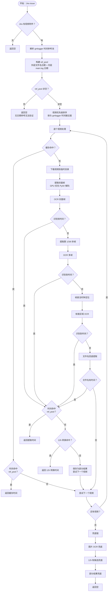
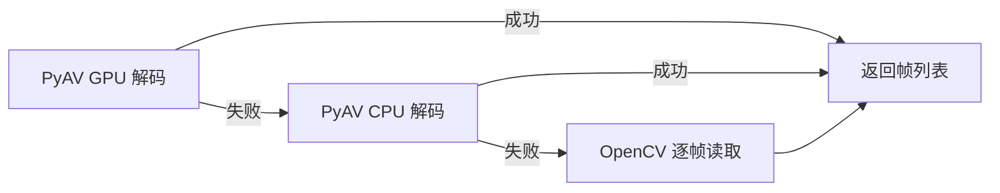
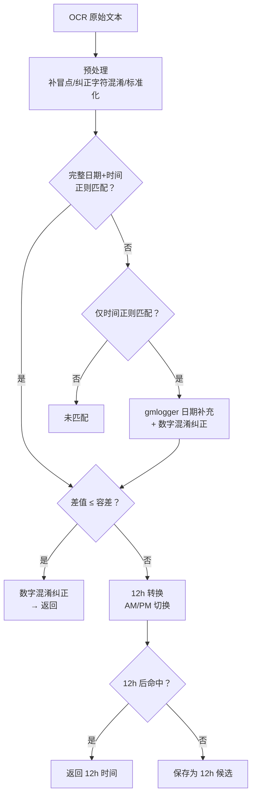
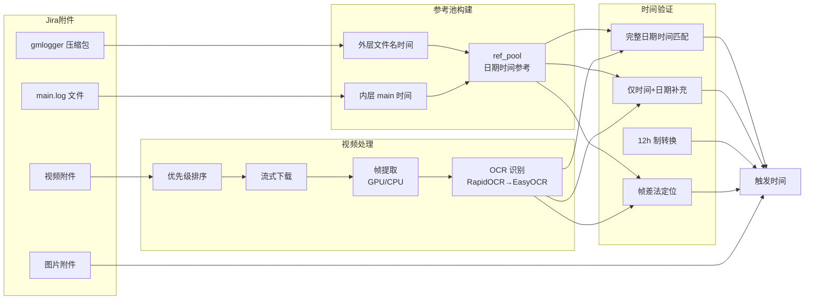

# 视频触发时间提取逻辑

## 概述

视频触发时间提取是触发时间获取的**兜底手段**，当评论/字段提取（`extract_trigger_time_from_issue`）未命中时启用。  
核心思路：从 Jira Bug 单附件中的视频帧 OCR 识别屏幕时钟，再与 gmlogger 压缩包时间交叉验证，确认时间有效性。

入口函数：`_diag_extract_time_from_video_simple()`（`src/services/server_legacy.py`）

---

## 流程图



---

## 核心模块说明

### 1. gmlogger 时间参考池构建

提取视频 OCR 时间后，需要与 gmlogger 时间交叉验证。参考池从三个来源构建：

| 来源 | 方法 | 说明 |
|------|------|------|
| **外层文件名** | `_diag_gmlogger_times()` | 从 gmlogger 压缩包文件名解析日期时间（如 `gmlogger_2026_10_13_3_3_35.zip`） |
| **内层 main.log** | `_diag_parse_entry_time()` | 从直接上传的 main.log 文件名或非 gmlogger 压缩包内的 main 文件名解析 |
| **压缩包探测** | `_diag_list_archive_entries()` | 对非 gmlogger 压缩包解压探测包内 main 文件（不解压，仅列目录） |

**匹配容差**：
- 有内层 main.log 日期 → **300 秒**（5 分钟，精度高）
- 仅外层文件名日期 → **600 秒**（10 分钟，精度低）

### 2. 视频优先级排序

`_rank_videos()` 按与 gmlogger 的相关性排序：

| 优先级 | 排序依据 | 说明 |
|--------|---------|------|
| 1 | 视频文件名时间 vs gmlogger 文件名时间差 | 最精确，两者都有时间戳时按差值升序 |
| 2 | 视频上传时间 vs gmlogger 上传时间差 | 次精确，文件名无时间时回退 |
| 3 | 视频上传时间升序 | 兜底，完全无 gmlogger 参考时 |

### 3. 视频帧提取

`_extract_video_frames_gpu()` 支持 GPU 加速解码：



提取策略：
- **Phase 0**：封面帧（第 0 秒），1 帧
- **Phase 1**：封面未识别 → 第 1/3/6 秒，3 帧
- **帧差法**：Phase 0+1 均未识别 → 提取第 0~5 秒共 6 帧做帧差分析

### 4. OCR 识别引擎

`_ocr_readtext()` 统一 OCR 接口，RapidOCR 优先 + EasyOCR 回退：

| 优先级 | 引擎 | 特点 |
|--------|------|------|
| 1 | **RapidOCR** | 中文场景强，置信度高（avg 0.867），onnxruntime 推理 |
| 2 | **EasyOCR** | 回退引擎，avg_conf < 0.3 时启用 |

图像预处理：
- 小尺寸帧（< 1280px）自动放大 1.5x
- 帧差法裁剪区域：放大 3x + 自适应二值化 + 锐化（跳过放大）

### 5. 时间匹配与验证

OCR 提取到的时间需经过多层匹配验证：



**关键匹配规则**：
1. **完整日期+时间**（`_OCR_TIME_FULL_RE`）：直接解析 + 容差验证
2. **数字混淆纠正**（`_correct_ocr_by_reference`）：OCR 把 `0` 读成 `O`、`1` 读成 `l` 等，参照 gmlogger 时间纠正
3. **12h 制转换**：OCR 只读到 12h 制时钟（如 `2:49` 实际是 `14:49`），尝试 ±12h 匹配
4. **仅时间**（`_OCR_TIME_ONLY_RE`）：用最近 gmlogger 的日期补充 + 纠正 + 容差验证

### 6. 帧差法时钟定位

`_frame_diff_clock_ocr()` 用于标准帧 OCR 未识别到时间时的回退方案：

```
原理：视频里只有时钟数字在变化，其他 UI 元素不动
```

| 步骤 | 方法 | 说明 |
|------|------|------|
| 1 | 相邻帧灰度差值累积 | 高阈值（50）过滤压缩噪点 |
| 2 | 形态学清理 | 开运算去散点 + 闭运算填充 |
| 3 | 连通域分析 | 面积最大连通域 = 时钟位置 |
| 4 | 投影法回退 | 连通域失败时用行列投影定位 |
| 5 | ROI 增强 | 裁剪 → 灰度 → 放大 3x → 二值化 → 锐化 |
| 6 | 增强区域 OCR | `_already_enhanced=True` 跳过放大 |

### 7. 兜底链

所有视频均未严格命中 ref_pool 时，按优先级尝试：

| 优先级 | 兜底方式 | 说明 |
|--------|---------|------|
| 1 | **图片 OCR 兜底** | `_image_fallback_time()` 从 Jira 图片附件中 OCR 时钟 |
| 2 | **12h 制候选** | 所有视频中差值最小的 12h 转换候选 |
| 3 | **单视频部分结果** | 仅 1 个视频时，即使未命中 ref_pool 也返回 |
| 4 | **多视频部分结果** | 多个视频均未命中时返回第一个部分结果 |
| 5 | **返回空** | 所有方法均失败 |

---

## 缓存机制

`data/video_time_cache.json` 按 `{bugid}:{video_name}` 缓存提取结果：

| 场景 | 行为 |
|------|------|
| **缓存命中且有时间** | 直接使用缓存时间验证 ref_pool，命中则返回，跳过下载+OCR |
| **缓存命中但无时间** | 跳过该视频（之前提取过但无结果） |
| **缓存未命中** | 下载视频 → OCR → 成功则写入缓存 |

---

## 数据流总览



---

## 关键代码位置

| 模块 | 文件 | 核心函数 |
|------|------|---------|
| 视频提取主逻辑 | `src/services/server_legacy.py` | `_diag_extract_time_from_video_simple()` |
| 视频优先级排序 | `src/services/server_legacy.py` | `_rank_videos()` |
| 帧提取（GPU优先） | `src/services/server_legacy.py` | `_extract_video_frames_gpu()` |
| 帧差法时钟定位 | `src/services/server_legacy.py` | `_frame_diff_clock_ocr()` |
| 统一 OCR 接口 | `src/services/server_legacy.py` | `_ocr_readtext()` |
| RapidOCR 引擎 | `src/services/server_legacy.py` | `_rapid_ocr_readtext()` |
| gmlogger 时间解析 | `src/services/server_legacy.py` | `_diag_gmlogger_times()` |
| gmlogger 智能匹配 | `src/services/server_legacy.py` | `_find_closest_gmlogger()` / `_build_gmlogger_info()` |
| 数字混淆纠正 | `src/services/server_legacy.py` | `_correct_ocr_by_reference()` |
| OCR 文本预处理 | `src/services/server_legacy.py` | `_fix_ocr_missing_colon()` / `_preprocess_ocr_datetime()` |
| 文件名时间回退 | `src/services/server_legacy.py` | `_parse_video_filename_time()` |
| 图片 OCR 兜底 | `src/services/server_legacy.py` | `_image_fallback_time()` |
| gmlogger 智能检测 | `src/services/server_legacy.py` | `_has_gmlogger_logs()` / `_jira_att_auth()` |
| 视频缓存 | `data/video_time_cache.json` | `_load_video_time_cache()` / `_save_video_time_cache()` |

## 表格对比的时间判定（2026-10-28 新增）

「表格提取」页在提取后，会用 **日志包抓包时间** 与 **Jira 创建时间** 做双重参照，给出判定：

| 判定 | 规则 |
|---|---|
| 正常 | 提取时间与表格时间差 ≤5 分钟 |
| 表格错误 | 表格时间晚于 Jira 创建时间（或与抓包时间明显不符） |
| 提取错误 | 提取时间晚于抓包时间 5 分钟以上，或早于抓包时间 60 分钟以上 |
| 两边都错 | 提取与表格都偏离参照时间 |
| 日期待确认 | 两者相差整天（±2 分钟内），多半是日期取错 |
| 提取失败 | 未提取到时间，或只有 `00:00:00`（无时分） |

相关实现：

| 功能 | 文件 | 函数 |
|---|---|---|
| 判定逻辑 | `src/api/routes/trigger.py` | `_judge_compare_time()` |
| 抓包时间参考 | `src/api/routes/trigger.py` | `_ref_capture_time()` |
| 多视频排序（按创建时间） | `src/services/server_legacy.py` | `_rank_videos(..., created_dt=)` |
| 前端判定列 | `frontend/src/panels/TimeExtractPanel.vue` | `judgeTagType()` |

## 提取结果纠偏（2026-10-28 新增）

`_diag_extract_time_from_video_simple()` 在返回前会调用 `_fix_video_time_against_created()`，以 **Jira 创建时间** 为硬上限做纠偏：

| 情况 | 处理 |
|---|---|
| 提取为空 | 最近日志包抓包时间 → 视频录制时间 → 视频文件名时分 + 创建日 |
| 提取时间晚于创建时间 | 日期对齐“最接近创建时间且不晚于创建时间”的日志包；若与日志包时间差 >2h，直接用日志包时间 |
| 无日期参照且日期与创建日不同（≤3 天） | 改用创建日期 |
| 与视频录制时间相差 >1 小时 | 以录制时间为准 |

对应实现：`src/services/server_legacy.py` → `_fix_video_time_against_created()`
