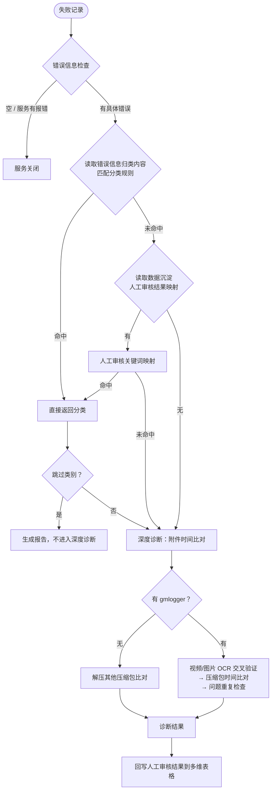

# 错误排查归类逻辑

## 概述

错误排查归类是 AI 日志分析失败后的自动诊断系统，对每条失败记录自动判定错误原因分类，减少人工排查成本。系统采用三级分类链路：预归类（人工审核映射 + 错误信息关键词快判）→ 深度诊断（附件时间比对）→ 报表归类（多维表格倒推）。

入口函数：`troubleshoot_diagnose()`（`src/services/server_legacy.py`）

---

## 一、错误排查逻辑

### 预归类详细映射（错误信息 → 分类）

| 错误信息关键词 | 分类结果 | 说明 |
|--------------|---------|------|
| （空） / 服务有报错 | 服务关闭 | 无排查依据 |
| 没有可下载的日志附件 | 无gmlogger | Jira 无可下载附件 |
| JIRA 分析任务执行超时 / 网关超时 | 分析任务执行超时，跳过排查 | Jira 侧超时 |
| 分析任务执行超时（不含JIRA/网关） | 并发过多 | 队列阻塞导致 |
| reasoning 第N轮 LLM 调用失败 | 并发过多 | LLM 接口拥堵 |
| 分析报告生成失败 | 并发过多 | 报告生成接口拥堵 |
| adjudication 失败 | 并发过多 | 裁决接口拥堵 |
| 504 Gateway Timeout / 502 Bad Gateway | 并发过多 | 网关层拥堵 |
| 模型调用失败 | IT侧服务停止 | 模型服务不可用 |
| Server disconnected | 服务关闭 | 服务断开 |
| All connection attempts failed | 服务关闭 | 连接全部失败 |
| [Errno 28] No space left on device | 磁盘空间不足 | 磁盘满 |
| HTTPStatusError | 待后端开发排查 | HTTP 状态异常 |
| 未找到问题时间 | 触发时间问题 | 需进入深度诊断 |
| 时间过滤后日志为空 / 未找到有效日志 | （空串） | 需下载附件比对后才能判定 |
| 其他未知错误 | 待后端开发排查 | 兜底 |

### 人工审核结果映射（从多维表格读取）

| 人工审核关键词 | 映射分类 |
|--------------|---------|
| 并发过多 / 接口拥堵 / 手动中断 | 并发过多 |
| 模型调用失败 / IT侧服务停止 | IT侧服务停止 |
| 服务关闭 / 服务有报错 | 服务关闭 |
| 待后端开发排查 | 待后端开发排查 |
| JIRA Server / 过载 / 网络抖动 | 并发过多 |
| 执行超时 / JIRA 分析任务执行超时 | 分析任务执行超时，跳过排查 |
| 问题重复 | 问题重复 |
| 未复现 / 不复现 | 问题未复现 |
| 无gmlogger / 无gmlogger文件 / gmlogger文件已上传 | 无gmlogger |
| 损坏 / 日志文件已损坏 | 日志过滤逻辑 |
| 磁盘空间不足 | 磁盘空间不足 |
| 时间添加 / 时间异常 | 触发时间问题 |
| 解压 / unrar / RAR5 | 解压问题 |
| 分析can信号 | 分析can信号导致超时 |

### 跳过类别（不进入深度诊断）

`_SKIP_ANALYSIS_CATEGORIES`：待后端开发排查、磁盘空间不足、服务关闭、并发过多、IT侧服务停止、接口连接问题、接口响应问题、分析任务执行超时（跳过排查）、问题重复、问题未复现

### 每日播报待办跟进规则

每日播报中“待办跟进”仅包含以下人工审核结果类型，其他分类不计入待办：

| 人工审核结果 | 是否进入待办 | 说明 |
|--------------|--------------|------|
| （空/未审核） | ✅ 进 | 尚未人工排查，需关注 |
| 时间添加为... / 时间异常 | ✅ 进 | 触发时间问题，需修正云端时间 |
| 服务关闭 / 服务有报错 | ✅ 进 | 需确认服务状态 |
| 分析任务执行超时 / JIRA分析超时 | ✅ 进 | 需排查超时原因 |
| 待后端开发排查 | ✅ 进 | 需开发人员介入 |
| 并发过多 | ❌ 不进 | 环境问题，自动恢复 |
| IT侧服务停止 | ❌ 不进 | 外部服务问题，等待恢复 |
| 无gmlogger | ❌ 不进 | 无日志可分析 |
| 磁盘空间不足 | ❌ 不进 | 运维环境问题 |
| 问题重复 / 问题未复现 | ❌ 不进 | 无需跟进 |
| 解压问题 / 日志过滤逻辑 | ❌ 不进 | 已知的格式兼容问题 |

---

## 二、错误分类统计

基于多维表格 4426 条记录中 1397 条失败数据的实际统计（仅展示有人工审核的 948 条）：

| 错误信息 | 条数 | 人工审核结果 |
|---------|------|-------------|
| **时间过滤后日志为空** | 408 | 336 触发时间问题、28 无gmlogger、25 gmlogger已上传、6 问题重复、5 解压已修复、2 时间异常无日志、2 触发时间无日志、1 解压待排查、1 日志损坏、1 核心日志不在gmlogger(含时间)、1 核心日志不在gmlogger |
| **处理后未找到有效的日志文件** | 167 | 135 触发时间问题、16 无gmlogger、4 解压待排查、4 解压已修复、4 无效bug(信息不全)、3 缺少unrar/RAR5、1 gmlogger已上传 |
| **[Errno 28] No space left on device** | 124 | 124 磁盘空间不足 |
| **JIRA 分析任务执行超时或被取消** | 82 | 68 JIRA分析超时、7 无效bug、6 触发时间问题、1 问题重复 |
| **没有可下载的日志附件** | 34 | 26 无gmlogger、8 gmlogger已上传 |
| **服务有报错** | 49 | 49 服务关闭（已回溯更新） |
| **reasoning 第N轮 LLM 调用失败** | 55 | 55 并发过多（已回溯更新） |
| **(无错误信息)** | 40 | 40 服务关闭（已回溯更新） |
| **JIRA 网关分析任务执行超时或被取消** | 15 | 8 JIRA分析超时、7 分析can信号超时 |
| **分析任务执行超时** | 8 | 8 并发过多（已回溯更新） |
| **分析报告生成失败** | 7 | 7 并发过多（含已回溯更新的 reasoning 相关） |
| **解压后未找到可识别的日志文件** | 5 | 3 触发时间问题、2 无gmlogger |
| **未预期的错误: HTTPStatusError** | 5 | 5 待后端开发排查 |
| **模型调用失败** | 20 | 20 IT侧服务停止（已回溯更新） |
| **adjudication 失败** | 4 | 4 并发过多 |
| **Server error 504 Gateway Timeout** | 4 | 3 JIRA Server重启/过载/网络抖动、1 触发时间问题 |
| **Server disconnected** | 2 | 2 服务关闭 |
| **All connection attempts failed** | 2 | 2 手动中断（归入服务关闭） |
| **Server error 502 Bad Gateway** | 1 | 1 并发过多 |
| **未预期的错误: ProcessLookupError** | 1 | 1 触发时间问题 |

---

## 三、修改历史

<b>1. 基于多维表格真实数据重构错误分类策略（2026-10-16）</b>

- **背景**：从多维表格读取 4426 条记录（1397 条失败，948 条有人工审核），分析错误信息与人工审核结果的真实配对关系，发现原有分类策略存在多处不合理的归类
- **核心变更**：
  - 预归类流程改为三级优先：错误信息归类规则 → 数据沉淀人工审核映射 → 深度诊断
  - 新增错误信息关键词映射：reasoning LLM调用失败/adjudication失败/分析报告生成失败/504/502 → **并发过多**；模型调用失败/服务停止 → **IT侧服务停止**；HTTPStatusError → **待后端开发排查**
  - 合并旧类别：服务运行问题/接口连接问题/服务有报错/无报错信息 → **服务关闭**；接口并发响应问题/接口拥堵手动中断 → **并发过多**
  - 区分 JIRA 分析超时（→ 分析任务执行超时）与普通分析超时（→ 并发过多）
  - 回溯更新多维表格 149 条历史记录的人工审核结果

<b>2. 每日播报待办跟进规则优化（2026-10-22）</b>

- **背景**：原待办逻辑采用“排除法”（排除已知通用原因后全部进入待办），导致大量无需跟进的记录（如并发过多、无gmlogger等）进入待办列表，干扰真正需要关注的问题
- **核心变更**：
  - 待办规则从“排除法”改为“白名单模式”，仅以下5类进入待办：未审核、触发时间问题（时间添加为）、服务关闭、分析任务执行超时、待后端开发排查
  - 其余分类（并发过多、IT侧服务停止、无gmlogger、磁盘空间不足、问题重复、问题未复现、解压问题、日志过滤逻辑等）均不计入待办
  - 待办条目新增“人工审核”字段，云端文档表格增加人工审核列，便于直接查看审核内容
  - 移除对 `_EXCLUDE_REASONS` 集合的依赖

