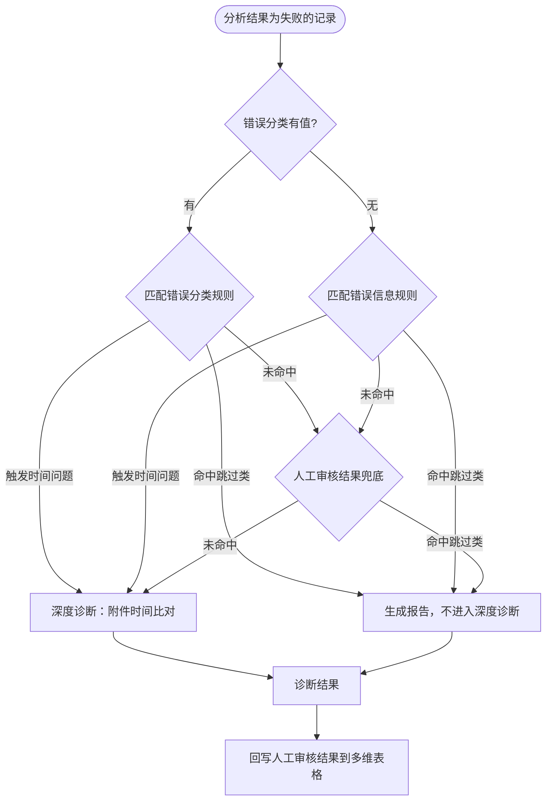

# 错误排查归类逻辑

## 概述

错误排查归类是 AI 日志分析失败后的自动诊断系统。当前版本**优先读取数据沉淀表的「错误分类」字段**，字段为空或未识别时才回退「错误信息」文本，再走人工审核结果兜底和深度诊断。

入口函数：`_diag_pre_classify()`（`src/services/troubleshoot_service.py`）

---

## 一、错误排查逻辑

### 预归类映射（错误分类 → 分类）

| 错误分类字段值 | 分类结果 | 是否深度分析 |
|---|---|---|
| 时间过滤后日志为空 | 触发时间问题 | ✅ 继续深度分析 |
| 处理后未找到有效的日志文件 | 无gmlogger | ❌ 跳过 |
| 没有可下载的日志附件 | 无gmlogger | ❌ 跳过 |
| `[Errno 28] No space left on device` | 磁盘空间不足 | ❌ 跳过 |
| 分析报告生成失败 | 并发过多 | ❌ 跳过 |
| 服务有报错 | 服务关闭 | ❌ 跳过 |
| All connection attempts failed | 服务关闭 | ❌ 跳过 |
| Server disconnected without sending a response | 服务关闭 | ❌ 跳过 |
| JIRA 分析任务执行超时或被取消 | 待人工排查 | ❌ 跳过自动分析，查 app.log |
| JIRA 网关分析任务执行超时或被取消 | 待人工排查 | ❌ 跳过自动分析，查 app.log |
| adjudication 失败 | 待人工排查 | ❌ 跳过自动分析，查 app.log |
| reasoning 第N轮 LLM 调用失败 | 待人工排查 | ❌ 跳过自动分析，查 app.log |
| 504/502/503/500 网关错误 | IP配置错误 | ❌ 跳过 |
| 分析任务被取消 | 人工取消 | ❌ 跳过 |
| 未找到问题时间 | 无时间信息 | ❌ 跳过 |
| 网络通信失败 / 网络连接超时 | 网络波动 | ❌ 跳过 |
| 分卷压缩包不完整 | （空串） | ✅ 正常深度分析 |
| 解压后未找到可识别的日志文件 | （空串） | ✅ 正常深度分析 |
| 分析任务执行超时（不含 JIRA/网关） | 并发过多 | ❌ 跳过 |
| 模型调用失败 | IT侧服务停止 | ❌ 跳过 |
| 错误分类为空且错误信息也为空 | 待人工排查 | ❌ 跳过自动分析 |

> `无gmlogger` 与 `无gmlogger文件` 已合并，统一使用 `无gmlogger`。

### 错误信息兜底映射

当「错误分类」为空或未命中时，继续按原错误信息文本匹配：

| 错误信息关键词 | 分类结果 |
|---|---|
| 时间过滤后日志为空 | 触发时间问题 |
| 处理后未找到有效的日志文件 / 没有可下载的日志附件 | 无gmlogger |
| JIRA 分析任务执行超时 / JIRA 网关分析任务执行超时 | 待人工排查 |
| adjudication 失败 / reasoning 第N轮 LLM 调用失败 | 待人工排查 |
| 分析任务被取消 | 人工取消 |
| 网络通信失败 / 网络连接超时 | 网络波动 |
| 504 / 502 / 503 / 500 网关错误 | IP配置错误 |
| 未找到问题时间 | 无时间信息 |
| 解压后未找到可识别的日志文件 / 分卷压缩包不完整 | （空串，走深度分析） |
| 分析任务执行超时（普通） | 并发过多 |
| 分析报告生成失败 | 并发过多 |
| 模型调用失败 | IT侧服务停止 |
| `[Errno 28]` / No space left on device | 磁盘空间不足 |
| 服务有报错 / Server disconnected / All connection attempts failed | 服务关闭 |
| HTTPStatusError | 待后端开发排查 |

### 人工审核结果映射

| 人工审核关键词 | 映射分类 |
|---|---|
| 并发过多 / 接口拥堵 / 手动中断 | 并发过多 |
| 模型调用失败 / IT侧服务停止 | IT侧服务停止 |
| 服务关闭 / 服务有报错 | 服务关闭 |
| 待后端开发排查 | 待后端开发排查 |
| JIRA Server / 过载 / 网络抖动 | 并发过多 |
| 执行超时 / JIRA 分析任务执行超时 | 待人工排查 |
| 问题重复 | 问题重复 |
| 未复现 / 不复现 | 问题未复现 |
| 无gmlogger / 无gmlogger文件 / gmlogger文件已上传 | 无gmlogger |
| 损坏 / 日志文件已损坏 | 日志过滤逻辑 |
| 磁盘空间不足 | 磁盘空间不足 |
| 时间添加 / 时间异常 | 触发时间问题 |
| 解压 / unrar / RAR5 | 解压问题 |
| 分析can信号 | 分析can信号导致超时 |

### 跳过类别（不进入深度诊断）

`_SKIP_ANALYSIS_CATEGORIES`：

待后端开发排查、磁盘空间不足、服务关闭、并发过多、IT侧服务停止、接口连接问题、接口响应问题、分析任务执行超时（跳过排查）、问题重复、问题未复现、无gmlogger、无gmlogger文件、IP配置错误、人工取消、无时间信息、网络波动、待人工排查。

> `触发时间问题` **不在**跳过类别中，继续走深度分析。

### 每日播报待办跟进规则

每日播报中“待办跟进”仅包含以下类型，其他分类不计入待办：

| 人工审核结果 | 是否进入待办 | 说明 |
|---|---|---|
| （空/未审核） | ✅ 进 | 尚未人工排查，需关注 |
| 时间添加为... / 时间异常 | ✅ 进 | 触发时间问题，需修正云端时间 |
| 服务关闭 / 服务有报错 | ✅ 进 | 需确认服务状态 |
| 分析任务执行超时 / JIRA分析超时 / 待人工排查 | ✅ 进 | 需人工查 app.log 或排查超时原因 |
| 待后端开发排查 | ✅ 进 | 需开发人员介入 |
| 并发过多 | ❌ 不进 | 环境问题，自动恢复 |
| IT侧服务停止 | ❌ 不进 | 外部服务问题，等待恢复 |
| 无gmlogger | ❌ 不进 | 无日志可分析 |
| 磁盘空间不足 | ❌ 不进 | 运维环境问题 |
| 问题重复 / 问题未复现 | ❌ 不进 | 无需跟进 |
| 解压问题 / 日志过滤逻辑 / IP配置错误 / 人工取消 / 无时间信息 / 网络波动 | ❌ 不进 | 已知原因或环境问题 |

---

## 二、错误分类统计（仅 `分析结果 = 失败`）

截至 2026-11-05，数据沉淀表共 7294 条记录，其中失败 **1774 条**，`错误分类` 归并后 **25 种**：

| 错误分类 | 失败数 | 映射分类 | 是否深度分析 |
|---|---:|---|---|
| 时间过滤后日志为空 | 930 | 触发时间问题 | ✅ |
| 处理后未找到有效的日志文件 | 167 | 无gmlogger | ❌ |
| `[Errno 28] No space left on device` | 124 | 磁盘空间不足 | ❌ |
| JIRA 分析任务执行超时或被取消 | 111 | 待人工排查 | ❌ |
| 没有可下载的日志附件 | 82 | 无gmlogger | ❌ |
| 分析报告生成失败 | 49 | 并发过多 | ❌ |
| 服务有报错 | 49 | 服务关闭 | ❌ |
| 解压后未找到可识别的日志文件 | 48 | （空串） | ✅ |
| （空） | 40 | 待人工排查 | ❌ |
| 模型调用失败 | 34 | IT侧服务停止 | ❌ |
| JIRA API 调用失败 | 31 | 未显式映射，回退错误信息/深度分析 | 视兜底 |
| 未预期的错误 | 26 | 未显式映射，回退错误信息/深度分析 | 视兜底 |
| 分析任务执行超时 | 19 | 并发过多 | ❌ |
| JIRA 网关分析任务执行超时或被取消 | 16 | 待人工排查 | ❌ |
| reasoning 第N轮 LLM 调用失败 | 12 | 待人工排查 | ❌ |
| All connection attempts failed | 11 | 服务关闭 | ❌ |
| 分析完成但包含部分错误 | 5 | 未显式映射，回退错误信息/深度分析 | 视兜底 |
| 504/502/503/500 网关错误 | 5 | IP配置错误 | ❌ |
| 分析任务被取消 | 4 | 人工取消 | ❌ |
| adjudication 失败 | 4 | 待人工排查 | ❌ |
| Server disconnected without sending a response | 2 | 服务关闭 | ❌ |
| 未找到问题时间 | 2 | 无时间信息 | ❌ |
| 网络通信失败 | 1 | 网络波动 | ❌ |
| 分卷压缩包不完整 | 1 | （空串） | ✅ |
| 网络连接超时 | 1 | 网络波动 | ❌ |

---

## 三、修改历史

<b>1. 基于多维表格真实数据重构错误分类策略（2026-10-16）</b>

- **背景**：从多维表格读取 4426 条记录（1397 条失败，948 条有人工审核），分析错误信息与人工审核结果的真实配对关系，发现原有分类策略存在多处不合理的归类。
- **核心变更**：
  - 预归类流程改为三级优先：错误信息归类规则 → 数据沉淀人工审核映射 → 深度诊断
  - 新增错误信息关键词映射：reasoning LLM调用失败/adjudication失败/分析报告生成失败/504/502 → **并发过多**；模型调用失败/服务停止 → **IT侧服务停止**；HTTPStatusError → **待后端开发排查**
  - 合并旧类别：服务运行问题/接口连接问题/服务有报错/无报错信息 → **服务关闭**；接口并发响应问题/接口拥堵手动中断 → **并发过多**
  - 区分 JIRA 分析超时（→ 分析任务执行超时）与普通分析超时（→ 并发过多）
  - 回溯更新多维表格 149 条历史记录的人工审核结果

<b>2. 每日播报待办跟进规则优化（2026-10-22）</b>

- **背景**：原待办逻辑采用“排除法”，导致大量无需跟进的记录进入待办列表。
- **核心变更**：
  - 待办规则从“排除法”改为“白名单模式”，仅未审核、触发时间问题、服务关闭、分析任务执行超时、待后端开发排查进入待办。
  - 其余分类（并发过多、IT侧服务停止、无gmlogger、磁盘空间不足、问题重复、问题未复现、解压问题、日志过滤逻辑等）均不计入待办。
  - 待办条目新增“人工审核”字段。

<b>3. 优先按「错误分类」字段预归类（2026-11-05）</b>

- **背景**：数据沉淀表已新增「错误分类」字段，问题排查不再需要完全依赖「错误信息」文本正则。
- **核心变更**：
  1. 优先读 `错误分类`，空或未识别时回退 `错误信息`；
  2. `时间过滤后日志为空` → `触发时间问题`，保留正常深度分析；
  3. `处理后未找到有效的日志文件`、`没有可下载的日志附件` → `无gmlogger`，并合并 `无gmlogger` / `无gmlogger文件`；
  4. JIRA 分析/网关超时、adjudication、reasoning 第N轮 → `待人工排查`，不自动分析；
  5. 504/502/503/500 → `IP配置错误`；分析任务被取消 → `人工取消`；未找到问题时间 → `无时间信息`；网络通信失败/超时 → `网络波动`；
  6. 分卷压缩包不完整、解压后未找到可识别日志 → 保留正常深度分析；
  7. 失败记录的错误分类和错误信息都为空 → `待人工排查`，不再默认 `服务关闭`；
  8. 诊断缓存版本 `5 → 6`，旧缓存会重新预归类。
- **失败记录统计**：1774 条失败、25 种错误分类，详见第二节。
- **验证**：批量预归类用例通过：时间过滤→触发时间问题(needs_analysis=True)，处理后→无gmlogger，JIRA超时→待人工排查，504→IP配置错误，取消→人工取消，无时间→无时间信息，网络→网络波动，分卷→空(needs_analysis=True)。
- **实现文件**：`src/services/troubleshoot_service.py`、`src/services/server_legacy.py`、`src/services/report_ops.py`、`src/api/routes/troubleshoot.py`、`src/schemas/troubleshoot.py`、`frontend/src/panels/TroubleshootPanel.vue`

