# 错误排查归类逻辑

## 概述

错误排查归类是 AI 日志分析失败后的自动诊断系统。当前版本**最高优先级读取数据沉淀表的「错误类型」字段**（英文 ErrorType 枚举，如 `JIRA_API_ERROR`、`NO_LOG_ATTACHMENT`），精确映射到错误分类；未命中时回退「错误分类」和「错误信息」文本匹配；最后走人工审核结果兜底和深度诊断。

入口函数：`_diag_pre_classify(err_msg, error_class, error_type)`（`src/services/troubleshoot_service.py`）

---

## 一、错误排查逻辑

```mermaid
flowchart TD
    Start([分析结果为失败的记录]) --> ET{错误类型有值?}
    ET -->|有| ETMatch{精确映射 _ERROR_TYPE_MAP}
    ET -->|无| Field{错误分类有值?}

    ETMatch -->|命中跳过类| Skip[生成报告，不进入深度诊断]
    ETMatch -->|触发时间问题| Diag[深度诊断：附件时间比对]
    ETMatch -->|ATTACHMENT_INCOMPLETE| Diag
    ETMatch -->|未命中| Field

    Field -->|有| Match{匹配错误分类规则}
    Field -->|无| Msg{匹配错误信息规则}

    Match -->|命中跳过类| Skip
    Match -->|触发时间问题| Diag
    Match -->|未命中| Review{人工审核结果兜底}
    Msg -->|命中跳过类| Skip
    Msg -->|触发时间问题| Diag
    Msg -->|未命中| Review
    Review -->|命中跳过类| Skip
    Review -->|未命中| Diag

    Diag --> Result[诊断结果]
    Skip --> Result
    Result --> WriteBack[回写人工审核结果到多维表格]
```

### 最高优先级：ErrorType 精确映射（`_ERROR_TYPE_MAP`）

「错误类型」字段为英文枚举值，直接映射，优先级最高：

| ErrorType | 对应错误分类 | 分类结果 | 是否深度分析 |
|---|---|---|---|
| `JIRA_API_ERROR` | JIRA API 调用失败 | 并发过多 | ❌ 跳过 |
| `NO_PROBLEM_TIME` | 未找到问题时间 | 无时间信息 | ❌ 跳过 |
| `NO_LOG_ATTACHMENT` | 没有可下载的日志附件 / 无日志附件 | 无gmlogger | ❌ 跳过 |
| `ATTACHMENT_INCOMPLETE` | 分卷压缩包不完整 | （空串） | ✅ 走深度分析，判断附件是否真的缺失 |
| `EXTRACTION_NO_LOG` | 处理后未找到有效的日志文件 | 无gmlogger | ❌ 跳过 |
| `EXTRACTION_TIME_FILTERED` | 时间过滤后日志为空 / 日志文件均不在时间范围内 | 触发时间问题 | ✅ 深度排查 |
| `TIME_FILTER_EMPTY` | 时间过滤后日志为空 | 触发时间问题 | ✅ 深度排查 |
| `LLM_CALL_FAILED` | 模型调用失败 / adjudication/reasoning 失败 | 待重试 | ❌ 跳过，无需分析 |
| `REPORT_EMPTY` | 分析报告生成失败 | 待重试 | ❌ 跳过，无需分析 |
| `ANALYSIS_PARTIAL` | 分析完成但包含部分错误 | 待重试 | ❌ 跳过，无需分析 |
| `REPORT_DELIVERY_FAILED` | 飞书文档创建或发送失败 | 待重试 | ❌ 跳过，无需分析 |
| `POST_RESULT_FAILED` | JIRA 网关回填分析结果失败 | 待重试 | ❌ 跳过，无需分析 |
| `TASK_TIMEOUT` | JIRA 分析任务执行超时 / 分析任务执行超时 | 并发过多 | ❌ 跳过 |
| `TASK_CANCELLED` | 分析任务被取消 | 人工取消 | ❌ 跳过 |
| `NETWORK_TIMEOUT` | 网络通信失败 / 网络连接超时 | 网络波动 | ❌ 跳过 |
| `NETWORK_ERROR` | 网络通信失败 / 网络连接超时 | 网络波动 | ❌ 跳过 |
| `UNEXPECTED_ERROR` | 未预期的错误 | 并发过多 | ❌ 跳过 |

> ErrorType 未命中时回退到「错误分类」和「错误信息」文本匹配。

### 回退映射：错误分类 → 分类

当 ErrorType 未命中时，按「错误分类」字段文本匹配：

| 错误分类字段值 | 对应 ErrorType | 分类结果 | 是否深度分析 |
|---|---|---|---|
| 时间过滤后日志为空 | `EXTRACTION_TIME_FILTERED` / `TIME_FILTER_EMPTY` | 触发时间问题 | ✅ 继续深度分析 |
| 处理后未找到有效的日志文件 | `EXTRACTION_NO_LOG` | 无gmlogger | ❌ 跳过 |
| 解压后未找到可识别的日志文件 | `NO_LOG_ATTACHMENT` | 无gmlogger | ❌ 跳过 |
| 日志文件均不在时间范围内 | `EXTRACTION_TIME_FILTERED` | 触发时间问题 | ✅ 深度排查 |
| JIRA 分析任务执行超时/网关超时 | `TASK_TIMEOUT` | 待人工排查 | ❌ 跳过，查 app.log |
| adjudication/reasoning 失败 | `LLM_CALL_FAILED` | 待人工排查 | ❌ 跳过，查 app.log |
| 504/502/503/500 网关错误 | — | IP配置错误 | ❌ 跳过 |
| 分析任务被取消 | `TASK_CANCELLED` | 人工取消 | ❌ 跳过 |
| 未找到问题时间 | `NO_PROBLEM_TIME` | 无时间信息 | ❌ 跳过 |
| 网络通信失败 / 网络连接超时 | `NETWORK_TIMEOUT` / `NETWORK_ERROR` | 网络波动 | ❌ 跳过 |
| 分卷压缩包不完整 | `ATTACHMENT_INCOMPLETE` | （空串） | ✅ 走深度分析，判断附件是否真的缺失 |
| 没有可下载的日志附件 / 无日志附件 | `NO_LOG_ATTACHMENT` | 无gmlogger | ❌ 跳过 |
| JIRA API 调用失败 | `JIRA_API_ERROR` | 并发过多 | ❌ 跳过 |
| 未预期的错误 | `UNEXPECTED_ERROR` | 并发过多 | ❌ 跳过 |
| 分析完成但包含部分错误 | `ANALYSIS_PARTIAL` | 待重试 | ❌ 跳过，无需分析 |
| 分析报告生成失败 | `REPORT_EMPTY` | 待重试 | ❌ 跳过，无需分析 |
| 模型调用失败 | `LLM_CALL_FAILED` | 待重试 | ❌ 跳过，无需分析 |
| 飞书文档创建或发送失败 | `REPORT_DELIVERY_FAILED` | 待重试 | ❌ 跳过，无需分析 |
| JIRA 网关回填分析结果失败 | `POST_RESULT_FAILED` | 待重试 | ❌ 跳过，无需分析 |
| 服务有报错 | — | 服务关闭 | ❌ 跳过 |
| All connection attempts failed / Server disconnected | — | 服务关闭 | ❌ 跳过 |
| No space left on device / Errno 28 | — | 磁盘空间不足 | ❌ 跳过 |
| 分析任务执行超时（不含 JIRA/网关） | `TASK_TIMEOUT` | 并发过多 | ❌ 跳过 |
| 日志行数过多 | — | 日志行数过多，手动分析 | ❌ 跳过 |
| 错误分类、错误类型、错误信息都为空 | — | 服务关闭 | ❌ 跳过 |

> `无gmlogger` 与 `无gmlogger文件` 已合并，统一使用 `无gmlogger`。

### 错误信息兜底映射

当「错误类型」和「错误分类」都为空或未命中时，继续按「错误信息」文本匹配：

| 错误信息关键词 | 分类结果 |
|---|---|
| 未找到问题时间 | 无时间信息 |
| 没有可下载的日志附件 / 无日志附件 | 无gmlogger |
| JIRA API 调用失败 | 并发过多 |
| 未预期的错误 | 并发过多 |
| JIRA 分析任务执行超时 / JIRA 网关分析任务执行超时 | 待人工排查 |
| adjudication / reasoning 第N轮 LLM 调用失败 | 待人工排查 |
| 分析任务被取消 | 人工取消 |
| 网络通信失败 / 网络连接超时 | 网络波动 |
| 分析任务执行超时（普通） | 并发过多 |
| No space left on device / Errno 28 | 磁盘空间不足 |
| 模型调用失败 | 待重试 |
| 分析报告生成失败 | 待重试 |
| 分析完成但包含部分错误 | 待重试 |
| 飞书文档创建或发送失败 | 待重试 |
| JIRA 网关回填分析结果失败 | 待重试 |
| 504 / 502 / 503 / 500 网关错误 | IP配置错误 |
| server disconnected / All connection attempts failed / 连接失败 / 无法连接 | 服务关闭 |
| 服务有报错 | 服务关闭 |
| HTTPStatusError | 待后端开发排查 |
| 时间过滤后日志为空 | 触发时间问题 |
| 处理后未找到有效的日志文件 | 无gmlogger |
| 解压后未找到可识别的日志文件 | 解压问题 |

### 人工审核结果映射（`_review_category`）

| 人工审核关键词 | 映射分类 |
|---|---|
| 并发过多 / 接口拥堵 / 手动中断 | 并发过多 |
| 模型调用失败 / IT侧服务停止 / 服务停止 | IT侧服务停止 |
| 服务关闭 / 服务有报错 | 服务关闭 |
| 待后端开发排查 | 待后端开发排查 |
| 时间添加 / 时间异常 / 触发时间错误 / 触发时间问题 | 触发时间问题 |
| 无gmlogger / 无gmlogger文件 / 无日志附件 / gmlogger文件已上传 | 无gmlogger |
| 压缩包损坏 / 日志文件已损坏 | 压缩包损坏 |
| 解压 / unrar / RAR5 | 解压问题 |
| 接口无响应 | 接口响应问题 |
| JIRA Server / 过载 / 网络抖动 | 并发过多 |
| 执行超时 / JIRA 分析任务执行超时 | 待人工排查 |
| 人工取消 | 人工取消 |
| 无时间信息 / 未找到问题时间 | 无时间信息 |
| 网络波动 / 网络通信失败 / 网络连接超时 | 网络波动 |
| IP配置错误 | IP配置错误 |
| 问题重复 | 问题重复 |
| 未复现 / 不复现 | 问题未复现 |
| 磁盘空间不足 | 磁盘空间不足 |
| 待人工排查 | 待人工排查 |
| 分析can信号 | 分析can信号导致超时 |
| 日志行数过多 | 日志行数过多，手动分析 |
| 待重试 | 待重试 |

### 跳过类别（不进入深度诊断）

`_SKIP_ANALYSIS_CATEGORIES`：

待后端开发排查、磁盘空间不足、服务关闭、并发过多、IT侧服务停止、接口连接问题、接口响应问题、分析任务执行超时（跳过排查）、问题重复、问题未复现、无gmlogger、无gmlogger文件、IP配置错误、人工取消、无时间信息、网络波动、解压问题、压缩包损坏、日志行数过多（手动分析）、**待重试**。

> `触发时间问题` **不在**跳过类别中，继续走深度分析。

### 每日播报待办跟进规则

每日播报中"待办跟进"仅包含以下失败分类（按 `_classify_failure` 结果判断）：

| 失败分类 | 是否进入待办 | 说明 |
|---|---|---|
| 触发时间问题 | ✅ 进 | 需修正云端时间 |
| 待人工排查 | ✅ 进（未审核或审核仍为待人工排查时） | 需人工查 app.log |
| **待重试** | **✅ 进** | **需重新执行分析** |
| 未审核的失败记录 | ✅ 进 | 尚未人工排查，需关注 |
| 并发过多 / IT侧服务停止 / 服务关闭 | ❌ 不进 | 环境/服务问题，自动恢复 |
| 无gmlogger / 压缩包损坏 | ❌ 不进 | 无日志可分析 |
| 磁盘空间不足 | ❌ 不进 | 运维环境问题 |
| 问题重复 / 问题未复现 | ❌ 不进 | 无需跟进 |
| 解压问题 / IP配置错误 / 人工取消 / 无时间信息 / 网络波动 | ❌ 不进 | 已知原因或环境问题 |
| 日志行数过多，手动分析 | ❌ 不进 | 需人工分析 |

---

## 二、错误分类统计（仅 `分析结果 = 失败`）

截至 2026-11-05，数据沉淀表共 7294 条记录，其中失败 **1774 条**，`错误分类` 归并后 **25 种**：

| 错误分类 | 失败数 | 映射分类 | 是否深度分析 |
|---|---:|---|---|
| 时间过滤后日志为空 | 930 | 触发时间问题 | ✅ |
| 处理后未找到有效的日志文件 | 167 | 无gmlogger | ❌ |
| `[Errno 28] No space left on device` | 124 | 磁盘空间不足 | ❌ |
| JIRA 分析任务执行超时或被取消 | 111 | 待人工排查 | ❌ |
| 没有可下载的日志附件 | 82 | 无gmlogger | ❌ |
| 分析报告生成失败 | 49 | 并发过多 | ❌ |
| 服务有报错 | 49 | 服务关闭 | ❌ |
| 解压后未找到可识别的日志文件 | 48 | （空串） | ✅ |
| （空） | 40 | 服务关闭 | ❌ |
| 模型调用失败 | 34 | IT侧服务停止 | ❌ |
| JIRA API 调用失败 | 31 | 并发过多 | ❌ |
| 未预期的错误 | 26 | 并发过多 | ❌ |
| 分析任务执行超时 | 19 | 并发过多 | ❌ |
| JIRA 网关分析任务执行超时或被取消 | 16 | 待人工排查 | ❌ |
| reasoning 第N轮 LLM 调用失败 | 12 | 待人工排查 | ❌ |
| All connection attempts failed | 11 | 服务关闭 | ❌ |
| 分析完成但包含部分错误 | 5 | 历史数据，不再产生，不单独映射 | — |
| 504/502/503/500 网关错误 | 5 | IP配置错误 | ❌ |
| 分析任务被取消 | 4 | 人工取消 | ❌ |
| adjudication 失败 | 4 | 待人工排查 | ❌ |
| Server disconnected without sending a response | 2 | 服务关闭 | ❌ |
| 未找到问题时间 | 2 | 无时间信息 | ❌ |
| 网络通信失败 | 1 | 网络波动 | ❌ |
| 分卷压缩包不完整 | 1 | （空串） | ✅ |
| 网络连接超时 | 1 | 网络波动 | ❌ |

---

## 三、修改历史

<b>1. 基于多维表格真实数据重构错误分类策略（2026-10-16）</b>

- **背景**：从多维表格读取 4426 条记录（1397 条失败，948 条有人工审核），分析错误信息与人工审核结果的真实配对关系，发现原有分类策略存在多处不合理的归类。
- **核心变更**：
  - 预归类流程改为三级优先：错误信息归类规则 → 数据沉淀人工审核映射 → 深度诊断
  - 新增错误信息关键词映射：reasoning LLM调用失败/adjudication失败/分析报告生成失败/504/502 → **并发过多**；模型调用失败/服务停止 → **IT侧服务停止**；HTTPStatusError → **待后端开发排查**
  - 合并旧类别：服务运行问题/接口连接问题/服务有报错/无报错信息 → **服务关闭**；接口并发响应问题/接口拥堵手动中断 → **并发过多**
  - 区分 JIRA 分析超时（→ 分析任务执行超时）与普通分析超时（→ 并发过多）
  - 回溯更新多维表格 149 条历史记录的人工审核结果

<b>2. 每日播报待办跟进规则优化（2026-10-22）</b>

- **背景**：原待办逻辑采用“排除法”，导致大量无需跟进的记录进入待办列表。
- **核心变更**：
  - 待办规则从“排除法”改为“白名单模式”，仅未审核、触发时间问题、服务关闭、分析任务执行超时、待后端开发排查进入待办。
  - 其余分类（并发过多、IT侧服务停止、无gmlogger、磁盘空间不足、问题重复、问题未复现、解压问题、日志过滤逻辑等）均不计入待办。
  - 待办条目新增“人工审核”字段。

<b>3. 优先按「错误分类」字段预归类（2026-11-05）</b>

- **背景**：数据沉淀表已新增「错误分类」字段，问题排查不再需要完全依赖「错误信息」文本正则。
- **核心变更**：
  1. 优先读 `错误分类`，空或未识别时回退 `错误信息`；
  2. `时间过滤后日志为空` → `触发时间问题`，保留正常深度分析；
  3. `处理后未找到有效的日志文件`、`没有可下载的日志附件` → `无gmlogger`，并合并 `无gmlogger` / `无gmlogger文件`；
  4. JIRA 分析/网关超时、adjudication、reasoning 第N轮 → `待人工排查`，不自动分析；
  5. 504/502/503/500 → `IP配置错误`；分析任务被取消 → `人工取消`；未找到问题时间 → `无时间信息`；网络通信失败/超时 → `网络波动`；
  6. 根据人工审核结果：`JIRA API 调用失败`（30/31 为并发过多）→ `并发过多`；`未预期的错误` → `并发过多`；`分析完成但包含部分错误` 以后不再产生，不单独处理；
  7. 失败记录的错误分类和错误信息都为空：40 条历史记录人工审核均为 `服务关闭`，因此空值映射为 `服务关闭`；
  8. 分卷压缩包不完整、解压后未找到可识别日志 → 保留正常深度分析；
  9. 诊断缓存版本 `5 → 6`，旧缓存会重新预归类。
- **失败记录统计**：1774 条失败、25 种错误分类，详见第二节。
- **验证**：批量预归类用例通过：时间过滤→触发时间问题(needs_analysis=True)，处理后→无gmlogger，JIRA超时→待人工排查，504→IP配置错误，取消→人工取消，无时间→无时间信息，网络→网络波动，分卷→空(needs_analysis=True)。
- **实现文件**：`src/services/troubleshoot_service.py`、`src/services/server_legacy.py`、`src/services/report_ops.py`、`src/api/routes/troubleshoot.py`、`src/schemas/troubleshoot.py`、`frontend/src/panels/TroubleshootPanel.vue`

<b>4. 新增“日志行数过多，手动分析”错误类型（2026-11-10）</b>

- **背景**：数据沉淀多维表格「错误分类」字段新增取值“日志行数过多”，表示日志量超出自动分析处理能力，需人工介入。
- **核心变更**：
  1. `错误分类` 字段匹配：“日志行数过多” → “日志行数过多，手动分析”，跳过深度分析；
  2. 人工审核结果映射：“日志行数过多” → “日志行数过多，手动分析”；
  3. 加入 `_SKIP_ANALYSIS_CATEGORIES` 跳过集合；
  4. 加入 `_EXCLUDE_REASONS` 批量执行去重排除集合（不再重复执行）。
- **实现文件**：`src/services/troubleshoot_service.py`、`src/services/report_ops.py`、`src/api/routes/shared.py`

<b>5. 云端批次去重始终执行（2026-11-10）</b>

- **背景**：`prod_batch_run`（线上批量执行）在 `skip_existing: false` 时不会执行云端批次去重，导致分析失败的 Jira 被反复执行。
- **规则**：云端批次执行记录始终去重，不论 `skip_existing` 设置：
  - 非全失败的批次（如 20/25）：整批排除（包括失败项）；
  - 全失败的批次（0/N）：允许重试。
- **核心变更**：将云端批次去重逻辑从 `if any_filter` 块中提取为独立块，始终执行。
- **实现文件**：`src/api/routes/testing.py` — `prod_batch_run`

<b>6. 动态队列补给批次自动写入云端（2026-11-10）</b>

- **背景**：`batch_ai_single` 逐条提交只写内存标记（2h TTL），不创建云端文档，导致 TTL 过期后这些 Jira 会被重复选中。
- **规则**：服务端维护缓冲区，每次成功提交追加记录，每满 20 条自动写入云端批次文档。
  - 文档名：`动态队列 日期 时间 (成功数/总数)`
  - 每条记录包含各自的触发时间和执行时间（时间可不同）
  - 写入失败时数据放回缓冲区，不丢失
- **去重扫描**：`_get_same_source_executed_keys` 新增识别 `动态队列` 前缀文档。
- **实现文件**：`src/api/routes/testing.py` — `batch_ai_single`、`_flush_single_submit_buffer`、`_get_same_source_executed_keys`

<b>7. 错误类型(ErrorType)最高优先级映射 + 待重试分类 + 每日播报待办增强（2026-11-10）</b>

- **背景**：上游 AI 日志分析接口新增「错误类型」字段（英文 ErrorType 枚举，如 `JIRA_API_ERROR`、`NO_LOG_ATTACHMENT` 等 16 种），相比「错误分类」和「错误信息」更精确、更稳定。
- **核心变更**：
  1. `_diag_pre_classify` 新增 `error_type` 参数，最高优先级读取「错误类型」字段，通过 `_ERROR_TYPE_MAP` 精确映射 16 种 ErrorType；
  2. 新增分类类别「**待重试**」：`LLM_CALL_FAILED`、`REPORT_EMPTY`、`ANALYSIS_PARTIAL`、`REPORT_DELIVERY_FAILED`、`POST_RESULT_FAILED` 均映射为「待重试」，无需分析，加入 `_SKIP_ANALYSIS_CATEGORIES` 和 `_EXCLUDE_REASONS`；
  3. 原有映射调整：「模型调用失败」从 `IT侧服务停止` 改为 `待重试`；「分析报告生成失败」从 `并发过多` 改为 `待重试`；「分卷压缩包不完整」改为走深度分析判断附件是否真的缺失；「解压后未找到可识别日志」从“解压问题”改为 `无gmlogger`；
  4. 分类优先级变为三级：ErrorType 精确映射 → 错误分类/错误信息文本匹配 → 人工审核结果兜底；
  5. 全链路透传 `error_type`：`DiagnoseRequest` schema、`diagnose` 路由、`_troubleshoot_diagnose_impl`、`_troubleshoot_diagnose_inner`、`_classify_failure`、`batch_pre_classify`；
  6. 前端 `TroubleshootPanel.vue` 所有 API 调用（单条诊断、批量预归类）均新增 `error_type` 传递；
  7. `_extract_record_row` 新增提取「错误类型」字段；
  8. 每日播报待办规则调整：按 `_classify_failure` 结果判断，新增「待重试」进入待办；
  9. 新增 Jira 查询「表格查询」 Tab：从 VCS BUG 多维表格按创建日期查询，支持今日/昨日/本周/上周快捷按钮和AI初步分析结果过滤。
- **实现文件**：`src/services/troubleshoot_service.py`、`src/services/report_ops.py`、`src/services/server_legacy.py`、`src/api/routes/troubleshoot.py`、`src/api/routes/testing.py`、`src/api/routes/shared.py`、`src/schemas/troubleshoot.py`、`frontend/src/panels/TroubleshootPanel.vue`、`frontend/src/panels/JiraLookupPanel.vue`

